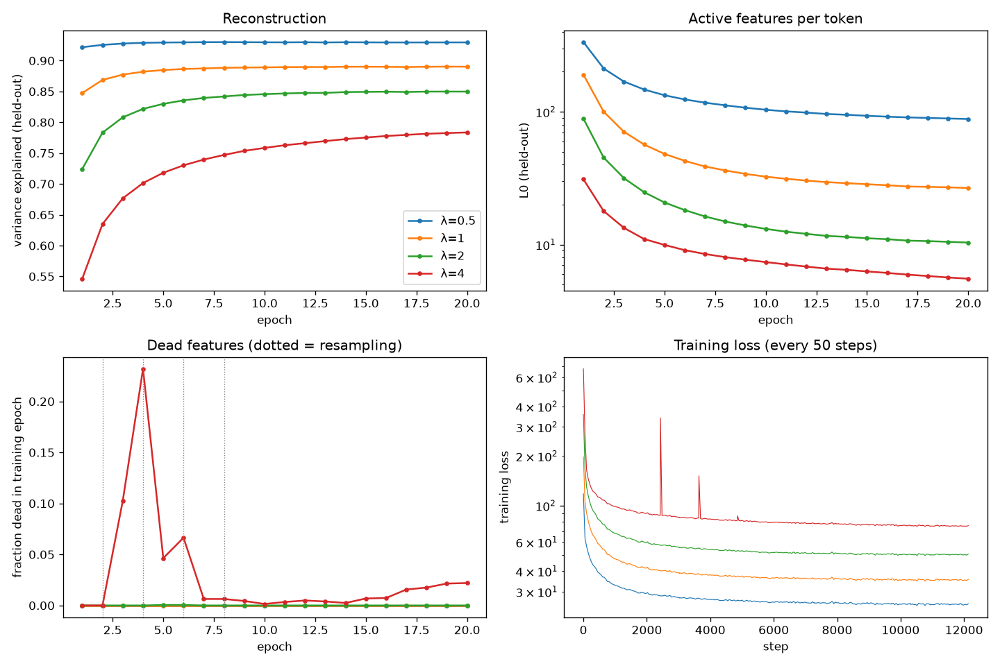
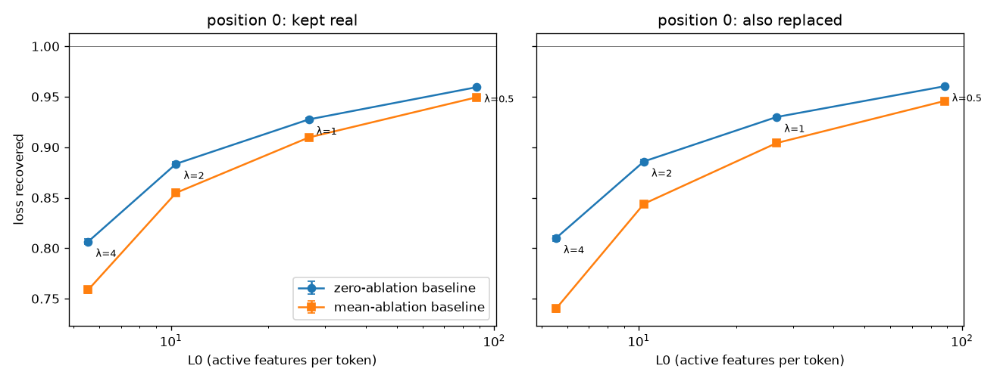
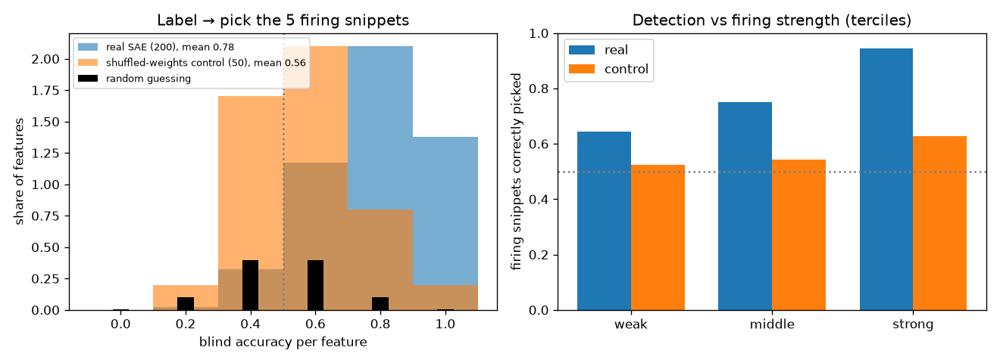
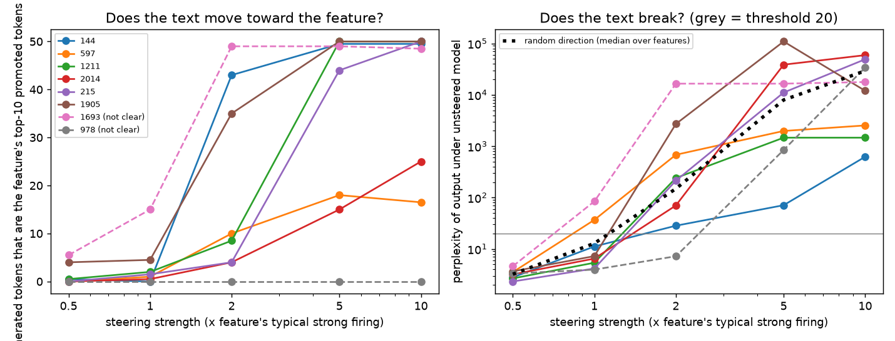
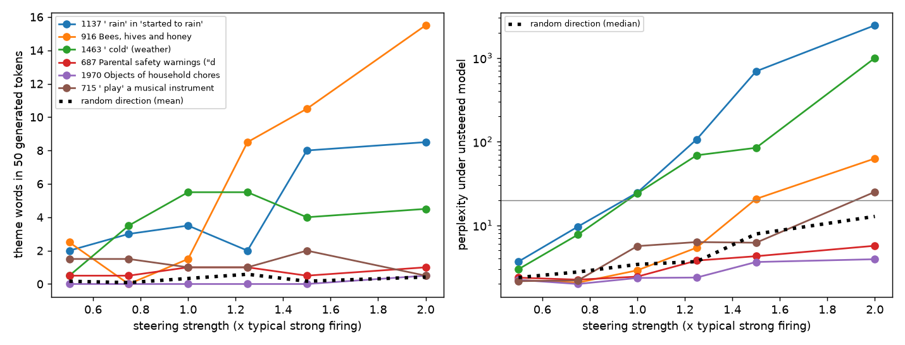
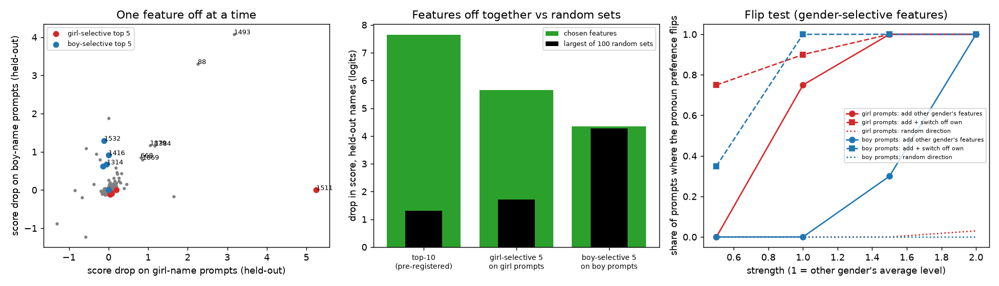

# Sparse autoencoders on TinyStories-8M: method, results, failures and limits

> **All feature labels in this project are AI-written (by Claude) and have not been verified by a human.** They were scored with an automated blind test (see below and `results/stage5_report.md`), but nobody checked them by hand. The same model family wrote the labels and took the blind test.

This is a small, careful application of published methods ([Prior work](#7-prior-work)) to one small model, not new research.
Every number below comes from a file in `results/`, gathered by `scripts/stage8_numbers.py` into `results/headline_numbers.json` and filled in by `scripts/stage8_docs.py`.
The README leads with the four main findings and their limits; this report gives the detail.

## 1. Summary

| Question | Answer | Main limit |
|---|---|---|
| Does the autoencoder capture the activations? | λ=1: variance explained 0.890, L0 26.7, loss recovered 0.928 (zero baseline) / 0.910 (mean baseline), but +0.54 nats | weak baselines; one seed |
| Are its features interpretable? | 37/200 strict-clear; blind test 0.779 vs control 0.564 vs chance 0.5 | AI labels, AI test, no human check |
| Do they steer the model? | next-word steering works, breaks the text at 2×; 3/6 topic features steered a topic | small test, narrow strength window |
| Can one behaviour be traced? | yes for context features; gender-selective features flip the pronoun | post-hoc analysis, few names |

## 2. Method

### 2.1 Model and activations
- Model: `roneneldan/TinyStories-8M` (GPT-Neo, 8 blocks, width 256). Activations are the residual stream after block 3 (0-indexed; 4 blocks before, 4 after), captured with a forward hook (`src/model.py`).
- Data: 12,747 training stories from one shard of TinyStories, 1,029 stories from its validation split, with no story shared between them (`train_heldout_identical_stories` = 0).
  Each story is the end-of-text token plus the story, truncated to 256 tokens, stored as one row per token in fp32 memmaps (2.79 GB total).
- Position 0 (the end-of-text prefix) is always the same vector (norm 4.84); it is excluded from autoencoder training. Other positions have mean norm 2.51.
  The mean activation vector holds 39% of the squared norm, so the decoder bias starts at the data's centre.
- All activations are multiplied by one constant (6.364) so their mean norm is √256. Autoencoder-unit activations quoted anywhere are in these scaled units.

### 2.2 Autoencoder and training (`src/sae.py`, `src/train.py`)
- Encode f = ReLU(W_e (x − b_d) + b_e), decode x̂ = W_d f + b_d; untied weights, 2048 features (8× the width).
- Loss: squared error summed over dimensions plus λ times the sum of feature strengths, averaged over the batch.
- Decoder columns are kept at unit length, and the gradient component parallel to each column is removed before each step (Bricken et al.).
- b_d starts at the geometric median of the data, which was 0.31 from the mean vector (whose norm is 10.0).
- Adam, learning rate 0.0003, batch size 4096, 20 epochs over 2,487,185 tokens (shuffled across stories), λ in [0.5, 1, 2, 4].
- Dead features are resampled after epochs [2, 4, 6, 8] (Bricken's procedure scaled to this run length, using 200,000 inputs to choose new directions).
- Tests: shapes, decoder normalisation, loss decreasing and true-direction recovery on a toy problem (`tests/test_sae.py`).

### 2.3 Faithfulness (`src/eval.py`)
Splice the autoencoder's reconstruction into the model at layer 3 and measure next-token loss on the 1,029 held-out stories (198,858 predicted tokens).
Loss recovered = (loss with activations ablated − loss with reconstruction) / (loss with activations ablated − unmodified loss), with two ablation baselines: zero, and the mean activation. Intervals are 95% bootstrap over stories.

### 2.4 Interpretation (`scripts/stage5_*.py`)
- 200 features were chosen at random (seed 1234) from the λ=1 autoencoder. For each: its top 20 activating snippets, 5 uniformly random firings, firing frequency, and the output tokens its direction promotes.
- **Labelling.** Claude wrote one label per feature from that evidence and a verdict, *clear* only if one concept explains the top examples *and* the random firings also fit. The user chose not to hand-label, so these labels are final. They are AI-written and unverified.
- **Blind test.** For each feature, a fresh Claude sub-agent that had not seen the evidence got only the label and 10 snippets from text not used for labelling (real: the held-out split): 5 where the feature fires (sampled uniformly among all firings, so many are weak) and 5 where it does not.
  It had to pick the firing ones. 250 puzzles (real and control, anonymised and shuffled together) were answered by 10 sub-agents; 0 answers were invalid. Chance is 0.5; p-values are hypergeometric per feature and simulated overall.
- **Control.** An autoencoder with the same settings trained on a copy of the model whose weights were shuffled (Bricken et al.): 357,783 training tokens at half precision, 120 epochs; final variance explained 0.899, L0 56.2.
  Its first 50 features were labelled and tested the same way.

### 2.5 Steering (`scripts/stage6_steer.py`)
Add k × s × d to the residual stream at layer 3 at every position except position 0, while the model generates 50 tokens (temperature 0.8, fixed seed per prompt).
d is the feature's unit decoder direction, s its typical strong firing (mean of its top-20 activations), converted back to model units. Control: a random unit direction of the same length.
Text is "broken" if its perplexity under the unsteered model exceeds 20.0 (unsteered text scores 1.4 to 2.5). Two prompts per feature.
**Selection.** Main run: features that were strict-clear *and* scored 5/5 blind, then 6 chosen for labels about visible words, plus 2 that were not clear. Extension: every Stage 5 label that names a topic or domain (not a syntactic slot or single next word), whatever its verdict or blind score.
Theme words for the extension were written down before reading any steered text.

### 2.6 Tracing (`scripts/stage7_*.py`)
- Behaviour: the model's choice of "she"/"he" (or "She"/"He") after a named character. Score = logit(correct pronoun) − logit(wrong pronoun) at the last position.
- Test set: 20 single-token names (5 girls' and 5 boys' for ranking, 5 and 5 held out) in 6 sentence frames = 120 prompts.
  4 frames give the name alone (the headline), 2 include "a little girl/boy named" (reported separately, since the noun gives the answer away).
- Ablation: set one feature to zero at all positions after the first, decode, add the autoencoder's reconstruction error back, so only that feature changes (`src/trace.py`, tested). 559 of 2048 features fire on these prompts; each was ablated alone.
- Pre-registered test: rank on the ranking names, switch off the top 10 together on held-out names, compare with 100 random sets of firing features. Post-hoc follow-up: gender-selective features (activation at least 5× larger on one gender's ranking names).
- Flip test: add the other gender's features at that gender's average activation (same frame, same position) × strength; control: random directions of the same length (20 draws).

## 3. Results

### 3.1 Training and faithfulness
| λ | L0 | variance explained | loss recovered, zero baseline [95% CI] | loss recovered, mean baseline [95% CI] | extra loss (nats) | perplexity after splicing | dead, last epoch | never fire, held-out | L0 levelled off | resampled |
|---|---|---|---|---|---|---|---|---|---|---|
| 0.5 | 88.2 | 0.930 | 0.959 [0.959, 0.960] | 0.949 [0.948, 0.951] | 0.30 | 6.28 | 0.0% | 0.0% | yes | 0 |
| 1 (chosen) | 26.7 | 0.890 | 0.928 [0.926, 0.929] | 0.910 [0.908, 0.911] | 0.54 | 7.97 | 0.0% | 0.0% | yes | 0 |
| 2 | 10.4 | 0.850 | 0.884 [0.882, 0.885] | 0.855 [0.852, 0.857] | 0.87 | 11.06 | 0.0% | 0.0% | yes | 1 |
| 4 | 5.5 | 0.784 | 0.806 [0.804, 0.809] | 0.759 [0.755, 0.762] | 1.44 | 19.65 | 2.2% | 8.3% | no | 624 |

Unmodified loss 1.535 nats (perplexity 4.64); zero-ablation 8.991; mean-ablation 7.515.
L0 had levelled off (changing under 2% per epoch over the last 3 epochs) for λ = 0.5, 1, 2 but not for λ = 4.

Other figure: `figures/stage3_density.png`. λ=1 was carried forward: sparse enough to read, no dead features, most of the loss recovered.

### 3.2 Interpretability
- Strict-clear: **37/200 (18.5%)** real, **1/50 (2.0%)** control. Judging on top examples alone: 181/200 real and 41/50 control look clear.
  So top examples flatter both autoencoders, including the one trained on a scrambled model; random firings separate them.

| Set | n | mean blind accuracy | 5/5 correct | 3/5 or fewer |
|---|---|---|---|---|
| Real, all labelled | 200 | 0.779 | 55 | 61 |
| Real, first 50 (same size as control) | 50 | 0.800 | 15 | 10 |
| Real, strict-clear | 37 | 0.886 | 20 | 4 |
| Real, not strict-clear | 163 | 0.755 | 35 | 57 |
| Real, labeller said 'unclear' | 19 | 0.779 | 7 | 7 |
| Shuffled-weights control | 50 | 0.564 | 2 | 40 |

Chance is 0.5. Real vs chance: p = 0.00000 (simulated; 0 means none of the simulations reached it); control vs chance: p = 0.00285. For one feature, only 5/5 is significant at p < 0.05.
By firing strength (terciles of activation), real features: weak 0.64, middle 0.75, strong 0.94; control: 0.52, 0.54, 0.63.
20 features are both strict-clear and 5/5 blind; 61 real features scored 3/5 or lower. Per-feature results: `results/stage5_blind_per_feature.csv`. 

Write-up with examples of failures: `results/stage5_report.md`.

### 3.3 Steering, main run
Mean over 2 prompts; "broken" is the count of the 2 prompts above the perplexity threshold; "promoted" is how many of 50 generated tokens are among the feature's top-10 promoted tokens.

| feature | label (AI-written) | blind | Stage 5 | k | feature: broken | feature: promoted | random: broken | random: promoted |
|---|---|---|---|---|---|---|---|---|
| 144 | ' little' in 'there was a little boy/girl' | 5/5 | clear | 0.5 | 0/2 | 0.5 | 0/2 | 0.0 |
| 144 | ' little' in 'there was a little boy/girl' | 5/5 | clear | 1 | 0/2 | 0.0 | 0/2 | 0.0 |
| 144 | ' little' in 'there was a little boy/girl' | 5/5 | clear | 2 | 2/2 | 43.0 | 2/2 | 0.0 |
| 144 | ' little' in 'there was a little boy/girl' | 5/5 | clear | 5 | 2/2 | 49.5 | 2/2 | 0.0 |
| 144 | ' little' in 'there was a little boy/girl' | 5/5 | clear | 10 | 2/2 | 49.5 | 2/2 | 0.0 |
| 597 | ' big' in 'saw a big ...' (encounter) | 5/5 | clear | 0.5 | 0/2 | 0.0 | 0/2 | 0.5 |
| 597 | ' big' in 'saw a big ...' (encounter) | 5/5 | clear | 1 | 1/2 | 1.0 | 1/2 | 0.0 |
| 597 | ' big' in 'saw a big ...' (encounter) | 5/5 | clear | 2 | 2/2 | 10.0 | 2/2 | 0.0 |
| 597 | ' big' in 'saw a big ...' (encounter) | 5/5 | clear | 5 | 2/2 | 18.0 | 2/2 | 0.0 |
| 597 | ' big' in 'saw a big ...' (encounter) | 5/5 | clear | 10 | 2/2 | 16.5 | 2/2 | 0.5 |
| 1211 | ' mom' as companion ('with her mom', 'her mom and dad') | 5/5 | clear | 0.5 | 0/2 | 0.5 | 0/2 | 0.0 |
| 1211 | ' mom' as companion ('with her mom', 'her mom and dad') | 5/5 | clear | 1 | 0/2 | 2.0 | 0/2 | 1.5 |
| 1211 | ' mom' as companion ('with her mom', 'her mom and dad') | 5/5 | clear | 2 | 2/2 | 8.5 | 2/2 | 1.0 |
| 1211 | ' mom' as companion ('with her mom', 'her mom and dad') | 5/5 | clear | 5 | 2/2 | 50.0 | 2/2 | 0.0 |
| 1211 | ' mom' as companion ('with her mom', 'her mom and dad') | 5/5 | clear | 10 | 2/2 | 50.0 | 2/2 | 0.0 |
| 2014 | Animal noun introduced as protagonist in the opening sentence (fox, cat) | 5/5 | clear | 0.5 | 0/2 | 0.0 | 0/2 | 0.0 |
| 2014 | Animal noun introduced as protagonist in the opening sentence (fox, cat) | 5/5 | clear | 1 | 0/2 | 0.5 | 0/2 | 0.0 |
| 2014 | Animal noun introduced as protagonist in the opening sentence (fox, cat) | 5/5 | clear | 2 | 2/2 | 4.0 | 2/2 | 0.0 |
| 2014 | Animal noun introduced as protagonist in the opening sentence (fox, cat) | 5/5 | clear | 5 | 2/2 | 15.0 | 2/2 | 0.0 |
| 2014 | Animal noun introduced as protagonist in the opening sentence (fox, cat) | 5/5 | clear | 10 | 2/2 | 25.0 | 2/2 | 0.0 |
| 215 | ' was' followed by 'so' + emotion after a mishap ('He was so sad') | 5/5 | clear | 0.5 | 0/2 | 0.0 | 0/2 | 0.5 |
| 215 | ' was' followed by 'so' + emotion after a mishap ('He was so sad') | 5/5 | clear | 1 | 0/2 | 1.5 | 0/2 | 0.5 |
| 215 | ' was' followed by 'so' + emotion after a mishap ('He was so sad') | 5/5 | clear | 2 | 2/2 | 4.0 | 0/2 | 0.0 |
| 215 | ' was' followed by 'so' + emotion after a mishap ('He was so sad') | 5/5 | clear | 5 | 2/2 | 44.0 | 2/2 | 1.0 |
| 215 | ' was' followed by 'so' + emotion after a mishap ('He was so sad') | 5/5 | clear | 10 | 2/2 | 50.0 | 2/2 | 0.0 |
| 1905 | '.' ending a story's closing/moral sentence (e.g. 'happily ever after.') | 5/5 | clear | 0.5 | 0/2 | 4.0 | 0/2 | 2.5 |
| 1905 | '.' ending a story's closing/moral sentence (e.g. 'happily ever after.') | 5/5 | clear | 1 | 0/2 | 4.5 | 1/2 | 2.0 |
| 1905 | '.' ending a story's closing/moral sentence (e.g. 'happily ever after.') | 5/5 | clear | 2 | 2/2 | 35.0 | 2/2 | 1.0 |
| 1905 | '.' ending a story's closing/moral sentence (e.g. 'happily ever after.') | 5/5 | clear | 5 | 2/2 | 50.0 | 2/2 | 0.0 |
| 1905 | '.' ending a story's closing/moral sentence (e.g. 'happily ever after.') | 5/5 | clear | 10 | 2/2 | 50.0 | 2/2 | 0.0 |
| 1693 | ' time' in 'it was time to go home' | 1/5 | NOT clear | 0.5 | 0/2 | 5.5 | 0/2 | 5.0 |
| 1693 | ' time' in 'it was time to go home' | 1/5 | NOT clear | 1 | 2/2 | 15.0 | 2/2 | 4.0 |
| 1693 | ' time' in 'it was time to go home' | 1/5 | NOT clear | 2 | 2/2 | 49.0 | 2/2 | 3.0 |
| 1693 | ' time' in 'it was time to go home' | 1/5 | NOT clear | 5 | 2/2 | 49.0 | 2/2 | 0.0 |
| 1693 | ' time' in 'it was time to go home' | 1/5 | NOT clear | 10 | 2/2 | 48.5 | 2/2 | 0.0 |
| 978 | ' sunshine' in 'in the sunshine' | 2/5 | NOT clear | 0.5 | 0/2 | 0.0 | 0/2 | 0.0 |
| 978 | ' sunshine' in 'in the sunshine' | 2/5 | NOT clear | 1 | 0/2 | 0.0 | 0/2 | 0.0 |
| 978 | ' sunshine' in 'in the sunshine' | 2/5 | NOT clear | 2 | 0/2 | 0.0 | 0/2 | 0.0 |
| 978 | ' sunshine' in 'in the sunshine' | 2/5 | NOT clear | 5 | 2/2 | 0.0 | 2/2 | 0.0 |
| 978 | ' sunshine' in 'in the sunshine' | 2/5 | NOT clear | 10 | 2/2 | 0.0 | 2/2 | 0.0 |

Side-by-side text for every cell, including failures: `results/stage6_report.md`.

Of the 6 strict-clear/5-of-5 features, 6 stayed fluent at 0.5× and 6 broke at 2×. Random directions broke 5 of 6 at 2×. At the brief's other strengths, all 8 main-run features broke on both prompts at 5× and at 10×.
The not-clear features: 1693 (first broken at 1×), 978 (first broken at 5×).

### 3.4 Steering, topic extension
Strengths 0.5, 0.75, 1, 1.25, 1.5, 2. "Theme words" = whole-word matches to a list fixed in `config.yaml` before reading the output, in 50 tokens, mean over 2 prompts; the maximum is taken over strengths where neither prompt broke.
"Steered a topic" = the feature's maximum exceeds the random control's at the same strengths.

| feature | label (AI-written) | blind | Stage 5 | theme words, unsteered | max, feature | max, random | highest unbroken k | steered a topic |
|---|---|---|---|---|---|---|---|---|
| 1137 | ' rain' in 'started to rain' | 3/5 | clear | 0.0 | 3.0 | 0.0 | 0.75 | yes |
| 916 | Bees, hives and honey | 5/5 | NOT clear | 0.5 | 8.5 | 0.0 | 1.25 | yes |
| 1463 | ' cold' (weather) | 3/5 | NOT clear | 0.5 | 3.5 | 0.0 | 0.75 | yes |
| 687 | Parental safety warnings ("don't go too close"); promotes 'dangerous' | 4/5 | NOT clear | 0.0 | 1.0 | 1.5 | 2.0 | no |
| 1970 | Objects of household chores (dishes, laundry, weeds) | 4/5 | NOT clear | 0.0 | 0.5 | 0.5 | 2.0 | no |
| 715 | ' play' a musical instrument | 3/5 | NOT clear | 1.5 | 2.0 | 2.5 | 1.5 | no |

Full text and per-strength tables: `results/stage6_extension_report.md`.

Features that failed are reported with the rest: 687, 1970, 715 produced no more theme words than random directions did.

### 3.5 Tracing the pronoun
- Unmodified model, name-only prompts: correct pronoun beats the wrong one on 100% of 80 prompts, is the model's top-1 token on 75%, mean logit gap 9.06.
- Pre-registered test (held-out names, name-only prompts): switching off the top 10 features together lowers the gap from 9.06 to 1.41 (correct pronoun still preferred on 85% of prompts);
  100 random sets of 10 firing features lower it by 0.12 on average and 1.30 at most; the top set beats 100/100. The pre-registered test passes.
- **6 of the top 10 (features 1493, 88, 1384, 1879, 1869, 668) fire with equal strength on girls' and boys' names.** They are context features, so this test cannot tell gender from context.
- Post-hoc, gender-selective features (candidates: 59 girl-selective, 39 boy-selective), top 5 each, held-out names:

| set | features | clean gap | drop on own gender | random sets: mean / max drop | beats | drop on other gender |
|---|---|---|---|---|---|---|
| girl-selective | [1511, 1735, 905, 1630, 1324] | 9.42 | 5.66 | 0.10 / 1.72 | 100/100 | -0.21 |
| boy-selective | [1314, 1416, 1532, 1197, 2037] | 8.70 | 4.34 | 0.17 / 4.28 | 100/100 | -0.30 |

- Flip test with the gender-selective features: share of held-out prompts where the wrong pronoun becomes preferred. "add" adds the other gender's features; "swap" also switches off the prompt's own gender-selective features. Left block: name-only prompts (20 per gender); right block: noun-plus-name prompts (10 per gender).

| prompts | features added from | strength | add | swap | random | add (noun) | swap (noun) | random (noun) |
|---|---|---|---|---|---|---|---|---|
| girl | boy | 0.5 | 0% | 75% | 0% | 0% | 0% | 0% |
| girl | boy | 1 | 75% | 90% | 0% | 0% | 0% | 0% |
| girl | boy | 1.5 | 100% | 100% | 0% | 20% | 50% | 0% |
| girl | boy | 2 | 100% | 100% | 3% | 100% | 100% | 0% |
| boy | girl | 0.5 | 0% | 35% | 0% | 0% | 0% | 0% |
| boy | girl | 1 | 0% | 100% | 0% | 0% | 0% | 0% |
| boy | girl | 1.5 | 30% | 100% | 0% | 0% | 0% | 0% |
| boy | girl | 2 | 100% | 100% | 0% | 0% | 20% | 0% |

Full tables, per-feature results and the first (confounded) flip test: `results/stage7_report.md`.

## 4. Failures, surprises and things that went wrong

- **The sparsest autoencoder is unhealthy.** At λ=4, 8.3% of features never fire on held-out text, 624 features were resampled during training, and L0 had not levelled off; it was not used.
- **The pre-registered tracing test passed for the wrong reason** (6 of 10 top features are gender-neutral context features), and the first flip test was confounded by them. The gender-selective analysis fixed this but was designed after seeing the data.
- **Top examples are misleading.** 181/200 real features and 41/50 control features look clear from top examples. Only random firings separate them (strict rule: 37 vs 1).
- **The labeller's "unclear" verdict was not informative:** those features scored 0.779 blind, the same as all features (0.779). Some strict-clear features still scored badly (see `results/stage5_report.md`).
- **The control is not a worthless autoencoder.** It reconstructs as well as the real one (variance explained 0.899 vs 0.890) and its blind accuracy (0.564) is above chance (p = 0.00285). Reconstruction quality alone says nothing about interpretability.
- **Steering strengths from the brief were too strong.** 2× already broke the text for 6 of 6 strict-clear main features, so gentler strengths were added, and the extension used finer steps. Random directions also broke text at that size.
- **Steering hits the next word more than the topic.** Many features fire on one token and predict the next, so strong steering produces repeats of that word. One weak-label feature (978, "sunshine") produced the most graceful steering of the main run; whether a label was strict-clear or scored well blind did not predict which topic features steered (section 3.4).
- **Promoted-token counts miss some effects.** Feature 978's promoted tokens do not include "sunshine", so its count of promoted tokens stays at 0 even when the text turns to sunshine; I judged by reading the text and, in the extension, by pre-written theme words.
- **Boy-name features are name-specific.** The boy-selective features lowered the gap by 10.24 on the names they were ranked on but 4.34 on held-out names, barely above the best random set (4.28).
- **A real bug caught early:** the first full activation collection ran out of GPU memory because every batch had a different padded length; padding to multiples of 64 and clearing the cache fixed it, and recomputing a random sample on CPU confirmed the saved activations (max difference 2.0e-06 over 50 stories).
- **Held-out leakage caught:** the first held-out sample contained stories also present in the training sample (TinyStories has duplicates); they were excluded and `results/stage2_checks.json` confirms zero overlap.
- **Initialisation deviation:** the brief's encoder initialisation (the transpose of the decoder) made the first reconstruction several times too large; scaling it by 0.25 fixed that (see section 6).
- **Dataset quirk:** TinyStories contains encoding artefacts (curly quotes appearing as odd byte sequences), and at least one feature tracks them.

## 5. Limits

- One model, one layer (3), one dictionary size (2048), one seed. No variation across training seeds was measured; the confidence intervals are over stories.
- The autoencoder is lossy (0.54 nats of extra loss), so anything the reconstruction error carries is invisible to feature-level analysis. In the tracing, ablating features never changed which pronoun was preferred for the gender-selective sets, so some gender information is elsewhere.
- **All labels are AI-written and unverified.** The labeller and the blind guessers are the same model family, so their errors may be correlated; the blind test uses random tokens as the non-firing examples, an easy contrast.
- Only 200 of 2048 features were labelled, chosen at random; claims about "most features" extend from that sample.
- The shuffled-weights control used 357,783 half-precision tokens against 2,487,185 full-precision tokens for the real autoencoder, and its evaluation tokens come from the same stories as its training tokens.
- Steering used 2 prompts and 50 tokens per cell; success was judged by counts and reading. The "broken" threshold (20.0) is a judgement call.
- Tracing used 20 names and 6 hand-written frames; the gender-selective analysis was exploratory. The random-set controls match the number of features, not their activation size.
- Promoted-token lists are an approximation (the direction is multiplied by the unembedding although 4 blocks remain after layer 3).

## 6. Deviations from the brief and from the papers

| Topic | Brief / papers | What I did | Why |
|---|---|---|---|
| Encoder init | W_e = transpose of W_d | W_e = 0.25 × W_dᵀ | the brief's init gave a first reconstruction several times too large (user approved) |
| b_d init | data mean | geometric median (Bricken) | cheap; was 0.31 from the mean |
| Decoder gradient | rescale columns only | also remove the gradient component parallel to each column (Bricken) | published and cheap |
| Position 0 | not mentioned | excluded from training | it is a constant vector |
| Data size | Bricken: billions of vectors | 2,487,185 tokens, 20 epochs | disk cap; repeated epochs risk dead features, so resampling was used |
| λ grid | 4 values spaced about 3× | [0.5, 1, 2, 4] (2× spacing) | after the pilot, 3× spacing would have put half the runs outside the usable range |
| Loss recovered | zero baseline | zero and mean baselines | zero-ablation flatters (Bricken) |
| Labels | not specified | AI-written, no human check | user's decision to not hand-label; blind test added to partly compensate |
| Steering strengths | 2×, 5×, 10× | 0.5, 1, 2, 5, 10× (main), 0.5, 0.75, 1, 1.25, 1.5, 2× (extension) | 2× already broke the text |
| Tracing | one pre-registered test | plus a post-hoc gender-selective analysis and flip test | the first test did not isolate gender; flagged as exploratory |

## 7. Prior work

- Ronen Eldan and Yuanzhi Li. *TinyStories: How Small Can Language Models Be and Still Speak Coherent English?* arXiv:2305.07759, 2023.
- Trenton Bricken, Adly Templeton, Joshua Batson, Brian Chen, Adam Jermyn, Tom Conerly, Nicholas L. Turner, Cem Anil, Carson Denison, Amanda Askell, Robert Lasenby, Yifan Wu, Shauna Kravec, Nicholas Schiefer, Tim Maxwell, Nicholas Joseph, Zac Hatfield-Dodds, Alex Tamkin, Karina Nguyen, Brayden McLean, Josiah E. Burke, Tristan Hume, Shan Carter, Tom Henighan and Chris Olah.
  *Towards Monosemanticity: Decomposing Language Models With Dictionary Learning.* Transformer Circuits Thread, 2023. (The page header omits Hatfield-Dodds; the paper's own BibTeX includes him.)
- Hoagy Cunningham, Aidan Ewart, Logan Riggs, Robert Huben and Lee Sharkey. *Sparse Autoencoders Find Highly Interpretable Features in Language Models.* arXiv:2309.08600, 2023.

Citation details were checked against the sources in Stage 3 (`docs/method_comparison.md`, which also has the full comparison with the brief).

## 8. Reproducibility

- Seed 1234 in `config.yaml`; per-stage seeds derive from it and are recorded in the result files. Device: `mps` on an M1 MacBook Air (a CPU-only run should give the same results up to floating-point differences, which I did not test).
- Commands, in order, are in the README. `data/` (2.79 GB) and `checkpoints/` are git-ignored and regenerable. Long steps resume when re-run.
- Not fully scripted: the label text (stored in `scripts/stage5_write_labels.py`) and the blind answers (stored raw in `results/stage5_blind/responses.json`; the scoring script recomputes everything from them). Re-running the blind test needs new answers and would give slightly different numbers.
- The README and this report are generated from `results/headline_numbers.json`, which `scripts/stage8_numbers.py` builds from the result files. `PROGRESS.md` records each stage's decisions.
