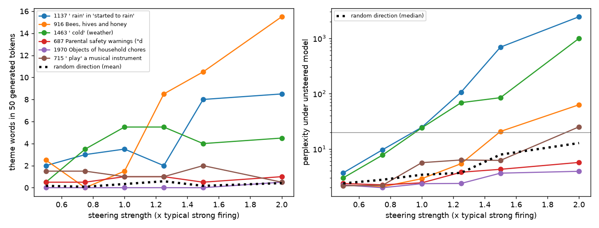

# Stage 6 extension: steering context/theme features

> No feature label here has been verified by a human.

**How features were chosen.** Every Stage 5 label that names a topic or domain (weather, bees, chores, music, danger) rather than a syntactic slot or one predicted next word, whatever its clear verdict or blind score, excluding features already steered. That gave 6: 1137 (' rain' in 'started to rain', 3/5 blind, clear), 916 (Bees, hives and honey, 5/5 blind, not clear), 1463 (' cold' (weather), 3/5 blind, not clear), 687 (Parental safety warnings ("don't go too close"); promotes 'dangerous', 4/5 blind, not clear), 1970 (Objects of household chores (dishes, laundry, weeds), 4/5 blind, not clear), 715 (' play' a musical instrument, 3/5 blind, not clear).

Same method as the main Stage 6 run (same prompts, seeds, random-direction control of equal length), strengths [0.5, 0.75, 1, 1.25, 1.5, 2]. **Theme words** were fixed in config.yaml before reading any steered text; counted as whole words. 'Broken' = perplexity under the unsteered model > 20. A run counts as *fluent and on-theme* if not broken and it has more theme words than both the unsteered text and the random control at the same strength and prompt.

## Summary

| feature | label | blind | fluent & on-theme runs (of 12) | k where both prompts broken |
|---|---|---|---|---|
| 1137 | ' rain' in 'started to rain' | 3/5 | 5 (p0 k=0.5, p0 k=0.75, p0 k=1, p1 k=0.5, p1 k=0.75) | 1.25 |
| 916 | Bees, hives and honey | 5/5 | 5 (p0 k=0.5, p0 k=1.25, p1 k=1, p1 k=1.25, p1 k=1.5) | 2 |
| 1463 | ' cold' (weather) | 3/5 | 3 (p0 k=0.5, p0 k=0.75, p1 k=1) | 1.25 |
| 687 | Parental safety warnings ("don't go too close"); promotes 'dangerous' | 4/5 | 6 (p0 k=0.5, p0 k=0.75, p0 k=1.25, p0 k=1.5, p1 k=1, p1 k=2) | none up to 2 |
| 1970 | Objects of household chores (dishes, laundry, weeds) | 4/5 | 1 (p0 k=2) | none up to 2 |
| 715 | ' play' a musical instrument | 3/5 | 1 (p0 k=1.5) | 2 |

| feature | k | feature: theme / ppl / broken | random: theme / ppl / broken |
|---|---|---|---|
| 1137 | 0.5 | 2.0 / 3.7 / 0/2 | 0.0 / 4.7 / 0/2 |
| 1137 | 0.75 | 3.0 / 9.6 / 0/2 | 0.0 / 6.2 / 0/2 |
| 1137 | 1 | 3.5 / 24.6 / 1/2 | 0.0 / 28.4 / 2/2 |
| 1137 | 1.25 | 2.0 / 106.4 / 2/2 | 0.0 / 43.5 / 2/2 |
| 1137 | 1.5 | 8.0 / 691.5 / 2/2 | 0.0 / 177.5 / 2/2 |
| 1137 | 2 | 8.5 / 2450.9 / 2/2 | 0.0 / 682.3 / 2/2 |
| 916 | 0.5 | 2.5 / 2.2 / 0/2 | 0.0 / 1.9 / 0/2 |
| 916 | 0.75 | 0.0 / 2.1 / 0/2 | 0.0 / 2.7 / 0/2 |
| 916 | 1 | 1.5 / 2.9 / 0/2 | 0.0 / 4.1 / 0/2 |
| 916 | 1.25 | 8.5 / 5.4 / 0/2 | 0.0 / 3.0 / 0/2 |
| 916 | 1.5 | 10.5 / 20.7 / 1/2 | 0.0 / 5.2 / 0/2 |
| 916 | 2 | 15.5 / 62.8 / 2/2 | 0.0 / 16.0 / 1/2 |
| 1463 | 0.5 | 0.5 / 3.0 / 0/2 | 0.0 / 3.0 / 0/2 |
| 1463 | 0.75 | 3.5 / 7.7 / 0/2 | 0.0 / 3.4 / 0/2 |
| 1463 | 1 | 5.5 / 24.1 / 1/2 | 0.0 / 14.1 / 0/2 |
| 1463 | 1.25 | 5.5 / 68.6 / 2/2 | 0.0 / 33.3 / 2/2 |
| 1463 | 1.5 | 4.0 / 84.3 / 2/2 | 0.0 / 114.9 / 2/2 |
| 1463 | 2 | 4.5 / 995.9 / 2/2 | 0.0 / 301.5 / 2/2 |
| 687 | 0.5 | 0.5 / 2.4 / 0/2 | 0.0 / 2.2 / 0/2 |
| 687 | 0.75 | 0.5 / 2.2 / 0/2 | 0.0 / 2.9 / 0/2 |
| 687 | 1 | 1.0 / 2.4 / 0/2 | 1.0 / 2.6 / 0/2 |
| 687 | 1.25 | 1.0 / 3.8 / 0/2 | 0.5 / 2.5 / 0/2 |
| 687 | 1.5 | 0.5 / 4.3 / 0/2 | 0.0 / 3.3 / 0/2 |
| 687 | 2 | 1.0 / 5.7 / 0/2 | 1.5 / 6.2 / 0/2 |
| 1970 | 0.5 | 0.0 / 2.2 / 0/2 | 0.0 / 2.3 / 0/2 |
| 1970 | 0.75 | 0.0 / 2.0 / 0/2 | 0.0 / 2.3 / 0/2 |
| 1970 | 1 | 0.0 / 2.4 / 0/2 | 0.0 / 2.7 / 0/2 |
| 1970 | 1.25 | 0.0 / 2.4 / 0/2 | 0.5 / 3.3 / 0/2 |
| 1970 | 1.5 | 0.0 / 3.6 / 0/2 | 0.5 / 3.5 / 0/2 |
| 1970 | 2 | 0.5 / 3.9 / 0/2 | 0.0 / 4.0 / 0/2 |
| 715 | 0.5 | 1.5 / 2.2 / 0/2 | 1.0 / 2.5 / 0/2 |
| 715 | 0.75 | 1.5 / 2.2 / 0/2 | 0.5 / 2.4 / 0/2 |
| 715 | 1 | 1.0 / 5.6 / 0/2 | 1.0 / 2.6 / 0/2 |
| 715 | 1.25 | 1.0 / 6.3 / 0/2 | 2.5 / 4.0 / 0/2 |
| 715 | 1.5 | 2.0 / 6.2 / 0/2 | 0.5 / 10.6 / 0/2 |
| 715 | 2 | 0.5 / 25.1 / 2/2 | 1.0 / 9.5 / 0/2 |

## Side-by-side text

### Feature 1137 (clear, blind 3/5): ' rain' in 'started to rain'

theme words: cloud, clouds, puddle, puddles, rain, rained, raining, rainy, storm, umbrella, wet

**Prompt:** Once upon a time, there was a little girl named Lily.

| run | theme | ppl | text |
|---|---|---|---|
| no steering | 0 | 1.4 |  She loved to play outside in the sunshine and pick flowers. One day, she found a shiny rock on the ground. She picked it up and showed it to her mom. ⏎  ⏎ "Look, Mommy! I found a pretty rock!" said |
| feature 0.5× | 3 | 2.4 |  She loved to play in her puddles when it rained. One day, Lily's mom told her to come inside because the water was coming in. Lily was sad because she didn't want to stop playing in the rain. ⏎  ⏎ L |
| random 0.5× | 0 | 3.4 |  She loved to play in her tent with her friends. They would sleep in the tent and make plans to play every day.  ⏎  ⏎ One day, a bad boy named Max came to their tent. He wanted to play with them, but he |
| feature 0.75× | 3 | 5.7 |  Lily loved to play in the puddles. One day, she put on her boots and jumped in the puddles. But, the water started to come in. Lily forgot about her boots and started to fall. She would get wet from |
| random 0.75× | 0 | 7.1 |  She had a lot of toys and friends, and they played on the same songs and had a cheerful smile. ⏎  ⏎ One day, a boy came to play with her. He had a big, blue ball and he was very happy. He saw |
| feature 1× | 3 | 15.3 |  Lily loved to play in the puddles. One day, she put on wet raincoat and her boots. Lily loved to put on her so her puddles started to fall. ⏎  ⏎ Lily put on rainbows would come when she |
| random 1× | 0 | 21.1 |  She had a lot of people, and they were sad. They thought, played, and they were very loud and happy. But then, one sister came to tease her. "I want to make a good friend," she said, and when she |
| feature 1.25× | 2 | 109.1 |  Lily loved to fill her puddles in. Every day, or come back to coming in. ⏎  ⏎ Rainbows came in and came. The days. Lily would come to fall and rain. Rainbows coming from coming in. ⏎  ⏎  every |
| random 1.25× | 0 | 61.0 |  She had a lot of people, and they were sad and wanted to play with their sad children. They called it to be friends and they played on it. "Do you want to play with you on the children on the kids would call down to |
| feature 1.5× | 10 | 354.5 |  Rain rained water and lots and rain water. ⏎  ⏎ J rained rained and the rained and come to wet. The water started to pour.. Soon started to leave outside. ained from coming to rain. Soon rained rain |
| random 1.5× | 0 | 242.5 |  She had a lot of people, and they were sad and they smiled and played on the smile on the loud and gave was to children. "A very will. He will smile and kids will come to. Then the kids start to come to kids |
| feature 2× | 12 | 3991.0 |  Rain rained water wet p p water water. ⏎  rain water pears rained coming to rained and! Soon. ainedained rain water p pained her started to rained.... ained rain rain pours rain rain |
| random 2× | 0 | 878.1 |  She had a sad and made a to play on sad. "Let's played on the with a child and he will make splles and swings, and will. boy children on his kids, and friends. children smiled and kids would be in kids |

**Prompt:** Tom and his dog went to the park. They saw

| run | theme | ppl | text |
|---|---|---|---|
| no steering | 0 | 2.5 |  a big slide. It was fun. The slide had ice cream. Tom and his dog ran to the slide. They started to play. ⏎  ⏎ A girl named Sue came to the park. She said, "Can I play too?" Tom and |
| feature 0.5× | 1 | 5.0 |  a big tree. At the tree, there was a hole. Tom said, "Lily, I will get your ball for you!" ⏎  ⏎ Tom jumped off the tree and ran to the hole. The sun was shining. The rain was down |
| random 0.5× | 0 | 6.0 |  a big gate. It was locked. The dog wanted to play. ⏎  ⏎ "Can we play with you?" asked a girl said. "You need to lock the gate and have a nice home." ⏎  ⏎ The boy smiled. "We can |
| feature 0.75× | 3 | 13.6 |  a big rainbow. The sky was bright and the water was pouring. ⏎  ⏎ Tom poured and lots of pretty clouds in. Lots of rain started to come down. The rain started to fall. ⏎  ⏎ Tom poured more and more raindrops falling. |
| random 0.75× | 0 | 5.3 |  a man selling sunglasses. They were bright and happy. Tom wanted to play on the sunglasses. But they were not for kids. They were for kids. ⏎  ⏎ The man said, "I have sunglasses. I want to make children with them. |
| feature 1× | 4 | 33.8 |  a big puddle and water came in. The water was pouring. ⏎  ⏎ Tom poured andcoat. The clouds came from. Soon. The rain started to fall. Soon, and Lily came to rain. The pained and jumped into the p |
| random 1× | 0 | 35.6 |  a man on the and they smiled. "I want to play for my son. He has a good heart and he is very strong. He wants to make children smile. He played on the kids and he smiled. This is the word to remember |
| feature 1.25× | 2 | 103.6 |  a lot from. At last, the water came from. The drops came from. Rainbows came from coming. ⏎  ⏎ Tom poured in the rain and put down. Soon, and Rainbows started to come down. This rain from the drops. |
| random 1.25× | 0 | 25.9 |  a boy and a girl came to kids. They wanted to play on the name on a red sheep. The boy and the boy said, "Let's celebrate, the children and these children are called to play on the kids. They call out, |
| feature 1.5× | 6 | 1028.4 |  a lot from. At. Rain puddles in and so. ⏎  ⏎  drops water andcoat. The clouds in. Lots wet.. rain started to stop. Soon and from. ⏎  ⏎  rain pours.ained water from. ⏎ ained |
| random 1.5× | 0 | 112.4 |  a boy and a girl came to kids. They had children, children, and they kids. They smiled and kids played on their songs and kids. They invited to kids to children: "Let's kids play on the boy and kids kids play on |
| feature 2× | 5 | 910.8 |  a.ained water and water p pouring water. ⏎ ained.. ⏎ Jainedained. rainbows rained rained.Rainbows. rainbows waterbows wet pained from. ⏎  ⏎  rainbows rained. rained. more. |
| random 2× | 0 | 486.4 |  a boy and a girl came to kids and they had a boy was to will. He has a happy children was at home and smile. "Let's his children have to smile and bandles and kids to children children. They smile children play on |

### Feature 916 (not clear, blind 5/5): Bees, hives and honey

theme words: bee, bees, buzz, buzzing, flower, flowers, hive, hives, honey

**Prompt:** Once upon a time, there was a little girl named Lily.

| run | theme | ppl | text |
|---|---|---|---|
| no steering | 1 | 1.4 |  She loved to play outside in the sunshine and pick flowers. One day, she found a shiny rock on the ground. She picked it up and showed it to her mom. ⏎  ⏎ "Look, Mommy! I found a pretty rock!" said |
| feature 0.5× | 5 | 1.9 |  She loved to play in her garden and look at the flowers. One day, she saw a bee buzzing around the flowers.  ⏎  ⏎ "Hello, bee. You're so pretty," Lily said. ⏎  ⏎ "Thank you, little girl. |
| random 0.5× | 0 | 1.7 |  She loved to play outside, but it was very cold. So, she decided to go to the park and play on the swings.  ⏎  ⏎ When she got there, she saw a boy playing with a ball. She wanted to play too, |
| feature 0.75× | 0 | 2.1 |  She loved to play in the forest near her house. One day, she found a yummy-looking berry on the ground. She picked it up and took a bite, but it was very sour.  ⏎  ⏎ Her friend, Tommy, |
| random 0.75× | 0 | 2.6 |  She loved to play outside, but it was very cold. So, she decided to go to a place where it was warm.  ⏎  ⏎ When she got there, she saw a big building with a sign that said "Hot Prices." She didn |
| feature 1× | 0 | 2.1 |  She loved to play in the forest near her house. One day, she found a yummy-looking berry on the ground. She picked it up and took a bite, but it was very sour.  ⏎  ⏎ Her friend, Tommy, |
| random 1× | 0 | 5.1 |  She loved to play in her backyard and make a castle with a big tower. She was very creative and used only colorful bricks to make walls and towers that nobody could make as towers as high as her castle.  ⏎  ⏎ One day, when she |
| feature 1.25× | 5 | 4.5 |  She loved to play in the forest near her house. One day, she found a yummy-looking bee hive on her honeycomb. She wanted to put some bee honey on it, but it was too buzzing around. She decided to wait until |
| random 1.25× | 0 | 2.3 |  She had a lot of toys, but her favorite toy was a fake star. She loved to play with it every day. ⏎  ⏎ One day, Lily's friend came over to play. Lily wanted to show her friend her toy star, but she |
| feature 1.5× | 9 | 24.0 |  She loved to draw on pretty paper with her mommy. Honey was honey, honey, that garden was honey! One day, honey was very sticky and Honey was very sticky on the honey. Honey was very sticky and it made honey sticky in her |
| random 1.5× | 0 | 3.5 |  She had a lot of toys, but her favorite toy was a fake star. She loved to play with it every day. ⏎  ⏎ One day, Lily's friend came to visit and saw the fake star. "This toy can shoot fire when it |
| feature 2× | 13 | 55.4 |  She liked to play in the garden, big bee hive honey on top honey. She loved to bees bee bees! One bee hive honeycomb was very sweet honey. She tried to make honey honey, but it was very sticky and she had sticky honey |
| random 2× | 0 | 20.3 |  She had a lot of toys and a big balls that could make a lot of bubbles. She was very loud and loud that all the water came out of the tops and started to fill up the leak. ⏎  ⏎ But then, the bottom of the |

**Prompt:** Tom and his dog went to the park. They saw

| run | theme | ppl | text |
|---|---|---|---|
| no steering | 0 | 2.5 |  a big slide. It was fun. The slide had ice cream. Tom and his dog ran to the slide. They started to play. ⏎  ⏎ A girl named Sue came to the park. She said, "Can I play too?" Tom and |
| feature 0.5× | 0 | 2.6 |  a big slide. It was very fun. Tom wanted to slide on the slide. He ran to the slide and climbed up. He slid down fast and laughed. Then he slid down again. ⏎  ⏎ "Tom, it's time to play!" |
| random 0.5× | 0 | 2.1 |  a big gate. At the gate, there was a gate. Tom wanted to see what was behind the gate. But the gate was locked. ⏎  ⏎ Tom's friend, Lily, came to the park too. Lily wanted to help Tom. She |
| feature 0.75× | 0 | 2.1 |  a big slide. It was very high. Tom wanted to slide on the slide. He ran to the slide and climbed up. He slid down fast and made a big splash. ⏎  ⏎ "Wow, that was fun!" Tom said. ⏎  ⏎  |
| random 0.75× | 0 | 2.8 |  a big gate. At the gate, there was a gate. The gate was very high. Tom and his dog wanted to see what was on the other side. ⏎  ⏎ They told a nice man near the gate. The man said, "I |
| feature 1× | 3 | 3.7 |  a big slide. It was very high. Tom wanted to slide on the slide. He climbed to the top. But then, he felt very dizzy. He felt dizzy too. ⏎  ⏎ "Buzz on me, honey," said the bee |
| random 1× | 0 | 3.2 |  a big gate. At the gate, there was a gate. The gate was very high. Tom wanted to raise a gate. ⏎  ⏎ Tom had an idea. He wanted to find a way to raise the gate. This time, he found a |
| feature 1.25× | 12 | 6.3 |  a bee hive. It was hive. The bees made honey. Tom wanted to drink some honey. He went to the hive. ⏎  ⏎ "Buzz hive!" said Tom. "Bee hive!" ⏎  ⏎ BuzzBee was very happy. "Buzz pot |
| random 1.25× | 0 | 3.8 |  a big gate. At the gate, there was a gate that was full of oxygen. The oxygen was like a big ball. ⏎  ⏎ Tom wanted to see what was inside the big gate. He tried to open the door, but he could not |
| feature 1.5× | 12 | 17.3 |  a bee hive. It was hive honey. Tom wanted to make honey. But he was not sure. ⏎  ⏎ "Bee stuck in the hive," said his friend, Beebee. "Buzz hive honey."Beebee was sticky. "Buzz hive |
| random 1.5× | 0 | 6.8 |  a big gate. At the gate, there was a gate that was full of oxygen. The oxygen was like a big ball. ⏎  ⏎ Tom wanted to see what the oxygen was. He wanted to see more things. This problem was that there were |
| feature 2× | 18 | 70.3 |  a bee hive. It was hive honey. Honeybees buzzing bees. ⏎  ⏎ "Bee, bee, bees buzz buzz and honeybees!" cried Beety. ⏎  ⏎ "Bee hive, honeybees buzzing hive!"beety bee hivebee hive buzz |
| random 2× | 0 | 11.7 |  a man with a cap. The cap was a cap made of a hat and a cap. The cap had a cap that made a loud sound. ⏎  ⏎ The cap wanted to see something that could make a joke. This problem was that there was |

### Feature 1463 (not clear, blind 3/5): ' cold' (weather)

theme words: coat, cold, freezing, ice, icy, shiver, shivering, snow, warm, winter

**Prompt:** Once upon a time, there was a little girl named Lily.

| run | theme | ppl | text |
|---|---|---|---|
| no steering | 0 | 1.4 |  She loved to play outside in the sunshine and pick flowers. One day, she found a shiny rock on the ground. She picked it up and showed it to her mom. ⏎  ⏎ "Look, Mommy! I found a pretty rock!" said |
| feature 0.5× | 1 | 3.3 |  She loved to play outside, but it was very cold. So, she went to the porch to get some hot food.  ⏎  ⏎ Suddenly, she heard a loud noise. It was very scary! But, her mommy came outside and helped |
| random 0.5× | 0 | 2.8 |  She loved to play with her toys and have fun with her friends. One day, Lily's mom asked her to pack her bag with some old clothes. Lily was eager to help and ran to her room.  ⏎  ⏎ Her mom said, " |
| feature 0.75× | 6 | 7.0 |  She lived in a cold place and had lots of snow. One day, Lily found icy wind blowing outside and it made her shiver. She wanted to play outside, but she couldn't. She wanted to keep her cold and cold, but instead |
| random 0.75× | 0 | 2.9 |  She loved to play with her toys and have fun with her toys. One day, her mommy told her it was time to do math. Lily didn't know what math was, so her mommy showed her a little copy. "It's |
| feature 1× | 5 | 35.8 |  She lived in the cold winter and ice on the ground. So, she sent her icy wind to her night. One day, cold air finally, but. Lily couldn't stop it all, even though. She wanted to play outside, but she |
| random 1× | 0 | 12.0 |  She loved holding her toy cars and building. One day, she went to the park with her mom and found a bin with a lid on it. She wondered what her bin was. Maybe it was old and there. Maybe she had a little bit |
| feature 1.25× | 7 | 82.9 |  She lived in the cold winter and ice. One day, and night, while shivering windgyly it outside. The air cold air and colder, but. The wind was already made, but. The snow was cold and windy when it |
| random 1.25× | 0 | 44.4 |  She loved holding her toy cars and building. She had her favorite pink car, so adorable. Maybe she had it in her mind. Maybe it was not. Maybe her world was missing. ⏎  |
| feature 1.5× | 6 | 76.1 |  She wanted to play outside, but it was. It was on a cold wind, and wind. It was it winter outside. cold air and colder, but. ⏎  ⏎  day, and cold, shivering. The cold air would touch when it |
| random 1.5× | 0 | 111.3 |  She loved holding her toy cars and building. She had her favorite in her heart. She was out of curious and ready. Maybe she had. Maybe she had. She had a missing out. What is. Maybe that is missing. What is out |
| feature 2× | 6 | 1077.2 |  night, and in night, shivering and shivering. shivered in the ground and wind. It snow outside in the air cold air., but.. and started to sh sh shiver.. night cold. and wind started when it |
| random 2× | 0 | 307.1 |  She had a lot of out of her eye. with her eye is not serious. What that can?" curious and ordinary. What is up. with that.. She is curious and curious. What is out. What does out. ⏎  What is |

**Prompt:** Tom and his dog went to the park. They saw

| run | theme | ppl | text |
|---|---|---|---|
| no steering | 1 | 2.5 |  a big slide. It was fun. The slide had ice cream. Tom and his dog ran to the slide. They started to play. ⏎  ⏎ A girl named Sue came to the park. She said, "Can I play too?" Tom and |
| feature 0.5× | 0 | 2.7 |  a big puddle and wanted to play in it. Tom wanted to splash, but his dog did not like it. His dog said, "No, Tom! Go away!" Tom was sad and mad. He wanted to play with his dog, |
| random 0.5× | 0 | 3.2 |  a big box. It was brown and furry. Tom said, "Let's see what's inside." ⏎  ⏎ They opened the box and found a small box. It was very small. Tom tried to lift the lid. It was heavy. He |
| feature 0.75× | 1 | 8.4 |  a wallet on the ground. Tim wanted to see what was inside. ⏎  ⏎ Tim was scared, but Tim was in the cold water. Tim wanted to go home, but Tim did not know. Tim shivered but he could not stop. Tim |
| random 0.75× | 0 | 3.9 |  a big box. It was brown and furry. Tom said, "What is this?" He ran to the box and picked it up. It was rough and rusty. He wondered what it was for. He looked at it and said, "I |
| feature 1× | 6 | 12.3 |  a lot of fog and cold. Tim shivered and cold. Tim wanted to play, but Tim was shivering. His cold and day. Tim wanted to play outside, but Tim had a cold. Tim shivered and cold. Tim wanted to |
| random 1× | 0 | 16.3 |  a big box. It was brown and furry. Tom's dog was enthusiastic. He loved the color. He ran to the box and opened it. What can do? What is available. He runs to the garage and stands in the corner. He |
| feature 1.25× | 4 | 54.4 |  a lot of ice and water. He tried to get it, but it was. He was cold and shivering. His arms and colder. Tim and his coat. Tim and shivered the air. Tim shivered. It was, but then |
| random 1.25× | 0 | 22.1 |  a big box. It was brown and furry. What is for?" ⏎  |
| feature 1.5× | 2 | 92.5 |  a lot. It was, and there. The air was, but it was. Tim and wind. The air was and cold. Tim wanted to out. The air and colder. Tim, tried to play on the cold water. but it was |
| random 1.5× | 0 | 118.4 |  a car in the corner. It is modest. What is. What is normal. What is modest. ⏎  |
| feature 2× | 3 | 914.6 |  a night in the air. and it started to freeze ice.. ⏎ , though, and wind. The air outside. and cold.. and out of air. and colder, like it tried to sh snow but it.. but it all |
| random 2× | 0 | 295.9 |  a little box. It is not ordinary. What is available. What is normal. What is just. ⏎ . What is out. What does. What can can keep up. What is a good. What does that is modest. What can can |

### Feature 687 (not clear, blind 4/5): Parental safety warnings ("don't go too close"); promotes 'dangerous'

theme words: careful, close, danger, dangerous, hurt, safe, stay, warned, warning

**Prompt:** Once upon a time, there was a little girl named Lily.

| run | theme | ppl | text |
|---|---|---|---|
| no steering | 0 | 1.4 |  She loved to play outside in the sunshine and pick flowers. One day, she found a shiny rock on the ground. She picked it up and showed it to her mom. ⏎  ⏎ "Look, Mommy! I found a pretty rock!" said |
| feature 0.5× | 1 | 2.3 |  She loved to play outside in the sunshine and pick flowers. One day, she found a shiny rock and put it in her pocket to keep it safe. ⏎  ⏎ As she was playing, she noticed that some of the flowers she had lost every bit |
| random 0.5× | 0 | 2.0 |  She loved to play outside, but it was very cold. So, she went to her mommy and said, "Mommy, I am cold. Can we make a cocoa?" ⏎  ⏎ Mommy said, "Sure, what kind of cocoa |
| feature 0.75× | 1 | 2.4 |  She loved to play outside in the park with her mommy and daddy. One day, Lily's mommy told her to be careful and not let her step on her toes.  ⏎  ⏎ Lily walked around the park and saw some ducks swimming |
| random 0.75× | 0 | 2.0 |  She loved to play outside, but it was very cold. So, she went to her mommy and said, "Mommy, I am cold. Can we make a cocoa?" ⏎  ⏎ Mommy said, "Sure, what kind of cocoa |
| feature 1× | 1 | 2.7 |  She loved to play outside in the park with her mommy and dad. One day, Lily's mommy told her to be careful and not let her step on her toes.  ⏎  ⏎ Lily walked around the park and saw some ducks swimming |
| random 1× | 2 | 2.2 |  She loved to play outside, but it was very cold. So, she went to her mommy and said, "Mommy, I am so cold. Can we stay home today?" ⏎  ⏎ Mommy replied, "Yes, let's stay |
| feature 1.25× | 2 | 3.3 |  She loved to play outside in the park with her mommy and dad. One day, Lily's mommy told her to be careful and not let her step on her head on the step.  ⏎  ⏎ Lily was very careful and did not |
| random 1.25× | 1 | 2.0 |  She loved to play outside, but it was very cold. So, she went to her mommy and said, "Mommy, I am so cold. Can we stay here and play inside?" ⏎  ⏎ Her mommy said, "Yes, |
| feature 1.5× | 1 | 3.6 |  She liked to play in the forest near her house. One day, she found a weak log on the ground. She was not careful and it broke.  ⏎  ⏎ Lily's mommy told her to step on the sharp rocks and step on |
| random 1.5× | 0 | 2.9 |  She loved to play outside, but it was very cold. So, she asked her mom to bring her sweater, but her mom said, "I don't want to. It's too cold, and it might freeze!" ⏎  ⏎ Lily's |
| feature 2× | 0 | 5.2 |  She liked to play in the water. One day, her mommy said, "Lily, it's not ready to get wet." ⏎  ⏎ Lily was playing outside when she saw a big water. Her mommy called her to get wet |
| random 2× | 2 | 6.6 |  She was holding a piece of paper and said, "Look, look, I found a pretty paper!" ⏎  ⏎ Lily's mom came and said, "Lily, be careful, it's a safe climb the tree." ⏎  ⏎ Lily |

**Prompt:** Tom and his dog went to the park. They saw

| run | theme | ppl | text |
|---|---|---|---|
| no steering | 0 | 2.5 |  a big slide. It was fun. The slide had ice cream. Tom and his dog ran to the slide. They started to play. ⏎  ⏎ A girl named Sue came to the park. She said, "Can I play too?" Tom and |
| feature 0.5× | 0 | 2.4 |  a big gate. The gate was locked. Tom wanted to see what was behind it. He saw a pretty butterfly in the garden. The butterfly was very fast. Tom wanted to catch it. ⏎  ⏎ Tom tried to catch the butterfly, but it |
| random 0.5× | 0 | 2.5 |  a big slide. The slide was fun. Tom wanted to slide down, but he was scared. He saw a girl named Sue at the bottom. Sue was also scared to slide. ⏎  ⏎ Tom said, "Sue, can I play with |
| feature 0.75× | 0 | 2.1 |  a big gate. The gate was locked. Tom wanted to see what was behind it. He saw a man with a hat. The man said, "Do not go near the gate." ⏎  ⏎ Tom went to the man and said, "I |
| random 0.75× | 0 | 3.8 |  a big park. At the park, there was a lot of waste. The waste was hard to collect. It was not very good. Tom felt sad. ⏎  ⏎ Tom said to his dog, "Let's make something new. We can make |
| feature 1× | 1 | 2.2 |  a big gate. The gate was locked. Tom wanted to see what was behind it. His dog was scared. ⏎  ⏎ Tom said, "Dog, can you please open the gate?" The dog said, "No, it is not safe." |
| random 1× | 0 | 3.0 |  a big park. At the park, there was a lot of waste. The waste was bad. It made a big mess. ⏎  ⏎ Tom said to his dog, "We need to pick the trash." His dog did not want to help. |
| feature 1.25× | 0 | 4.3 |  a big well. At the park, there was water. Tom was thirsty, but he did not want to get wet. ⏎  ⏎ A little girl named Sue was playing near the well. She liked to throw her toys near the water. Sue did |
| random 1.25× | 0 | 3.1 |  a big park. At the park, there was a lot of waste. The waste was bad. It made a big mess. ⏎  ⏎ Tom felt bad. He wanted to help. He said to his dog, "I am sorry, do not |
| feature 1.5× | 0 | 5.0 |  a big well. At the park, there was water. Tom was thirsty, but he did not want to get wet. ⏎  ⏎ A little boy named Tim was playing near the well. Tim liked to throw water. Tim said, "We don |
| random 1.5× | 0 | 3.7 |  a big park. At the park, there was a lot of waste. The waste was bad. It made a big mess. ⏎  ⏎ Tom felt bad. He wanted to help. But the waste was too bad. This made the park more sad |
| feature 2× | 2 | 6.1 |  a big fire. It was very loud. The fire was not for playing. ⏎  ⏎ His mom was not home. She was very safe. Tom and his dog were not alert. They did not want to get hurt. They listened to the fire |
| random 2× | 1 | 5.7 |  a big well. It was not safe. Tom wanted to see what was in it. He was troubled. ⏎  ⏎ Tom was very sad. He saw a man who was fixing the well. The man was bad. This was not good. ⏎  |

### Feature 1970 (not clear, blind 4/5): Objects of household chores (dishes, laundry, weeds)

theme words: chores, clean, cleaning, dishes, laundry, mess, sweep, tidy, wash, washing, weeds

**Prompt:** Once upon a time, there was a little girl named Lily.

| run | theme | ppl | text |
|---|---|---|---|
| no steering | 0 | 1.4 |  She loved to play outside in the sunshine and pick flowers. One day, she found a shiny rock on the ground. She picked it up and showed it to her mom. ⏎  ⏎ "Look, Mommy! I found a pretty rock!" said |
| feature 0.5× | 0 | 1.8 |  She loved to play outside in the sunshine and pick flowers. One day, she found a shiny rock on the ground and showed it to her mommy.  ⏎  ⏎ Her mommy said, "That's a very pretty rock, Lily. Don |
| random 0.5× | 0 | 1.9 |  She loved to play outside in the park with her friends. One day, while they were playing, they saw a big dog. The dog was so big that Lily couldn't see his head.  ⏎  ⏎ She said to her friend, "I |
| feature 0.75× | 0 | 1.6 |  She loved to play outside in the sunshine and pick flowers. One day, she found a shiny rock on the ground and showed it to her mommy.  ⏎  ⏎ "Look, mommy! I found a pretty rock!" said Lily. ⏎  |
| random 0.75× | 0 | 1.9 |  She loved to play outside in the park with her friends. One day, while they were playing, they saw a big dog barking loudly. They were scared and ran away. ⏎  ⏎ Lily's friends asked her why she was scared, and she |
| feature 1× | 0 | 1.6 |  She loved to play outside in the sunshine and pick flowers. One day, she found a shiny rock on the ground and showed it to her mommy.  ⏎  ⏎ "Look, mommy! I found a pretty rock!" said Lily. ⏎  |
| random 1× | 0 | 2.2 |  She loved to play in her garden and look at the flowers. One day, she saw a big onion and it looked very strange. She asked her mommy, "What is this onion, mommy?" Her mommy replied, "It's |
| feature 1.25× | 0 | 1.8 |  She loved to play in her garden and collect pretty flowers. One day, she found a big, red tomato and decided to plant it in her garden. She watered it every day and waited patiently for it to grow. ⏎  ⏎ One day, a |
| random 1.25× | 1 | 2.5 |  She loved to play in her garden, but one day her favorite flower garden was very messy. Lily tried and tried to clean it, but it wouldn't budge. She felt sad and didn't know what to do. ⏎  ⏎ Her mom came |
| feature 1.5× | 0 | 2.5 |  She had a lot of toys and a big yard to play on. One day, Lily's friend came over to play with her. They played with toys and had lots of fun. But suddenly, they heard a loud noise outside. It was a |
| random 1.5× | 1 | 2.5 |  She loved to play in her garden, where she had a big sunflower. She would look at the sun every day with her sunflower in her hand. ⏎  ⏎ One day, Lily's mom told her to clean up her room. But Lily |
| feature 2× | 1 | 3.4 |  She had a lot of toys and a big yard to play on. One day, Lily's friend, Tom, came over to play. He brought his toy truck and started to build a big tower. Lily thought the tower looked very tidy, so |
| random 2× | 0 | 3.3 |  She liked to play in her garden with her toys. One day, she found a big pumpkin pumpkin. It was big and round, and it had a face. She thought it was very funny. ⏎  ⏎ Lily went inside the house and asked |

**Prompt:** Tom and his dog went to the park. They saw

| run | theme | ppl | text |
|---|---|---|---|
| no steering | 0 | 2.5 |  a big slide. It was fun. The slide had ice cream. Tom and his dog ran to the slide. They started to play. ⏎  ⏎ A girl named Sue came to the park. She said, "Can I play too?" Tom and |
| feature 0.5× | 0 | 2.6 |  a big slide. It was fun to climb and slide down. Tom wanted to play on the slide, but it was too high up. Sam wanted to go up the slide, but he was scared. ⏎  ⏎ Tom said, "Let's try |
| random 0.5× | 0 | 2.6 |  a big park. At the park, there was a big building. Tom and his dog ran to the building. They saw a man in a suit and a man in a suit. The man looked serious. ⏎  ⏎ Tom said to his dog, |
| feature 0.75× | 0 | 2.4 |  a big tree. The sky was bright and the sun was warm. Tom and his dog ran to the tree. They saw a bird in the tree. The bird was deaf, so it could not hear. The bird could not hear, but it |
| random 0.75× | 0 | 2.6 |  a big park. At the park, there was a big building. Tom and his dog ran to the building. They saw a man in a suit and a man in a suit. The man looked serious. ⏎  ⏎ Tom said to his dog, |
| feature 1× | 0 | 3.1 |  a big tree. It was very tall and had lots of leaves. Tom wanted to play with the leaves, but they were stuck up high. He wanted to run around to get them. ⏎  ⏎ Tom asked his friend, Sam the dog, for |
| random 1× | 0 | 3.2 |  a big gate. It was locked. Tom wanted to unlock the gate. But he didn't know how. ⏎  ⏎ Then, a tall man came out of the house. He told Tom and the dog to help him. The tall man put the |
| feature 1.25× | 0 | 3.0 |  a big tree. It was dry and sunny. Tom and his dog went to play near the tree. The sun was hot and the tree started to rot. The tree started to rot. Tom and his dog were sad. ⏎  ⏎ A cop saw |
| random 1.25× | 0 | 4.2 |  a big gate. It was locked. The dog wanted to enter. ⏎  ⏎ Tom said, "Now I will be a hero." But the dog did not know the lock. Tom was sad. He asked his friend, Sam the dog, for |
| feature 1.5× | 0 | 4.8 |  a big tree. It was dry and sunny. Tom liked the color. But he did not like the itch. He wanted to play with his ball and his dog. ⏎  ⏎ Tom gave the ball to his dog. This made the itch more go |
| random 1.5× | 0 | 4.5 |  a big gate. It was locked. The dog wanted to enter. ⏎  ⏎ Tom said, "Now I will be a hero!" But the dog did not know the way. Tom was sad. He called for his mom. She heard him and |
| feature 2× | 0 | 4.5 |  a big well. At the well, there was water and plants. Tom was very thirsty. He wanted to get a drink from the well. ⏎  ⏎ Tom's mom gave him some water. There were many plants. This water was very strong. |
| random 2× | 0 | 4.7 |  a big gate. It was locked. The dog wanted to enter. ⏎  ⏎ Tom said, "Now I will be a hero!" But the dog did not know the way. Tom was a cat. The dog was very big. The dog did |

### Feature 715 (not clear, blind 3/5): ' play' a musical instrument

theme words: drum, drums, guitar, instrument, music, piano, play, played, sing, singing, song, songs, violin

**Prompt:** Once upon a time, there was a little girl named Lily.

| run | theme | ppl | text |
|---|---|---|---|
| no steering | 1 | 1.4 |  She loved to play outside in the sunshine and pick flowers. One day, she found a shiny rock on the ground. She picked it up and showed it to her mom. ⏎  ⏎ "Look, Mommy! I found a pretty rock!" said |
| feature 0.5× | 1 | 2.5 |  She loved to play in her garden and look at the flowers. One day, she saw a beautiful crown on a flower.  ⏎  ⏎ "Wow, this crown is so pretty!" said Lily. ⏎  ⏎ She decided to collect the crown and put |
| random 0.5× | 2 | 2.1 |  She loved to play outside in the sunshine. One day, she saw a butterfly flying around her garden. It was so pretty! But then, she saw a dead butterfly on a flower. Lily felt sad because she couldn't play with the butterfly anymore |
| feature 0.75× | 1 | 2.2 |  She loved to play in her backyard with her toys. One day, she found a shiny ornament on the ground. It was round and had pretty colors on it. ⏎  ⏎ Lily's friend, Tim, came over and asked, "What's |
| random 0.75× | 1 | 2.2 |  She loved to play outside in the sunshine. One day, she saw a butterfly flying around her garden. It was so pretty! But then, she saw a dead butterfly. She didn't want it to be dead, so she decided to keep it |
| feature 1× | 1 | 3.8 |  She had a lot of toys and games in her room. Sometimes, she would stand in her room and play with her favorite teddy bear. ⏎  ⏎ One day, Lily's teacher came to her and asked her a question. "What color is |
| random 1× | 1 | 1.9 |  She loved to play in the jungle near her house. One day, she found a big, scary crocodile! She was scared and didn't know what to do. She tried to run away, but the crocodile was too fast. ⏎  ⏎  |
| feature 1.25× | 1 | 5.2 |  She had a lot of toys and games in her room. Sometimes, she would stand in her garden and play with her dolls. But sometimes, she was a bad boy. She would tease her toys and make funny faces. ⏎  ⏎ One day, |
| random 1.25× | 1 | 2.9 |  She loved to play in the jungle near her house. One day, she found a big, scary spider. She didn't know what to do, but she didn't want to leave it.  ⏎  ⏎ She decided to follow the spider when it |
| feature 1.5× | 2 | 6.7 |  She had a lot of toys and games in her room. Sometimes, she would stand in the garden and play with her favorite teddy bear. ⏎  ⏎ One day, Lily's teacher came to her. The children saw the play and said, " |
| random 1.5× | 1 | 7.2 |  She loved to play in the sea and look at herself in the pretty blue seas. One day, she went to a new place to explore. She went inside and saw a big, beautiful seashell. She couldn't wait to explore what was hidden |
| feature 2× | 0 | 20.7 |  Lily had a lot of her talents in her talent. her favorite animal, a graceful deer that gracely and graceful in the ground. The deer would dance in the trees and twinkle on the ground. Lily and the deer were the best in the |
| random 2× | 1 | 11.0 |  She loved to play in her home in the ocean. One day, she was very excited as she could today was ready to explore what was in the world. ⏎  ⏎ As she walked on her adventure, she couldn't wait to find what she would |

**Prompt:** Tom and his dog went to the park. They saw

| run | theme | ppl | text |
|---|---|---|---|
| no steering | 2 | 2.5 |  a big slide. It was fun. The slide had ice cream. Tom and his dog ran to the slide. They started to play. ⏎  ⏎ A girl named Sue came to the park. She said, "Can I play too?" Tom and |
| feature 0.5× | 2 | 1.9 |  a big tree. The tree had many leaves. Tom and his dog wanted to play near the tree. ⏎  ⏎ As they played, they saw a small bird. The bird was sad. Tom and his dog looked at the bird. They wanted to |
| random 0.5× | 0 | 2.8 |  a big park. At the park, there was a big slide. Tom and his dog ran to the slide. They started to go down. The slide was long and fun. Tom and his dog went up and down the slide as they went. |
| feature 0.75× | 2 | 2.2 |  a big tree. The tree had many leaves. Tom and the dog wanted to play near the tree. ⏎  ⏎ As they played, they saw a small bird. The bird was sad. Tom tried to make the bird feel better. He wanted to |
| random 0.75× | 0 | 2.5 |  a big park. At the park, there was a big slide. Tom and his dog ran to the slide. They started to go down the slide together. The slide was very fun. ⏎  ⏎ While they were at the bottom of the slide, |
| feature 1× | 1 | 7.5 |  a big statue. It was the same as the ball. Tom was excited and said, "Tom, I am a dependable dog. I will help you." Then, Tom told a nice cat to play on the ball. They ran and laughed |
| random 1× | 1 | 3.3 |  a big park. At the park, there was a new park. Tom and his dog ran to the new park. They were very happy. ⏎  ⏎ They played in the new park all day. They ran to the new park as they ran. |
| feature 1.25× | 1 | 7.5 |  a big statue. It was clear and pretty. Tom said, "Let's play with the statue." ⏎  ⏎ Mia came up with a pale star in her hand. She told a nice man. The man was the one of the statue. |
| random 1.25× | 4 | 5.2 |  a big park. At first, it was fun. Tom liked the park a lot. He ran and played with his dog. They played and had fun together. Then, Tom played a new game. The game was separate. They could play the |
| feature 1.5× | 2 | 5.6 |  a big statue. It was clear and pretty. Tom said, "Let's play with the statue. I will strike the ball first. I will be the best." ⏎  ⏎ Tom played the statue. The ball was very impressive. He ran fast |
| random 1.5× | 0 | 14.1 |  a big park. At first, it was fun. Tom loved to run and jump. He would run fast to feel happy. ⏎  ⏎ One day, his dog wanted to act. He could do so many things. This day was his playd |
| feature 2× | 1 | 29.4 |  a big ball. The ball was fragile. The ball was a match. The birds were in the square. ⏎  ⏎ Tom and the balls were loud and clap loudly. The birds came from the nearby nearby. "Twinkle the word and sing |
| random 2× | 1 | 8.0 |  a big park and they were happy there. They wanted to perform for their families. They were ready. ⏎  ⏎ As they were ready, they felt ready. They were ready to have a nice day. The sun was shining and they could play in |
