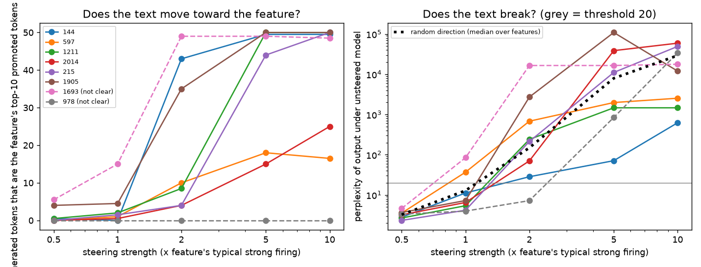

# Stage 6: steering report

> All feature labels are AI-written (by Claude) and have not been verified by a human.

Model TinyStories-8M, residual stream after block 3, SAE λ=1. Seed 1234 per prompt (prompt i uses seed 1234+i); 50 new tokens; temperature 0.8, top-k 50.

**How features were selected.** The six main features were taken only from features that were labelled *clear* under the strict Stage 5 rule (random firings also fit the label) **and** scored 5/5 on the blind label test; among those 20, I picked ones whose labels are about content visible in text. Two features that were *not* clear were added to show steering with a weak label.

**Steering.** Add `k × s × d` to the residual stream at every position except the EOS prefix, where d is the feature's unit decoder direction, s its typical strong firing (mean of its top-20 activations), and k the strength. Converted to model units by dividing by the rescale factor 6.3639. Mean activation length at this layer is 2.51 in model units. **Control:** a random unit direction with the same length, per feature and strength.

**Strengths.** The brief asks for 2, 5 and 10×. The smoke test showed 2× already breaks the text for strongly-firing features, so 0.5× and 1× were added. Used: [0.5, 1, 2, 5, 10].

**Measures.** *Promoted hits*: how many of the 50 generated tokens are among the feature's top-10 promoted tokens (Stage 5). *Perplexity*: of the generated text under the unsteered model; above 20 is counted as broken (unsteered generations score 1.4 and 2.5).

## Summary table (medians/means over the 2 prompts)

| feature | group | label | blind | k | vector length | feature: hits / ppl / broken | random: hits / ppl / broken |
|---|---|---|---|---|---|---|---|
| 144 | clear_5of5 | ' little' in 'there was a little boy/girl' | 5/5 | 0.5 | 0.62 | 0.5 / 2.8 / 0/2 | 0.0 / 3.4 / 0/2 |
| 144 | clear_5of5 | ' little' in 'there was a little boy/girl' | 5/5 | 1 | 1.24 | 0.0 / 11.2 / 0/2 | 0.0 / 16.2 / 0/2 |
| 144 | clear_5of5 | ' little' in 'there was a little boy/girl' | 5/5 | 2 | 2.48 | 43.0 / 28.3 / 2/2 | 0.0 / 198.5 / 2/2 |
| 144 | clear_5of5 | ' little' in 'there was a little boy/girl' | 5/5 | 5 | 6.20 | 49.5 / 71.0 / 2/2 | 0.0 / 32192.8 / 2/2 |
| 144 | clear_5of5 | ' little' in 'there was a little boy/girl' | 5/5 | 10 | 12.40 | 49.5 / 622.8 / 2/2 | 0.0 / 359.8 / 2/2 |
| 597 | clear_5of5 | ' big' in 'saw a big ...' (encounter) | 5/5 | 0.5 | 0.68 | 0.0 / 3.5 / 0/2 | 0.5 / 2.4 / 0/2 |
| 597 | clear_5of5 | ' big' in 'saw a big ...' (encounter) | 5/5 | 1 | 1.36 | 1.0 / 36.8 / 1/2 | 0.0 / 17.5 / 1/2 |
| 597 | clear_5of5 | ' big' in 'saw a big ...' (encounter) | 5/5 | 2 | 2.72 | 10.0 / 680.3 / 2/2 | 0.0 / 132.7 / 2/2 |
| 597 | clear_5of5 | ' big' in 'saw a big ...' (encounter) | 5/5 | 5 | 6.80 | 18.0 / 1979.3 / 2/2 | 0.0 / 3242.5 / 2/2 |
| 597 | clear_5of5 | ' big' in 'saw a big ...' (encounter) | 5/5 | 10 | 13.61 | 16.5 / 2534.3 / 2/2 | 0.5 / 29471.8 / 2/2 |
| 1211 | clear_5of5 | ' mom' as companion ('with her mom', 'her mom and dad') | 5/5 | 0.5 | 0.43 | 0.5 / 2.7 / 0/2 | 0.0 / 2.2 / 0/2 |
| 1211 | clear_5of5 | ' mom' as companion ('with her mom', 'her mom and dad') | 5/5 | 1 | 0.86 | 2.0 / 5.4 / 0/2 | 1.5 / 4.8 / 0/2 |
| 1211 | clear_5of5 | ' mom' as companion ('with her mom', 'her mom and dad') | 5/5 | 2 | 1.71 | 8.5 / 240.2 / 2/2 | 1.0 / 45.0 / 2/2 |
| 1211 | clear_5of5 | ' mom' as companion ('with her mom', 'her mom and dad') | 5/5 | 5 | 4.28 | 50.0 / 1464.9 / 2/2 | 0.0 / 15224.1 / 2/2 |
| 1211 | clear_5of5 | ' mom' as companion ('with her mom', 'her mom and dad') | 5/5 | 10 | 8.56 | 50.0 / 1464.9 / 2/2 | 0.0 / 47354.0 / 2/2 |
| 2014 | clear_5of5 | Animal noun introduced as protagonist in the opening sentence (fox, cat) | 5/5 | 0.5 | 0.55 | 0.0 / 3.2 / 0/2 | 0.0 / 3.5 / 0/2 |
| 2014 | clear_5of5 | Animal noun introduced as protagonist in the opening sentence (fox, cat) | 5/5 | 1 | 1.11 | 0.5 / 6.5 / 0/2 | 0.0 / 9.5 / 0/2 |
| 2014 | clear_5of5 | Animal noun introduced as protagonist in the opening sentence (fox, cat) | 5/5 | 2 | 2.21 | 4.0 / 70.1 / 2/2 | 0.0 / 268.7 / 2/2 |
| 2014 | clear_5of5 | Animal noun introduced as protagonist in the opening sentence (fox, cat) | 5/5 | 5 | 5.53 | 15.0 / 38614.7 / 2/2 | 0.0 / 9161.8 / 2/2 |
| 2014 | clear_5of5 | Animal noun introduced as protagonist in the opening sentence (fox, cat) | 5/5 | 10 | 11.05 | 25.0 / 59186.9 / 2/2 | 0.0 / 4901.2 / 2/2 |
| 215 | clear_5of5 | ' was' followed by 'so' + emotion after a mishap ('He was so sad') | 5/5 | 0.5 | 0.38 | 0.0 / 2.3 / 0/2 | 0.5 / 3.1 / 0/2 |
| 215 | clear_5of5 | ' was' followed by 'so' + emotion after a mishap ('He was so sad') | 5/5 | 1 | 0.77 | 1.5 / 4.2 / 0/2 | 0.5 / 3.4 / 0/2 |
| 215 | clear_5of5 | ' was' followed by 'so' + emotion after a mishap ('He was so sad') | 5/5 | 2 | 1.53 | 4.0 / 213.1 / 2/2 | 0.0 / 10.9 / 0/2 |
| 215 | clear_5of5 | ' was' followed by 'so' + emotion after a mishap ('He was so sad') | 5/5 | 5 | 3.83 | 44.0 / 11072.2 / 2/2 | 1.0 / 1913.2 / 2/2 |
| 215 | clear_5of5 | ' was' followed by 'so' + emotion after a mishap ('He was so sad') | 5/5 | 10 | 7.67 | 50.0 / 49180.6 / 2/2 | 0.0 / 29081.2 / 2/2 |
| 1905 | clear_5of5 | '.' ending a story's closing/moral sentence (e.g. 'happily ever after.') | 5/5 | 0.5 | 0.60 | 4.0 / 3.7 / 0/2 | 2.5 / 3.4 / 0/2 |
| 1905 | clear_5of5 | '.' ending a story's closing/moral sentence (e.g. 'happily ever after.') | 5/5 | 1 | 1.19 | 4.5 / 7.2 / 0/2 | 2.0 / 25.3 / 1/2 |
| 1905 | clear_5of5 | '.' ending a story's closing/moral sentence (e.g. 'happily ever after.') | 5/5 | 2 | 2.38 | 35.0 / 2709.4 / 2/2 | 1.0 / 164.6 / 2/2 |
| 1905 | clear_5of5 | '.' ending a story's closing/moral sentence (e.g. 'happily ever after.') | 5/5 | 5 | 5.95 | 50.0 / 109102.6 / 2/2 | 0.0 / 6712.6 / 2/2 |
| 1905 | clear_5of5 | '.' ending a story's closing/moral sentence (e.g. 'happily ever after.') | 5/5 | 10 | 11.90 | 50.0 / 11970.0 / 2/2 | 0.0 / 79947.7 / 2/2 |
| 1693 | not_clear | ' time' in 'it was time to go home' | 1/5 | 0.5 | 0.99 | 5.5 / 4.6 / 0/2 | 5.0 / 3.8 / 0/2 |
| 1693 | not_clear | ' time' in 'it was time to go home' | 1/5 | 1 | 1.98 | 15.0 / 84.3 / 2/2 | 4.0 / 41.0 / 2/2 |
| 1693 | not_clear | ' time' in 'it was time to go home' | 1/5 | 2 | 3.96 | 49.0 / 16488.5 / 2/2 | 3.0 / 1663.1 / 2/2 |
| 1693 | not_clear | ' time' in 'it was time to go home' | 1/5 | 5 | 9.91 | 49.0 / 16488.5 / 2/2 | 0.0 / 57891.7 / 2/2 |
| 1693 | not_clear | ' time' in 'it was time to go home' | 1/5 | 10 | 19.82 | 48.5 / 17732.3 / 2/2 | 0.0 / 1062653.2 / 2/2 |
| 978 | not_clear | ' sunshine' in 'in the sunshine' | 2/5 | 0.5 | 0.31 | 0.0 / 3.3 / 0/2 | 0.0 / 2.4 / 0/2 |
| 978 | not_clear | ' sunshine' in 'in the sunshine' | 2/5 | 1 | 0.63 | 0.0 / 4.0 / 0/2 | 0.0 / 2.3 / 0/2 |
| 978 | not_clear | ' sunshine' in 'in the sunshine' | 2/5 | 2 | 1.25 | 0.0 / 7.2 / 0/2 | 0.0 / 6.3 / 0/2 |
| 978 | not_clear | ' sunshine' in 'in the sunshine' | 2/5 | 5 | 3.13 | 0.0 / 842.9 / 2/2 | 0.0 / 719.2 / 2/2 |
| 978 | not_clear | ' sunshine' in 'in the sunshine' | 2/5 | 10 | 6.25 | 0.0 / 33965.1 / 2/2 | 0.0 / 6621.0 / 2/2 |

## Side-by-side text

### Feature 144 (clear, 5/5 blind, blind 5/5): ' little' in 'there was a little boy/girl'

promoted tokens: ' boy' | ' sheep' | ' rabbit' | ' pig' | ' girl' | ' shrimp' | ' lamb' | ' turtle' | ' birds' | ' fish'

**Prompt:** Once upon a time, there was a little girl named Lily.

| run | ppl | text |
|---|---|---|
| no steering | 1.4 |  She loved to play outside in the sunshine and pick flowers. One day, she found a shiny rock on the ground. She picked it up and showed it to her mom. ⏎  ⏎ "Look, Mommy! I found a pretty rock!" said |
| feature 0.5× | 2.2 |  She loved to play outside, but one day it was very cold. She went to her mommy and said, "Mommy, I am so cold. Can you help me?" Her mommy hugged her and said, "I know how to |
| random 0.5× | 2.9 |  She had a lot of toys and a big smile on her face. She played with her toys all day and it made her feel happy. ⏎  ⏎ One day, her mom asked her what she wanted to do next. Lily wanted to play with her |
| feature 1× | 8.0 |  She loved to play with her toys, but she was very shy. One day, she woke up early and ran into her room, excitedly pushing her toys. She saw a red car, like a car, and she loved to touch it. |
| random 1× | 15.1 |  She had a lot of toys and a big smile, but she was always playing with her toys on the table and making a noise like a happy, singing and laughing. His mom and dad looked into her eyes and saw him start talking and laughing too |
| feature 2× | 29.5 |  girl girl girl girl girl girl girl girl girl girl girl girl girl girl girl girl girl girl girl girl girl girl girl girl girl girl girl girl girl girl girl girl girl boy girl girl girl girl girl girl girl girl girl girl girl girl girl girl girl girl |
| random 2× | 325.8 |  He, Lily, wanted to play in the toy cars on the cars, playing on the toy car cars and it on top of his cars, making soms his cars on a his cars and getting a noise and moving his cars and cars in the |
| feature 5× | 79.1 |  girl girl girl girl boy boy girl girl girl girl boy girl boy boy girl girl girl girl girl girl girl girl boy boy girl girl girl girl girl girl girl girl girl boy girl girl girl girl girl girl girl girl girl girl girl girl girl girl girl girl |
| random 5× | 52663.3 |  Sam, Sam Sam cars cars Sam Sam Sam Sam cars cars on Sam Sam playing Sam Sam Sam car cars and it in his Sam Sam Sam cars cars s Jay race cars Sam car cars cars cars cars cars cars cars cars trucks trucks cars cars cars cars |
| feature 10× | 1081.5 |  boy girl girl boy boy boy girl boy boy boy boy boy boy boy boy rabbit girl boy girl girl girl boy boy boy girl girl boy girl boy boy boy girl girl boy girl boy boy boy girl boy rabbit boy boy boy boy girl girl boy girl boy |
| random 10× | 194.6 |  Sam Sam Sam Sam Sam Sam Sam Sam Sam Sam Sam Sam Sam Sam Sam Sam Sam Sam Sam Sam Sam Sam Sam Sam Sam Sam Sam Sam Sam Sam s Jay Sam Sam Sam Sam Sam Sam Sam Sam Sam Sam Sam Sam Sam swimming Sam Sam Sam Sam |

**Prompt:** Tom and his dog went to the park. They saw

| run | ppl | text |
|---|---|---|
| no steering | 2.5 |  a big slide. It was fun. The slide had ice cream. Tom and his dog ran to the slide. They started to play. ⏎  ⏎ A girl named Sue came to the park. She said, "Can I play too?" Tom and |
| feature 0.5× | 3.4 |  a big tree. At the tree, there was a small house. Inside the house lived a girl named Sue. Sue and Tom liked to play. They had a toy dog named Max. Tom liked to throw the ball. They would throw the ball |
| random 0.5× | 3.8 |  a big slide and ran to the top. Tom wanted to slide down, but he was scared. He started to scream and his dog barked. ⏎  ⏎ His dog, Lily, came running to him. She was very worried. "We need |
| feature 1× | 14.4 |  a car car. It was brown and furry. Tom was very happy. He had a dog, Max. It was white and yellow. Sam was very curious, but Ben was scared. He liked to play with the cat, Max. He did |
| random 1× | 17.2 |  a big car and a car came in. Everyone else was in a hurry, they were in a hurry and got in the car. They wanted to hurry to run in a jail and Lily was too tired. He was very fast and he wanted to |
| feature 2× | 27.2 |  a car car. It was brown puppy. Lily, Tom boy. boy, boy boy boy boy boy boy boy boy boy boy boy boy boy boy boy boy boy boy boy boy boy boy boy boy boy boy boy boy boy boy boy boy boy boy |
| random 2× | 71.2 |  a car in the cars and trucks started it again, and he wanted to play on the trucks on the cars and trucks started it on the toy cars and cars, trucks on the cars on the cars and trucks on the cars and trucks, making him |
| feature 5× | 62.9 |  a rabbit girl boy girl girl girl girl girl girl girl boy boy boy boy boy boy boy boy boy boy boy boy girl boy boy boy boy boy boy girl girl girl boy boy boy boy boy boy boy pig boy girl boy boy boy girl girl girl girl |
| random 5× | 11722.3 |  a car cars cars cars car cars cars cars cars cars cars cars car cars against cars car trucks cars cars cars cars in his cars cars cars Sam Sam and cars trucks race cars cars cars cars cars cars cars cars on cars cars cars cars cars cars cars |
| feature 10× | 164.0 |  boy boy boy boy girl boy lamb boy boy boy boy boy boy boy boy boy boy boy boy boy animals rabbit boy girl boy boy boy boy boy boy girl girl girl boy boy boy boy boy boy boy pig boy girl boy boy boy girl boy girl boy |
| random 10× | 525.0 |  Sam Sam cars cars cars Sam Sam Sam Sam swim in Sam Sam Sam Sam Sam Sam Sam Sam Sam Sam cars Sam Sam Sam Sam Sam Sam Sam Sam Sam Jazz Sam Sam cars Sam Sam Sam Sam Sam Sam Sam Sam Sam Sam Sam Sam Sam Sam Sam |

### Feature 597 (clear, 5/5 blind, blind 5/5): ' big' in 'saw a big ...' (encounter)

promoted tokens: ' scary' | ' messy' | ' dirty' | ' wide' | ' hill' | ' river' | ' mess' | ' blue' | ' cross' | ' boat'

**Prompt:** Once upon a time, there was a little girl named Lily.

| run | ppl | text |
|---|---|---|
| no steering | 1.4 |  She loved to play outside in the sunshine and pick flowers. One day, she found a shiny rock on the ground. She picked it up and showed it to her mom. ⏎  ⏎ "Look, Mommy! I found a pretty rock!" said |
| feature 0.5× | 2.5 |  She loved to play with her toys and sing songs. One day, she found a shiny ornament on the ground. She wanted to put it in her room. But her brother, Max, wanted to play with it too. ⏎  ⏎ Max took the |
| random 0.5× | 2.6 |  She loved to draw and color with her crayons. One day, she found a green crayon and gave it to her little brother, Timmy. He used it to color with his blue crayon. ⏎  ⏎ Later that day |
| feature 1× | 56.3 |  Lily, blue bird fly in the ocean. Lily, jumping on the waves. "Look at my boat!" he said.  ⏎  ⏎ Just, his wave came and tried to jump on the ship. "Get out!" he said, "Move |
| random 1× | 14.9 |  She loved to draw and color with pretty colors. She lived on a piece of ground with a regular line between some ordinary leaves and some water. ⏎  ⏎ One day, Lily was making a big piece of piece of the crayon and when she |
| feature 2× | 1120.9 | , scary monster monster., scary monster and scary threat. " teeth, mean monsters and monster. grow scary dragon, scary noise dinosaur monster., threat. " scary monster monster!" and scary, scared., scary monster monster with fire pill rock |
| random 2× | 140.1 |  She liked to live with her favorite color and a crucky color a little crmy and a color crucky color. She was very tired and some timeed some time while she was bit bit into her crumby little crucky and started to |
| feature 5× | 3724.4 | ,,,,,,,, scary monster, scary scary scary,,,, monster, scary scary scary, scary scary dinosaur monster.,,.., scary, and scary,, mess,, scary monster and scary monster, rock |
| random 5× | 1206.8 |  She colorished and color bugy and crucky crucky insecty squuckymy and colour greeny and color broke over timey bugy, slimy pinkmy bugy and color coloury cuty colour broke overmy and coloury bit |
| feature 10× | 4647.0 | ,,,,,,,, scary scary,, scary scary,,,,,,, and scary, scary scary dinosaur,,,, p.,,,, scary,, mess,, scary mess,, fire, rock |
| random 10× | 7865.3 |  able greenished shotmymy green avocadoy greenmyuckyyucky blueuckymyuckyy greenyucky color over overmyymymymy slimy pinkuckyuckyuckymymymymyy pink colour green orange pink greenmyy pink |

**Prompt:** Tom and his dog went to the park. They saw

| run | ppl | text |
|---|---|---|
| no steering | 2.5 |  a big slide. It was fun. The slide had ice cream. Tom and his dog ran to the slide. They started to play. ⏎  ⏎ A girl named Sue came to the park. She said, "Can I play too?" Tom and |
| feature 0.5× | 4.5 |  a big box. At the box, there was a key. Tom said, "Let's open it!" ⏎  ⏎ Inside the box, Sam was very fast. Then, a man came. He said, "I can serve the kids who can |
| random 0.5× | 2.2 |  a big tree. The tree had many leaves. Tom liked the tree. He said, "I will provide the tree with shade." ⏎  ⏎ Tom and his dog went to the tree. They found some leaves on the ground. They put the leaves |
| feature 1× | 17.2 |  a man with a bag. He took it out of it. ⏎  ⏎ "Can we drink water from it?" he said. ⏎  ⏎ Tom and scared of the water. He yelled, "Go away!" ⏎  ⏎ He jumped and his big, |
| random 1× | 20.2 |  a big squash. It was green and soft. Tom liked to hold it in his little, white toy. It was a bit bit. It was very important to the squash and it gave it yucky to eat. This one was a good thing |
| feature 2× | 239.6 |  a scary monster. It, scary threat animal. Tom, scary monster., scary, and scary monster. It in the scary dinosaur. scary, scary monster, scary scary dinosaur. " crocod monsters animal. " scary animals animals. " scary bug |
| random 2× | 125.3 |  a bit of sunshine and some cruttle color and some crel some some bit bit and some cr bits got some crayon help. It was very long of some and some white crayon and some bit over there as he was colour |
| feature 5× | 234.3 | , scary bath, and plastic scary, scary, scary, scary scary,, hole, and scary,, bad scary, scary scary scary scary scary and scary, scary scary, and,, scary scary scary scary scary,, and, scary, |
| random 5× | 5278.3 |  a bit bitmy and colory colory color coloury colour color orange colour coloury and colormy colour got bit cr bit bit bity colour and crhey bitmy and bit bitmy and colour colourymy brokemymy and colour |
| feature 10× | 421.6 | , scary bath, and plastic scary, scary,,, scary scary,, hole,,,,,, scary, scary scary scary scary scary scary scary, scary scary,,,, scary scary scary scary scary,, scary, scary, |
| random 10× | 51078.2 | my pink greenmy cushion armyymy colormyy pink color orange colour colormymy colormymyuckymymy bit yellow pink envelope colour arm pinkhe green orangemy colormyymyucky orangemymymy color colormy color colour |

### Feature 1211 (clear, 5/5 blind, blind 5/5): ' mom' as companion ('with her mom', 'her mom and dad')

promoted tokens: 'my' | 'ma' | ' packed' | ' gave' | ' notice' | 'he' | ' feed' | ' and' | ' signed' | ' expect'

**Prompt:** Once upon a time, there was a little girl named Lily.

| run | ppl | text |
|---|---|---|
| no steering | 1.4 |  She loved to play outside in the sunshine and pick flowers. One day, she found a shiny rock on the ground. She picked it up and showed it to her mom. ⏎  ⏎ "Look, Mommy! I found a pretty rock!" said |
| feature 0.5× | 1.8 |  She loved to play outside in the sunshine. One day, she went for a walk and saw a big, purple flower.  ⏎  ⏎ "Wow, this flower is so pretty!" said Lily. ⏎  ⏎ "Yes, it is," said her |
| random 0.5× | 2.1 |  She had a lot of toys, but her favorite was her favorite doll named Rosie. One day, Lily's mom asked her to clean up her toys. Lily didn't want to stop playing, but she knew she had to. ⏎  ⏎ After |
| feature 1× | 5.3 |  She loved to play outside in the sunshine. One day, she was drinking juice milk and felt a tickle in her nose. Suddenly, she sneezed. ⏎  ⏎ "Mama, can't we stop the sunshine? It hurts my nose |
| random 1× | 5.0 |  She had a lot of money on a big day. She wanted to buy a pretty dress that was very cheap.  ⏎  ⏎ One day, she went to the store with her mommy. They bought some coins and went on their way when they |
| feature 2× | 89.6 |  She liked to play in the kitchen. One day, her mommy said, "my, can?"my said, "my, we don't recommend this.my used a new work.'s recommend we use the can use the regular old's |
| random 2× | 49.2 |  She lived on a cold morning on a big white coat on a shivering his nose. ⏎  ⏎ A night on winter had yet cold on her white coat. But her eyes were shivering a little. Suddenly, the shivering had a little bunny |
| feature 5× | 216.3 | mymymymymymymymymymymymymymymymymymymymymymymymymymymymymymymymymymymymymymymymymymymymymymymymymymy |
| random 5× | 16232.3 |  okay on unicorn on there there right there on a safe on on alone alone. ⏎  ⏎ Do on on soon on right there alone on on there there on.. safelyDo on soon on right there on. �  on talking right there alone |
| feature 10× | 216.3 | mymymymymymymymymymymymymymymymymymymymymymymymymymymymymymymymymymymymymymymymymymymymymymymymymymy |
| random 10× | 85020.0 |  wolf talking right there there there right real soon right there talking on right right right right right there right now right right right there talking right right there there immediately right right there right right soon on right right right right there right right right talking real right there |

**Prompt:** Tom and his dog went to the park. They saw

| run | ppl | text |
|---|---|---|
| no steering | 2.5 |  a big slide. It was fun. The slide had ice cream. Tom and his dog ran to the slide. They started to play. ⏎  ⏎ A girl named Sue came to the park. She said, "Can I play too?" Tom and |
| feature 0.5× | 3.5 |  a big gate. The gate was locked. Tom wanted to unlock it. But he didn't know how to use it. ⏎  ⏎ A man came out of the house. He told Tom to wait. The man was deaf. So, Tom did |
| random 0.5× | 2.3 |  a big gate. It was locked. Tom wanted to look inside. ⏎  ⏎ Inside the gate, they met a nice man. The man said, "Hello, little dog. Do you know the way to the park?" Tom said, "Yes |
| feature 1× | 5.5 |  a big gate. The gate was locked. Tom wanted to go in the house. ⏎  ⏎ Tom and his mommy said, "We can go out now." But mommy told him, "No, we have to wait for the gate." |
| random 1× | 4.6 |  a big well. It was deep and dark. Tom was scared. ⏎  ⏎ "Can I come in?" asked a man stuck in the hole. ⏎  ⏎ "No, you can't. There are no water here. It's very deep." |
| feature 2× | 390.9 |  a lotion. It was dry it'smymy'smy. ⏎  ⏎ "Can we gomy and get somemies's help?" mommy said. "mymy told me know the can."mymy said,mymy can still |
| random 2× | 40.9 |  a little well. It was deep and he could hear heard really talk.  ⏎  ⏎ It was talking to a little man. He was very humble and his head had a very little friend. ⏎  ⏎ "Hello!" said an friendly word can. |
| feature 5× | 2713.4 | mymymymymymymymymymymymymymymymymymymymymymymymymymymymymymymymymymymymymymymymymymymymymymymymymymy |
| random 5× | 14215.8 |  very on he. It soon really there on  ⏎  heard really quickly on his right on.Don soon met right right there very safely on.  ⏎ Don right there right on on on right there. talking on right on right there quick there right |
| feature 10× | 2713.4 | mymymymymymymymymymymymymymymymymymymymymymymymymymymymymymymymymymymymymymymymymymymymymymymymymymy |
| random 10× | 9687.9 |  very horn right there right there right there horn right trust right there right right there right now there right right right right right there right there right right there right right right right right right right right right right there talking talking right right right wolf right there right |

### Feature 2014 (clear, 5/5 blind, blind 5/5): Animal noun introduced as protagonist in the opening sentence (fox, cat)

promoted tokens: 'aces' | ' named' | 'birds' | ' upon' | ' went' | ' walking' | ' pirate' | 'rying' | ' pirates' | 'ittle'

**Prompt:** Once upon a time, there was a little girl named Lily.

| run | ppl | text |
|---|---|---|
| no steering | 1.4 |  She loved to play outside in the sunshine and pick flowers. One day, she found a shiny rock on the ground. She picked it up and showed it to her mom. ⏎  ⏎ "Look, Mommy! I found a pretty rock!" said |
| feature 0.5× | 2.8 |  She loved to play in her garden and pick flowers. One day, she found a big, red poppy and it was so pretty. The poppy was incredible! Lily loved it so much that she decided to keep it forever.  ⏎  ⏎ Lily |
| random 0.5× | 2.6 |  She loved to play in her garden and look at the flowers. One day, she saw a big onion and it looked very strange.  ⏎  ⏎ Lily's mom saw her and said, "Lily, you have a very unusual onion in |
| feature 1× | 5.7 |  She loved to play in her garden. One day, she found a big tree with a lotion. She loved to polish her clothes and put some leaves in everything she could find.  ⏎  ⏎ One day, she went outside and saw a bird |
| random 1× | 7.4 |  She loved to play in her lab with her dog, Max. Max was very happy and Lily was very happy every day.  ⏎  ⏎ One day, Max barked a loud and scary show. Lily started to cry. She would cry when she |
| feature 2× | 63.0 |  She liked to go and go jogging in the yard. One day, and found a kangaroo named Max. They went through the house, and a dog named Sam, and they looked out the fur. They went down and jog in the |
| random 2× | 226.7 |  She always wanted to know a law to show a good story on a word, to tell you a word and it will be." to love." to her mom. A silly, y up, can you do to the little girl?"?"?" Mom |
| feature 5× | 75931.0 | , and went named and, and and named named, and and named named named, and and. named and named and goie and and went, and.. and named, and went named, and. upon went went and and and named named |
| random 5× | 8587.8 |  up you up up up up up to up!" up up on you up up up up in up?" up! up up up up up up, up will. up what? up up to you will. to up up up up! up? |
| feature 10× | 83555.8 | ,, went named,, and, and named, named, named named named, and named upon named and named, and named did, went,, and., named, and and named, named named upon went went named named, named named |
| random 10× | 1887.4 |  up head up up up up up up up up up up on up up up up up up up up up up in up up up up up up up up up up up up up up up up up up up up up up up up up up |

**Prompt:** Tom and his dog went to the park. They saw

| run | ppl | text |
|---|---|---|
| no steering | 2.5 |  a big slide. It was fun. The slide had ice cream. Tom and his dog ran to the slide. They started to play. ⏎  ⏎ A girl named Sue came to the park. She said, "Can I play too?" Tom and |
| feature 0.5× | 3.6 |  a big tree. At the tree, there was a small house. Inside the house lived a cat. The cat saw a boy and a girl. The dog was sad. The dog wanted to help the dog. He gave the dog a toy. |
| random 0.5× | 4.4 |  a big slide. The slide was fun and it made Tom wag. But it was difficult to get up. ⏎  ⏎ Tom said, "Let's try to get up on the slide, please!" The dog barked back. Spot barked |
| feature 1× | 7.3 |  a big park. At the park, there was a lot of junk. There were lots and people. The dog saw a dog and a cat. They had a dog and a dog. The cat said, "Cat, I can play with the |
| random 1× | 11.6 |  a big park. At the park, there was a big slide. ⏎  ⏎ "Can you take a pin?" a man with a pin. ⏎  ⏎ "Yes, I can!" Lily said." ⏎  ⏎ The monkey said, as he pinched |
| feature 2× | 77.2 |  a dog named Pete and set out walking in the park. They went down and they walked and they went down and jogging. They walked and jogging in to the park and they walked and the zips in thes. They jogging and |
| random 2× | 310.7 |  a dog in the park. A dogdog! ⏎  ⏎ The dog, will you?" and all dog will. Adog bit up.". ⏎  ⏎ "Woof!"", sound!" the dog.."," the one Dog. ⏎ "W |
| feature 5× | 1298.4 |  and walked in and went, and and and went, and and went, and went, and walking and went went in and and went, and and and named, and went and and. and and and went on named, and and, and did |
| random 5× | 9735.8 |  a up in the up in! up up! up up up for to! up up in! up up up in up up up in up up out in up up up up up up up up up up to up up up up! more up |
| feature 10× | 34818.0 |  and named named named and named named named and named named,, went,, went named and,, went upon named named and went named named and upon named, went to and named named, and and went named named,, and, and did |
| random 10× | 7915.0 |  very up up up up in up up up up up up up for up up up up up up up up up up up up up up up up up up up up up up up up up up up up up up up up up up up up |

### Feature 215 (clear, 5/5 blind, blind 5/5): ' was' followed by 'so' + emotion after a mishap ('He was so sad')

promoted tokens: ' so' | ' still' | ' not' | ' getting' | ' starting' | ' waiting' | ' mad' | ' very' | ' just' | ' never'

**Prompt:** Once upon a time, there was a little girl named Lily.

| run | ppl | text |
|---|---|---|
| no steering | 1.4 |  She loved to play outside in the sunshine and pick flowers. One day, she found a shiny rock on the ground. She picked it up and showed it to her mom. ⏎  ⏎ "Look, Mommy! I found a pretty rock!" said |
| feature 0.5× | 2.2 |  She loved to play outside in the sunshine and run around in the grass. One day, as she was playing in the park, she saw a butterfly flying high. She tried to catch it, but it flew away too fast. ⏎  ⏎ Suddenly, |
| random 0.5× | 2.8 |  She loved to play outside in the sunshine and pick pretty flowers. One day, she saw a big spiderweb in the corner of the garden. It was very colorful and looked like it was making a mess.  ⏎  ⏎ Lily wanted to help |
| feature 1× | 4.5 |  She loved to play outside, but sometimes the day when her mom or dad told her to stay in the yard. One day, Lily's mom told her to stay in the yard and not go into her room. But Lily was feeling very bored and |
| random 1× | 2.6 |  She loved to play in the garden and collect pretty flowers. One day, she found a shiny object on the ground. It was dull and old, but Lily was happy. She showed it to her mommy and said, "Look, I found |
| feature 2× | 204.3 |  She very sad. She sad because she lost all alone. So alone in the same sad the same now going to in the same place to not let in a part of trying to leave the only there in the same this this sad feeling like this alone |
| random 2× | 6.0 |  She loved the color purple color and wanted to print it.  ⏎  ⏎ One day, her dad asked, "What's perfect for you and his opinion. Can you do that?"  ⏎  ⏎ Lily looked at the picture and said, " |
| feature 5× | 14661.5 |  so very so so so very very very very very sad very really very so so so sad so so very mad really in so so so so mad so so so scared so so angry just angry so really scared so so so so sorry so so so so |
| random 5× | 2317.7 |  " who's busy drink number and a very serious and careful number. ⏎  ⏎ my and the regular number steps in the cup cup and sigh. The smy. ⏎  ⏎ 's ymy's reliable and safe and the little cup cup tip home's |
| feature 10× | 90394.2 |  so so so so so so so so so so so so so so so so so so so so so so so so so so so so so so so so so so so so so so so so so so so so so so so so so so |
| random 10× | 36133.9 |  ⏎   ⏎  ⏎   busy s warning the ch peanut glass lost pauses in the wet and the regular serious and warning continued looking   sigh home, s . ⏎  ⏎   the noisy ⏎   ⏎  warning warning the timer for s s busy troubled |

**Prompt:** Tom and his dog went to the park. They saw

| run | ppl | text |
|---|---|---|
| no steering | 2.5 |  a big slide. It was fun. The slide had ice cream. Tom and his dog ran to the slide. They started to play. ⏎  ⏎ A girl named Sue came to the park. She said, "Can I play too?" Tom and |
| feature 0.5× | 2.5 |  a big park. At the park, there was a big building. Tom and his dog ran to the building. They wanted to go inside. ⏎  ⏎ Inside the building, Tom and his dog went to play. They were having fun. But then |
| random 0.5× | 3.4 |  a big tree. The sky was bright and the sun was warm. ⏎  ⏎ Tom said, "Now I want to climb the tree!" Sam said, "No, it is too high. I can get to the top." They started to quarrel |
| feature 1× | 3.9 |  a big park. At the park, there was a big building. Tom and his dog ran to see it. They saw a big box. Inside the box, there was a surprise for Tom's friend. He was very happy. He wanted to |
| random 1× | 4.2 |  a big box. It was empty. Tom wanted to play. ⏎  ⏎ Tom's friend, a small bird, said, "Can you open the box?" The bird flew up and gave the box to the girl. This box was very big. |
| feature 2× | 221.9 |  a big park full of so big and lots of fun friends there. But also very sad and just happy met there in the waiting for the end of the now going to meet found so no a very friendly creature to the one there. He now all |
| random 2× | 15.8 |  a big box. It was empty and the name was empty. Tom wanted to play. He wanted to complete the task. ⏎  ⏎ Tom wanted to help his home. There was a family who called his name. He gave them the word and saw |
| feature 5× | 7482.8 |  very so so very brave so so so so so so so so so so so very so so so so so so so so very very so so so very very so so so very so so so so so so so so so so so so so still |
| random 5× | 1508.6 |  a tip in the and set the object's cup and safe distance for the cup and tip and his troubled tip tip's be very yummy and safe and his favorite is safe and safe something safe and his warning to observe. ⏎  ⏎  ⏎ " careful |
| feature 10× | 7966.9 |  very so so so so so so so so so so so so so so so very so so so so so so so so very so so so so so so so so so so so so so so so so so so so so so so so so |
| random 10× | 22028.5 |  a busy pause the and lost the safe and the s and pe for ⏎  ⏎  ⏎   dropping drop was careless tip in the lively drop careless warning and serious s home dropped object and safe s dropping the message warning for the phone object was j number  |

### Feature 1905 (clear, 5/5 blind, blind 5/5): '.' ending a story's closing/moral sentence (e.g. 'happily ever after.')

promoted tokens: '\n' | ' The' | ' In' | ' They' | ' And' | ' He' | ' All' | ' Suddenly' | ' Sadly' | ' Just'

**Prompt:** Once upon a time, there was a little girl named Lily.

| run | ppl | text |
|---|---|---|
| no steering | 1.4 |  She loved to play outside in the sunshine and pick flowers. One day, she found a shiny rock on the ground. She picked it up and showed it to her mom. ⏎  ⏎ "Look, Mommy! I found a pretty rock!" said |
| feature 0.5× | 3.3 |  She loved to play outside, but one day she got her nose stuck in a wet spot. ⏎  ⏎ Lily's mommy came up to her and said, "Lily, we need your help. Your nose is soaking wet and it's |
| random 0.5× | 3.0 |  She loved to play outside in the sunshine. One day, she was playing with her favorite toy when she saw a beautiful butterfly. It was very graceful as it flew around in a pretty butterfly. ⏎  ⏎ Lily decided to follow the butterfly when it |
| feature 1× | 8.3 |  She had a pet cat, but the cat was always after the cat, the cat was the cat's name was Fluffy. ⏎  ⏎ One day, Lily forgot her mommy and she left Fluffy. Fluffy was sad and Lily was happy |
| random 1× | 8.5 |  She loved to play outside, but one day she was feeling a little scared to go outside to play. Her mom gave her a cold try. ⏎  ⏎ Lily finally got to go outside to try out. She went to play and had a fun |
| feature 2× | 2959.0 |  She was ⏎  ⏎ One morning, Lily The lady She Lily The The She They They ⏎  ⏎  ⏎ Lily ⏎  ⏎ Lily They They ⏎  ⏎  ⏎ L Lily They They They ⏎  ⏎  ⏎  ⏎ L They They They ⏎  ⏎  ⏎  ⏎ L They |
| random 2× | 62.5 |  She had a lot of she was a very she had always wanted to go to the time to she were always had to go to always try and be tough. ⏎  ⏎ One was always had to go to always to the time to get to get to |
| feature 5× | 74756.7 |  The They ⏎  ⏎  ⏎  ⏎  ⏎  ⏎  The The The The The The The They They The The The The The The The They They They The ⏎  ⏎  They ⏎  ⏎  They They They They They ⏎  They They They They They They They They ⏎  ⏎  They |
| random 5× | 3204.2 |  Johnny always went to try was Johnny to always brushed he was really he promised Johnny Johnny Johnny Johnny was Johnny Johnny Johnny to always Johnny everyone he finally Johnny Johnny Johnny Johnny finally Johnny Johnny had finally he resisted Johnny Johnny to always finally she would had�othy |
| feature 10× | 22563.1 |  ⏎  ⏎  ⏎  ⏎  ⏎  ⏎  ⏎  ⏎  ⏎  ⏎  ⏎  ⏎  ⏎  The ⏎  ⏎  ⏎  ⏎  ⏎  ⏎  ⏎  ⏎  ⏎  ⏎  They The The The ⏎  ⏎  They ⏎  ⏎  ⏎  ⏎  ⏎  ⏎  ⏎  ⏎  The ⏎  ⏎  ⏎  ⏎  ⏎  ⏎  ⏎  ⏎  ⏎  They |
| random 10× | 49609.9 |  finally always finally tolerated were finally Freddy finally finally Lillyiza were finally finally Lilly finally Johnny finally Johnny were Greg Johnny Johnny Greg Greg Johnny did Lynn finally let Lilly Lilly finally finallyothy Johnny Lilly Greg Gregothy finally Lynn finally finally finally finally would finally whenothy |

**Prompt:** Tom and his dog went to the park. They saw

| run | ppl | text |
|---|---|---|
| no steering | 2.5 |  a big slide. It was fun. The slide had ice cream. Tom and his dog ran to the slide. They started to play. ⏎  ⏎ A girl named Sue came to the park. She said, "Can I play too?" Tom and |
| feature 0.5× | 4.0 |  a man in the park. The man had a ball and a whistle. The whistle was loud and happy. ⏎  ⏎ Then Tom saw a girl. The girl was sad. She told Tom and the dog to go away. The dog ran away. |
| random 0.5× | 3.8 |  a big park. At the park, there was a lot of space to play. Tom and his dog went to play. ⏎  ⏎ Tom wanted to organize his toys. He found a box for all his toys to play. His mom said, " |
| feature 1× | 6.2 |  a man in the park. The man was bald and he had a coat. ⏎  ⏎ Tom was curious. He wanted to know what the man was out of the house. He told Lily and Ben. ⏎  ⏎ "Hello, Mr. Lee. |
| random 1× | 42.0 |  a little girl had an incredible time playing and laughing. Tom wanted to touch the candy, and the little girl got him a bit like candy. ⏎  ⏎ Lilly wanted to try new things, tried to have to have one try as he would still |
| feature 2× | 2459.8 |  a squirrel They had an They were They The The ⏎  ⏎ The squirrel They They were They They They They ⏎  ⏎  ⏎ Then ⏎  ⏎ Then ⏎  ⏎  ⏎  ⏎ The squirrel They They They They They ⏎  ⏎  ⏎  ⏎  ⏎  ⏎  ⏎  They They They They |
| random 2× | 266.6 |  a healthy and had went to always he were always his time to get to always he was the time to finally got to always have to be get to always get to always get to have to know the time to ride would always try to get to try |
| feature 5× | 143448.4 |  They ⏎  ⏎  ⏎  The They They They The The The The The They ⏎  ⏎  ⏎  ⏎  The The They The The They They ⏎  They They They They They ⏎  ⏎  ⏎  ⏎  The They They They ⏎  ⏎  The The They They They They They They They |
| random 5× | 10221.0 |  Greg always he had were Johnny were Henry he once if he or was Greg were were Greg was Johnny was finally was always be were before he was Johnny always his to Johnny Johnny before Greg Johnny finally Greg finally he were was he finally as he wouldn Johnny |
| feature 10× | 1376.9 |  ⏎  ⏎  They ⏎  ⏎  They ⏎  ⏎  The The ⏎  ⏎  ⏎  ⏎  ⏎  The ⏎  ⏎  ⏎  ⏎  They ⏎  ⏎  ⏎  ⏎  ⏎  ⏎  ⏎  ⏎  ⏎  ⏎  ⏎  The The ⏎  ⏎  ⏎  ⏎  ⏎  ⏎  ⏎  The The ⏎  ⏎  ⏎  ⏎  The ⏎  ⏎  |
| random 10× | 110285.6 |  Greg would Lynn Rory were were were Henry Greg Johnny finallyothy eventually was Greg Greg were Greg Georg Johnny Johnny finallyothy finally always were finally finally finallyothyothyothy finallyothyothy finally Rory finally finally Greg finally finally Amelia was Greg finally asothyothy did |

### Feature 1693 (NOT clear, blind 1/5): ' time' in 'it was time to go home'

promoted tokens: ' ago' | ' before' | ' to' | ' down' | ' ready' | ' attention' | ' aside' | 'ila' | ',' | ' on'

**Prompt:** Once upon a time, there was a little girl named Lily.

| run | ppl | text |
|---|---|---|
| no steering | 1.4 |  She loved to play outside in the sunshine and pick flowers. One day, she found a shiny rock on the ground. She picked it up and showed it to her mom. ⏎  ⏎ "Look, Mommy! I found a pretty rock!" said |
| feature 0.5× | 5.1 |  Lily went to a party with her friends. At the party, Lily's friends found her new dress. Lily wore her new dress and was very happy to see her. She wore the party to the party.  ⏎  ⏎ At the party, Lily |
| random 0.5× | 4.1 |  She loved to play in the park and play with her friends. One day, she saw a big door and it was very pretty. She went to it every day, but she couldn't open it. So, she went to ask her mommy |
| feature 1× | 46.2 |  Lily went to a new to go to the exit. Lily to come to the park, to go to school. When she was to go to school, to the time to come to school. At to school, Lily went to school. When she |
| random 1× | 44.3 |  She was very pretty and pretty, pretty, but she lived in a big house, and it was very important to her family in the garden. to her pink and warm, pretty clothes every day. to her little girl would touch and shake |
| feature 2× | 12865.6 |  to to to to to to to to to to to to to to to to to to to to to to to to to to to to to to to to. to to to to to to to to to to to to to to to to to |
| random 2× | 1913.7 |  travel and it live in people and pretty and open you sit and look in the pretty and you you?" and it food and open you and old, it to you and warm and you and wear you and warm you to you bright and touch and shake |
| feature 5× | 12865.6 |  to to to to to to to to to to to to to to to to to to to to to to to to to to to to to to to to. to to to to to to to to to to to to to to to to to |
| random 5× | 65189.6 |  family family family spend fly people people visit visit spend sad visit explore you bright bright brightly ' special thank me family park outside me Especially visit strangers meadows  colorful person lady visit people thank me family spend family family different walk bright brightly jog jog family |
| feature 10× | 16575.0 |  to to to to to to to to to to to to on to to to to to to to to to to to to to to to to to to to. to to to to to to to to to to to to to to to when to |
| random 10× | 1537410.8 | Conf fre family mask strangers particularly bright musical balloon especially sad visit Especially Especially brightzersuses particularly brass particularly thankear family Especially brass brass Especially visitOutside me particularly brighterc particularly Especially particularly balloon thank me family Especially brightly bright bright masks bright brightly jog particularly Especially |

**Prompt:** Tom and his dog went to the park. They saw

| run | ppl | text |
|---|---|---|
| no steering | 2.5 |  a big slide. It was fun. The slide had ice cream. Tom and his dog ran to the slide. They started to play. ⏎  ⏎ A girl named Sue came to the park. She said, "Can I play too?" Tom and |
| feature 0.5× | 4.1 |  a big slide. At the park, Tom and his dog went for a ride. At the end of the ride, they were both ready to go home. Tom and his dog went home, and his dog went back to his house. Tom was |
| random 0.5× | 3.5 |  a big gate. It was open, but it was empty. Tom wanted to see what was inside. ⏎  ⏎ As he walked up to the gate, he saw a big sign. "Can I see something in the gate?" he asked. The |
| feature 1× | 122.4 |  a to park. At for lunch. The food to pass. for to eat. Tom and to pass to the food. At the food, Tom and to stop to eat. to pass the food. to to the food, Tom could run to |
| random 1× | 37.8 |  a big box. It was light and warm, warm ice-cream, so it was the morning. It was in your eyes and it was outside and it was light up and it was the morning. It was the day, it was very hot |
| feature 2× | 20111.4 |  to to to to to to to to to to to to to for to to to to to to to to to to to to to to to to to to to to to to to to to to to to to to to to to to to to |
| random 2× | 1412.6 |  very attractive and colorful and wear her dress and it you and it was my life very brightly and people and pretty things that people you and open and hold and warm you and to you and light and had you you to you to you and hug and look |
| feature 5× | 20111.4 |  to to to to to to to to to to to to to for to to to to to to to to to to to to to to to to to to to to to to to to to to to to to to to to to to to to |
| random 5× | 50593.9 |  very strangers park jelly park wearMy bright jog swim you?'?' jog brightlyMy wear person and people strangers wearing strangers park people strangers familyl and brightly and spend them please sit brightly and family park somebody and thank particularly family wear visit visit me and visit |
| feature 10× | 18889.5 |  to to to to to to to to to to to to to for to to to to to to to to to to to to to to to to to to to to to before to to to to to to to to to to to to to to |
| random 10× | 587895.6 |  mask'' park jelly park wearMy bright jog swimuit?'Like jog brightlyMy Especially brass different particularly spend particularly particularly park Especially'' family Especially joguit particularly spend particularly bright meEspecially brass family park Especially particularly particularly particularlyuit wear visit visit parklockuit |

### Feature 978 (NOT clear, blind 2/5): ' sunshine' in 'in the sunshine'

promoted tokens: ' Grass' | ' Neighbor' | ' manure' | ' sweep' | ' Play' | ' grate' | 'isc' | ' Dirt' | ' sessions' | 'awk'

**Prompt:** Once upon a time, there was a little girl named Lily.

| run | ppl | text |
|---|---|---|
| no steering | 1.4 |  She loved to play outside in the sunshine and pick flowers. One day, she found a shiny rock on the ground. She picked it up and showed it to her mom. ⏎  ⏎ "Look, Mommy! I found a pretty rock!" said |
| feature 0.5× | 3.9 |  She loved to play in her garden and look at the flowers. One day, she saw a green plant and it gave her a little plant. It was a pink flower with a smile on its lip. ⏎  ⏎ As she grew, she noticed that |
| random 0.5× | 2.3 |  She loved to play in her backyard with her toys. One day, she found a big, red ball and it made her feel very excited. She ran to her mom and said, "Mommy, look at my ball! It's so pretty |
| feature 1× | 3.7 |  She had a lot of toys and a big teddy bear on her bedroom. One day, she went outside to play with her friends. ⏎  ⏎ While playing, her friends found a shiny stone on the ground. They all looked at it and asked |
| random 1× | 2.4 |  She loved to play in her backyard with her toys. One day, she found a small hole in the ground. She was curious and wanted to see what was inside, so she crawled inside.  ⏎  ⏎ She found a tiny hole that she didn |
| feature 2× | 9.6 |  She lived in a house with her a big green grass. Sometimes, she played with her toys and her friends in the fields. One day, she went to the garden and saw a lovely yellow sun. "Look, little birdie! I value |
| random 2× | 6.9 |  She loved to play in her backyard all by herself. She had a lot of pretty lot of toys and she liked to make her family and friends so much fun. ⏎  ⏎ One day, Lily's friends came to her backyard play with her when they |
| feature 5× | 1602.2 |  ⏎  ⏎ One one of dales in the lovely sunshine. on a bright, the sunshine that r r r ring up in the sunshine. ⏎  ⏎  every. her sunshine on the sun every. ⏎ One sunshine on the bright and r clouds. |
| random 5× | 988.1 |  Lily's family live in her little to the little pond her little in the played the lot of littleupL big to wave to the water in the tiny wave. her little a little of the little to the water the little she was little in the |
| feature 10× | 66487.9 |  r r r r r r r r r r r r on r r r r adorable on r r coins every on r r adorable on r r r.. ⏎ . jack jack jack r r r r r r r r r r r r |
| random 10× | 7177.0 |  Show meup in seal me p to the me to me on a pool, the net that wasup me me in wave to me around in me tiny wave that her started to the me to Lup to to the little swimming tricks under me shake |

**Prompt:** Tom and his dog went to the park. They saw

| run | ppl | text |
|---|---|---|
| no steering | 2.5 |  a big slide. It was fun. The slide had ice cream. Tom and his dog ran to the slide. They started to play. ⏎  ⏎ A girl named Sue came to the park. She said, "Can I play too?" Tom and |
| feature 0.5× | 2.8 |  a big park. At the park, there was a lot of grass. The dog was happy. He liked to run and play. ⏎  ⏎ Tom and his dog went to the swings. The dog said, "Let's swing!" The dog did |
| random 0.5× | 2.5 |  a big gate. It was locked. Tom wanted to unlock the gate. He looked for a key. ⏎  ⏎ Tom saw a key under a bush. He used the key and opened the gate. He went on the path to the park. Tom |
| feature 1× | 4.3 |  a big park. At the park, there was a lot of trees. The squirrels ran around and played. Tom and the dog played in the trees. The sun was bright and the air was warm. The squirrels became friends with the squirrel |
| random 1× | 2.1 |  a big gate. At the gate, there was a sign. The sign said: "Do not open. It is not safe." But Tom and his dog were curious. They wanted to know what was behind the gate. ⏎  ⏎ Tom and his |
| feature 2× | 4.8 |  a big park. The sky was bright and the sun was warm. ⏎  ⏎ "Look, Tom!" said the dog. "There is a lot of colors!" ⏎  ⏎ "What is the most?" asked the children. ⏎  ⏎ "We are |
| random 2× | 5.8 |  a big box. At the park, there was a lot of other kids playing. They all wanted to play with the kids. They all wanted to join in the fun. So, Lily and the little boy started to play with the kids. They |
| feature 5× | 83.7 |  a lot of sunshine and sunshine. He made the sunshine and the lovely trees and the sunshine. ⏎  ⏎  ⏎ One sunshine and the sunshine. The sunshine and his sunshine. Then on from a lovely the sunshine. The sunshine. ⏎  ⏎ One sunshine r |
| random 5× | 450.3 |  a little little pond around in the pond that was in the other was the lot of lots of just of playing was in the water to the little lot of water to the little lot of little lot the little more to the little water was swimming around the |
| feature 10× | 1442.3 |  a on the sunshine and sunshine. new from the sunshine and so for the sunshine. r r r r r r r r r r r r r r r jack at him on from a r r r r r r. r r r r r |
| random 10× | 6065.0 |  a little little pond around in the pondter swim in small pond in to meup Lup just of the pond in the little me in just up to to to the me on the little the the meup to the little all the pond around zo |
