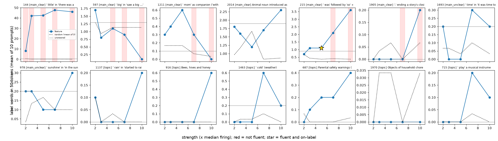

# Review rerun 1a: steering in units of median firing

> All feature labels are AI-written (by Claude) and have not been verified by a human.

Design, word lists and success rule were committed in `config.yaml` (`steering_v2`) before the run. 10 prompts, 3 random directions per feature, strengths [2, 3, 5, 7, 10] x each feature's median non-zero firing, 50 tokens.
Fluent threshold (rule: 2 x the 95th percentile of unsteered perplexity, 140 samples): **7.12** (unsteered median 2.45, 95th percentile 3.56).

**Rule.** *fluent*: a (feature, strength) cell is fluent if the median over prompts of the steered text's perplexity under the unsteered model is <= 2 x the 95th percentile of the perplexity of all unsteered samples in this run *on_label*: a cell is on-label if the steered text has more label words than the mean of the 3 random-direction texts on at least 9 of the 10 prompts (ties count against; one-sided sign test p = 0.011), and its mean label-word count also exceeds the unsteered mean *feature_succeeds*: a feature steers if at least one of the 5 strengths is both fluent and on-label (5 chances per feature, so a false pass has probability up to about 0.05 per feature) *claim*: 'steering reliably moves text toward the label' is supported for a group only if at least 5 of its 6 features steer; 2 to 4 = 'sometimes'; 0 or 1 = not supported. Counts are reported whatever they are.

## Result by group

| group | features that steer | verdict under the rule |
|---|---|---|
| main_clear | 1/6 (215) | not supported |
| main_unclear | 0/2 (none) | n/a (group of 2) |
| topic | 0/6 (none) | not supported |

## Every cell

hits = label words per 50 tokens, mean over prompts. wins = prompts (of 10) where the feature text has more label words than the mean of the random texts.

| feature | group | label | label words | k | vector length | unsteered hits | feature hits | random hits | wins | feature ppl | random ppl | fluent | on-label | success |
|---|---|---|---|---|---|---|---|---|---|---|---|---|---|---|
| 144 | main_clear | ' little' in 'there was a little boy/girl' | boy, girl, little | 2 | 1.90 | 0.5 | 8.0 | 0.4 | 7 | 43.3 | 58.1 | no | no | no |
| 144 | main_clear | ' little' in 'there was a little boy/girl' | boy, girl, little | 3 | 2.85 | 0.5 | 42.1 | 0.1 | 10 | 40.1 | 356.5 | no | yes | no |
| 144 | main_clear | ' little' in 'there was a little boy/girl' | boy, girl, little | 5 | 4.74 | 0.5 | 42.5 | 0.1 | 10 | 43.5 | 3428.6 | no | yes | no |
| 144 | main_clear | ' little' in 'there was a little boy/girl' | boy, girl, little | 7 | 6.64 | 0.5 | 47.7 | 0.1 | 10 | 53.3 | 7740.1 | no | yes | no |
| 144 | main_clear | ' little' in 'there was a little boy/girl' | boy, girl, little | 10 | 9.49 | 0.5 | 46.0 | 0.0 | 10 | 153.1 | 9810.5 | no | yes | no |
| 597 | main_clear | ' big' in 'saw a big ...' (encounter) | big, saw | 2 | 0.50 | 1.3 | 1.7 | 1.3 | 4 | 3.4 | 3.3 | yes | no | no |
| 597 | main_clear | ' big' in 'saw a big ...' (encounter) | big, saw | 3 | 0.75 | 1.3 | 0.8 | 0.9 | 4 | 4.5 | 4.1 | yes | no | no |
| 597 | main_clear | ' big' in 'saw a big ...' (encounter) | big, saw | 5 | 1.24 | 1.3 | 1.1 | 1.1 | 5 | 15.2 | 7.7 | no | no | no |
| 597 | main_clear | ' big' in 'saw a big ...' (encounter) | big, saw | 7 | 1.74 | 1.3 | 0.9 | 1.1 | 3 | 93.2 | 35.0 | no | no | no |
| 597 | main_clear | ' big' in 'saw a big ...' (encounter) | big, saw | 10 | 2.48 | 1.3 | 0.1 | 1.1 | 0 | 1078.6 | 150.7 | no | no | no |
| 1211 | main_clear | ' mom' as companion ('with her mom', 'her mom and dad') | dad, mom, mommy, mother, mum | 2 | 0.37 | 0.1 | 0.3 | 0.2 | 2 | 2.7 | 2.7 | yes | no | no |
| 1211 | main_clear | ' mom' as companion ('with her mom', 'her mom and dad') | dad, mom, mommy, mother, mum | 3 | 0.56 | 0.1 | 0.4 | 0.2 | 3 | 3.0 | 3.0 | yes | no | no |
| 1211 | main_clear | ' mom' as companion ('with her mom', 'her mom and dad') | dad, mom, mommy, mother, mum | 5 | 0.93 | 0.1 | 0.6 | 0.2 | 5 | 4.9 | 5.1 | yes | no | no |
| 1211 | main_clear | ' mom' as companion ('with her mom', 'her mom and dad') | dad, mom, mommy, mother, mum | 7 | 1.31 | 0.1 | 0.3 | 0.1 | 3 | 14.2 | 9.9 | no | no | no |
| 1211 | main_clear | ' mom' as companion ('with her mom', 'her mom and dad') | dad, mom, mommy, mother, mum | 10 | 1.87 | 0.1 | 0.0 | 0.0 | 0 | 349.2 | 53.9 | no | no | no |
| 2014 | main_clear | Animal noun introduced as protagonist in the opening sentence (fox, cat) | bear, bird, bunny, cat, cow, dog… | 2 | 0.16 | 1.9 | 1.8 | 1.0 | 4 | 2.6 | 2.6 | yes | no | no |
| 2014 | main_clear | Animal noun introduced as protagonist in the opening sentence (fox, cat) | bear, bird, bunny, cat, cow, dog… | 3 | 0.24 | 1.9 | 1.6 | 1.2 | 3 | 2.5 | 2.5 | yes | no | no |
| 2014 | main_clear | Animal noun introduced as protagonist in the opening sentence (fox, cat) | bear, bird, bunny, cat, cow, dog… | 5 | 0.40 | 1.9 | 1.2 | 1.7 | 2 | 2.7 | 2.9 | yes | no | no |
| 2014 | main_clear | Animal noun introduced as protagonist in the opening sentence (fox, cat) | bear, bird, bunny, cat, cow, dog… | 7 | 0.56 | 1.9 | 1.7 | 0.8 | 4 | 3.7 | 3.3 | yes | no | no |
| 2014 | main_clear | Animal noun introduced as protagonist in the opening sentence (fox, cat) | bear, bird, bunny, cat, cow, dog… | 10 | 0.80 | 1.9 | 2.3 | 0.9 | 5 | 4.3 | 4.3 | yes | no | no |
| 215 | main_clear | ' was' followed by 'so' + emotion after a mishap ('He was so sad') | angry, mad, sad, scared, so, upset… | 2 | 0.28 | 0.9 | 0.7 | 0.7 | 3 | 3.3 | 2.5 | yes | no | no |
| 215 | main_clear | ' was' followed by 'so' + emotion after a mishap ('He was so sad') | angry, mad, sad, scared, so, upset… | 3 | 0.42 | 0.9 | 1.1 | 0.4 | 5 | 3.2 | 2.7 | yes | no | no |
| 215 | main_clear | ' was' followed by 'so' + emotion after a mishap ('He was so sad') | angry, mad, sad, scared, so, upset… | 5 | 0.69 | 0.9 | 1.1 | 0.4 | 9 | 4.1 | 3.5 | yes | yes | **yes** |
| 215 | main_clear | ' was' followed by 'so' + emotion after a mishap ('He was so sad') | angry, mad, sad, scared, so, upset… | 7 | 0.97 | 0.9 | 2.1 | 0.4 | 10 | 11.8 | 5.4 | no | yes | no |
| 215 | main_clear | ' was' followed by 'so' + emotion after a mishap ('He was so sad') | angry, mad, sad, scared, so, upset… | 10 | 1.38 | 0.9 | 3.6 | 0.4 | 10 | 74.6 | 11.7 | no | yes | no |
| 1905 | main_clear | '.' ending a story's closing/moral sentence (e.g. 'happily ever after.') | after, end, ever, happily, learned, lesson… | 2 | 0.34 | 0.0 | 0.0 | 0.0 | 0 | 2.4 | 2.7 | yes | no | no |
| 1905 | main_clear | '.' ending a story's closing/moral sentence (e.g. 'happily ever after.') | after, end, ever, happily, learned, lesson… | 3 | 0.51 | 0.0 | 0.0 | 0.0 | 0 | 2.5 | 2.8 | yes | no | no |
| 1905 | main_clear | '.' ending a story's closing/moral sentence (e.g. 'happily ever after.') | after, end, ever, happily, learned, lesson… | 5 | 0.85 | 0.0 | 0.0 | 0.1 | 0 | 3.4 | 4.7 | yes | no | no |
| 1905 | main_clear | '.' ending a story's closing/moral sentence (e.g. 'happily ever after.') | after, end, ever, happily, learned, lesson… | 7 | 1.19 | 0.0 | 0.0 | 0.0 | 0 | 7.2 | 8.3 | no | no | no |
| 1905 | main_clear | '.' ending a story's closing/moral sentence (e.g. 'happily ever after.') | after, end, ever, happily, learned, lesson… | 10 | 1.70 | 0.0 | 0.2 | 0.1 | 2 | 58.2 | 31.5 | no | no | no |
| 1693 | main_unclear | ' time' in 'it was time to go home' | home, time | 2 | 0.12 | 0.2 | 0.2 | 0.1 | 2 | 2.3 | 2.4 | yes | no | no |
| 1693 | main_unclear | ' time' in 'it was time to go home' | home, time | 3 | 0.18 | 0.2 | 0.0 | 0.1 | 0 | 2.3 | 2.5 | yes | no | no |
| 1693 | main_unclear | ' time' in 'it was time to go home' | home, time | 5 | 0.29 | 0.2 | 0.0 | 0.0 | 0 | 2.7 | 2.6 | yes | no | no |
| 1693 | main_unclear | ' time' in 'it was time to go home' | home, time | 7 | 0.41 | 0.2 | 0.3 | 0.1 | 2 | 2.8 | 2.9 | yes | no | no |
| 1693 | main_unclear | ' time' in 'it was time to go home' | home, time | 10 | 0.59 | 0.2 | 0.2 | 0.0 | 2 | 3.2 | 2.9 | yes | no | no |
| 978 | main_unclear | ' sunshine' in 'in the sunshine' | sun, sunny, sunshine | 2 | 0.06 | 0.2 | 0.2 | 0.0 | 2 | 2.5 | 2.4 | yes | no | no |
| 978 | main_unclear | ' sunshine' in 'in the sunshine' | sun, sunny, sunshine | 3 | 0.09 | 0.2 | 0.2 | 0.1 | 2 | 2.2 | 2.4 | yes | no | no |
| 978 | main_unclear | ' sunshine' in 'in the sunshine' | sun, sunny, sunshine | 5 | 0.15 | 0.2 | 0.1 | 0.2 | 1 | 2.4 | 2.4 | yes | no | no |
| 978 | main_unclear | ' sunshine' in 'in the sunshine' | sun, sunny, sunshine | 7 | 0.21 | 0.2 | 0.1 | 0.1 | 1 | 2.3 | 2.6 | yes | no | no |
| 978 | main_unclear | ' sunshine' in 'in the sunshine' | sun, sunny, sunshine | 10 | 0.31 | 0.2 | 0.3 | 0.1 | 3 | 2.5 | 2.5 | yes | no | no |
| 1137 | topic | ' rain' in 'started to rain' | rain, raindrops, rained, raining, rainy | 2 | 0.09 | 0.0 | 0.1 | 0.1 | 1 | 2.5 | 2.6 | yes | no | no |
| 1137 | topic | ' rain' in 'started to rain' | rain, raindrops, rained, raining, rainy | 3 | 0.14 | 0.0 | 0.0 | 0.0 | 0 | 2.5 | 2.4 | yes | no | no |
| 1137 | topic | ' rain' in 'started to rain' | rain, raindrops, rained, raining, rainy | 5 | 0.23 | 0.0 | 0.0 | 0.0 | 0 | 2.5 | 2.6 | yes | no | no |
| 1137 | topic | ' rain' in 'started to rain' | rain, raindrops, rained, raining, rainy | 7 | 0.33 | 0.0 | 0.0 | 0.0 | 0 | 2.8 | 2.5 | yes | no | no |
| 1137 | topic | ' rain' in 'started to rain' | rain, raindrops, rained, raining, rainy | 10 | 0.47 | 0.0 | 0.2 | 0.0 | 2 | 3.1 | 2.8 | yes | no | no |
| 916 | topic | Bees, hives and honey | bee, beehive, bees, hive, hives, honey | 2 | 0.08 | 0.0 | 0.0 | 0.0 | 0 | 2.8 | 2.3 | yes | no | no |
| 916 | topic | Bees, hives and honey | bee, beehive, bees, hive, hives, honey | 3 | 0.12 | 0.0 | 0.0 | 0.0 | 0 | 2.4 | 2.7 | yes | no | no |
| 916 | topic | Bees, hives and honey | bee, beehive, bees, hive, hives, honey | 5 | 0.20 | 0.0 | 0.0 | 0.0 | 0 | 2.5 | 2.5 | yes | no | no |
| 916 | topic | Bees, hives and honey | bee, beehive, bees, hive, hives, honey | 7 | 0.27 | 0.0 | 0.0 | 0.0 | 0 | 2.6 | 2.5 | yes | no | no |
| 916 | topic | Bees, hives and honey | bee, beehive, bees, hive, hives, honey | 10 | 0.39 | 0.0 | 0.6 | 0.0 | 3 | 2.5 | 2.6 | yes | no | no |
| 1463 | topic | ' cold' (weather) | chilly, cold, colder, freezing, icy, snow… | 2 | 0.10 | 0.2 | 0.0 | 0.0 | 0 | 2.2 | 2.7 | yes | no | no |
| 1463 | topic | ' cold' (weather) | chilly, cold, colder, freezing, icy, snow… | 3 | 0.15 | 0.2 | 0.0 | 0.0 | 0 | 2.6 | 2.2 | yes | no | no |
| 1463 | topic | ' cold' (weather) | chilly, cold, colder, freezing, icy, snow… | 5 | 0.25 | 0.2 | 0.0 | 0.0 | 0 | 2.5 | 2.5 | yes | no | no |
| 1463 | topic | ' cold' (weather) | chilly, cold, colder, freezing, icy, snow… | 7 | 0.35 | 0.2 | 0.6 | 0.1 | 4 | 2.8 | 2.5 | yes | no | no |
| 1463 | topic | ' cold' (weather) | chilly, cold, colder, freezing, icy, snow… | 10 | 0.50 | 0.2 | 0.2 | 0.0 | 1 | 3.0 | 2.8 | yes | no | no |
| 687 | topic | Parental safety warnings ("don't go too close"); promotes 'dangerous' | careful, danger, dangerous, safe, warned, warning | 2 | 0.07 | 0.0 | 0.0 | 0.1 | 0 | 2.5 | 2.4 | yes | no | no |
| 687 | topic | Parental safety warnings ("don't go too close"); promotes 'dangerous' | careful, danger, dangerous, safe, warned, warning | 3 | 0.11 | 0.0 | 0.1 | 0.0 | 1 | 2.3 | 2.5 | yes | no | no |
| 687 | topic | Parental safety warnings ("don't go too close"); promotes 'dangerous' | careful, danger, dangerous, safe, warned, warning | 5 | 0.18 | 0.0 | 0.2 | 0.0 | 2 | 2.4 | 2.4 | yes | no | no |
| 687 | topic | Parental safety warnings ("don't go too close"); promotes 'dangerous' | careful, danger, dangerous, safe, warned, warning | 7 | 0.25 | 0.0 | 0.2 | 0.0 | 2 | 2.7 | 2.6 | yes | no | no |
| 687 | topic | Parental safety warnings ("don't go too close"); promotes 'dangerous' | careful, danger, dangerous, safe, warned, warning | 10 | 0.36 | 0.0 | 0.4 | 0.0 | 4 | 2.9 | 2.5 | yes | no | no |
| 1970 | topic | Objects of household chores (dishes, laundry, weeds) | chore, chores, clothes, dish, dishes, floor… | 2 | 0.06 | 0.0 | 0.0 | 0.0 | 0 | 2.5 | 2.6 | yes | no | no |
| 1970 | topic | Objects of household chores (dishes, laundry, weeds) | chore, chores, clothes, dish, dishes, floor… | 3 | 0.09 | 0.0 | 0.0 | 0.0 | 0 | 2.6 | 2.5 | yes | no | no |
| 1970 | topic | Objects of household chores (dishes, laundry, weeds) | chore, chores, clothes, dish, dishes, floor… | 5 | 0.14 | 0.0 | 0.0 | 0.0 | 0 | 2.3 | 2.5 | yes | no | no |
| 1970 | topic | Objects of household chores (dishes, laundry, weeds) | chore, chores, clothes, dish, dishes, floor… | 7 | 0.20 | 0.0 | 0.0 | 0.0 | 0 | 2.9 | 2.4 | yes | no | no |
| 1970 | topic | Objects of household chores (dishes, laundry, weeds) | chore, chores, clothes, dish, dishes, floor… | 10 | 0.28 | 0.0 | 0.0 | 0.0 | 0 | 2.8 | 2.7 | yes | no | no |
| 715 | topic | ' play' a musical instrument | drum, drums, flute, guitar, instrument, music… | 2 | 0.08 | 0.0 | 0.0 | 0.0 | 0 | 2.4 | 2.5 | yes | no | no |
| 715 | topic | ' play' a musical instrument | drum, drums, flute, guitar, instrument, music… | 3 | 0.13 | 0.0 | 0.0 | 0.0 | 0 | 2.5 | 2.4 | yes | no | no |
| 715 | topic | ' play' a musical instrument | drum, drums, flute, guitar, instrument, music… | 5 | 0.21 | 0.0 | 0.0 | 0.0 | 0 | 2.3 | 2.5 | yes | no | no |
| 715 | topic | ' play' a musical instrument | drum, drums, flute, guitar, instrument, music… | 7 | 0.29 | 0.0 | 0.2 | 0.0 | 1 | 2.6 | 2.8 | yes | no | no |
| 715 | topic | ' play' a musical instrument | drum, drums, flute, guitar, instrument, music… | 10 | 0.42 | 0.0 | 0.1 | 0.0 | 1 | 2.8 | 2.6 | yes | no | no |

## Sample text (prompts 0 and 4; feature and first random direction)

### Feature 144: ' little' in 'there was a little boy/girl'

**Prompt:** Once upon a time, there was a little girl named Lily.

| run | hits | ppl | text |
|---|---|---|---|
| unsteered | 1 | 1.9 |  She loved to play with her toys and share them with her friends. One day, Lily's little brother, Jack, came into her room and accidentally knocked over her favorite toy. Lily got very angry and started to cry. ⏎  ⏎ Jack's mom |
| feature 2x | 36 | 19.8 |  She lived in a house with her mommy and boy girl. girl girl girl named Rose. girl girl girl girl girl girl girl girl girl girl girl girl girl girl girl girl girl girl girl girl girl girl girl girl girl girl girl girl girl girl girl |
| random 2x | 0 | 86.1 |  She loved to swim in the water and getting in the water. One a big, scary and scary choice. The scary, and a scary, so scared her.  ⏎  ⏎  so the big, scaredchight and the big popped!  ⏎  |
| feature 3x | 40 | 159.5 |  girl boy, bunny bunny bunny bunny bunny animals. girl girl house. girl boy girl girl girl girl girl girl girl girl girl girl girl girl girl girl girl girl girl girl girl girl girl girl girl girl girl girl girl girl girl girl girl girl girl girl |
| random 3x | 0 | 765.2 |  sad and a big and a big, but so in a hall. a time and a big, and a silly one a!"." in a huge and a lot of a big and a much so much. from a big and a no a cro |
| feature 5x | 50 | 31.7 |  girl girl boy boy girl girl girl girl girl girl girl girl girl girl girl girl girl girl girl girl girl girl girl girl girl girl boy girl girl girl girl girl girl boy girl girl girl girl girl boy girl girl girl girl girl girl girl girl girl girl |
| random 5x | 0 | 8538.4 |  a a a happy a a happy time in a wide." a big and a bad. and a water tub in a it wide a so wide wide him. so. going in a deep station the in the big and water it a wide that a |
| feature 7x | 45 | 297.9 |  girl boy girl girl girl boy boy girl girl boy rabbit mouse girl boy boy boy boy girl boy girl girl boy girl boy girl girl girl boy boy girl girl girl boy girl girl girl girl girl boy like bunny rabbit girl girl girl girl boy girl girl girl |
| random 7x | 0 | 55255.5 |  him a a wide him a world a so him a him a a sleepy a wide a wide him a him past him everyone stop a wide a wide him it at a a him a deep a wide him him everyone the deep in a! him a |
| feature 10x | 46 | 354.3 |  boy boy boy boy girl girl boy boy girl girl girl rabbit mouse rabbit girl girl boy boy boy girl boy boy girl boy girl girl girl girl girl boy girl girl pig girl boy girl boy girl girl girl boy girl girl boy boy boy girl boy boy girl |
| random 10x | 0 | 33776.5 |  him him a a us him past him a him him him him fear of him him him him him him him him him him him him him him him him him him a scared him him him mess him him him into him him to him him your him |

**Prompt:** There was a big tree near the house. Under the tree,

| run | hits | ppl | text |
|---|---|---|---|
| unsteered | 0 | 2.6 |  there was a small rabbit. The rabbit was hungry. It looked for food to eat. The rabbit saw a carrot in a basket and said, "I want to eat that carrot, but it is too high for me." ⏎  ⏎ Then, a |
| feature 2x | 1 | 49.3 |  there was a green caterpillar named Jack. Jack lived in the tree, like a caterpillar like him. One day, he was very small, with a brown ant ants. Jack boy named Lily, who came into her crib, who was so |
| random 2x | 0 | 317.5 |  yummy cold, happy and sound joy. There, and happy full of bubbles. The bubbles and happy joy. Everyone, and bubbles, and bubbles pop, and everyone!!" ⏎  ⏎  so happy and all their happy! Everyone, so wide- |
| feature 3x | 48 | 57.2 |  Lily girl girl girl boy. girl boy girl girl girl girl girl girl girl girl girl boy girl girl girl girl girl girl girl girl boy girl boy girl girl girl girl girl girl girl girl boy girl girl girl boy girl girl girl girl girl girl girl girl |
| random 3x | 0 | 1540.1 |  a happy, hungry. happy to a wide and a empty space of a. ⏎ . filling him a empty and a big.. in the big from the big, and a happy so in the fill him. and the water the big and the |
| feature 5x | 37 | 282.7 |  girl rabbit bunny bunny, bunny boy bunny bunny bunny bunny. girl boy boy boy rabbit animals girl boy girl girl girl girl girl girl girl girl boy girl bunny girl girl girl girl boy girl girl girl girl girl girl girl boy girl girl girl girl girl girl |
| random 5x | 1 | 36715.0 |  a sleepy a sleepy a little him the a cool it a small it in a big and a a wide. a a gr, a deep so sleepy him a a sleepy. us the a deep him a a a big and a a deep a time |
| feature 7x | 50 | 51.0 |  boy girl girl girl girl girl girl girl girl girl girl girl girl girl girl girl boy boy girl girl girl girl girl girl girl boy girl boy girl girl girl girl boy girl girl girl girl girl girl girl girl girl girl girl girl girl girl girl boy girl |
| random 7x | 0 | 23833.6 |  it a wide and a him one some him a a a happy him into him the fill up a a a everyone in a full him him a a and from him and a a wide him him a wide him a us up a a a sleepy his |
| feature 10x | 46 | 246.2 |  boy bunny girl boy girl boy boy boy rabbit girl boy girl boy girl girl girl girl boy girl boy boy girl boy boy boy boy girl boy girl girl bunny boy boy boy bunny boy boy boy boy boy girl girl girl girl girl girl girl boy boy boy |
| random 10x | 0 | 13945.3 |  him a sleepy him him a mess him into a a him him him him scared him a him a wide him him a a deep him him him a a him him him him a a wide him him a him him!" him the him him him him |

### Feature 597: ' big' in 'saw a big ...' (encounter)

**Prompt:** Once upon a time, there was a little girl named Lily.

| run | hits | ppl | text |
|---|---|---|---|
| unsteered | 0 | 1.8 |  She loved to play with her toys all day long. One day, she wanted to paint a picture of her family. She asked her mommy, "Can I paint my picture, please?" ⏎  ⏎ Her mommy said, "Yes, you |
| feature 2x | 2 | 2.6 |  She loved to play with her toys and sing songs. One day, she saw a big ball outside. She wanted to play with it, so she went inside to get a better look. ⏎  ⏎ Suddenly, the ball started to roll towards the road |
| random 2x | 1 | 2.1 |  She loved to play with her toys and eat candy. One day, Lily's mommy showed her a big box of candy. Lily was very happy to see all the candy. ⏎  ⏎ Lily's mommy said, "Lily, you |
| feature 3x | 1 | 2.5 |  She loved to play outside in the garden. One day, she saw a butterfly flying in the air. Lily wanted to catch the butterfly, but she couldn't. She felt sad because she thought she might get dizzy. ⏎  ⏎ Just then, |
| random 3x | 1 | 2.1 |  She loved to play with her toys and eat candy. One day, her mom gave her a big jar of candy for lunch. Lily was so happy and asked her mom, "Can I have a candy, please?" ⏎  ⏎ Her mom said, |
| feature 5x | 1 | 27.9 |  Lily wanted to be a hero hero. Lily said, "I can help with magic dust. If you put dirt on the ground." ⏎  ⏎ Lily saw a spark toy car in the space. Lily had to sneeze. "Oh, |
| random 5x | 0 | 6.2 |  She was playing with her toys and thinking about her favorite toy. But her mom came home and her mom was angry.  ⏎  ⏎ Lily's mom told her that one toy was for her birthday. Lily was sad and didn't want to play |
| feature 7x | 0 | 84.6 |  Lily, brown cat cat who wanted to play. The cat came to the fire. The fire ball, and scary steam. The water flood water with water. The fire. The water came out. BOOM! BOOM!" lightning came in the |
| random 7x | 0 | 31.3 |  Her family was a happy family family who loved pizza to eat yummy food. ⏎  |
| feature 10x | 0 | 1054.5 | , scary monster came in mud cloud splashed water water. SPL scary, and scary monster jump bad monster that grow dinosaur. bear, fire monster in the tree. It grow. " fire, scary monster!", scary animal of rocks and scary monster |
| random 10x | 0 | 1008.5 |  ⏎  ⏎ Possible story day, play his toy, toy airplanes had his toy and toy airplanes. ⏎  |

**Prompt:** There was a big tree near the house. Under the tree,

| run | hits | ppl | text |
|---|---|---|---|
| unsteered | 0 | 2.1 |  there was a small hole. A little bird lived in the hole. The bird was sad because it lost its pretty nest. ⏎  ⏎ One day, a friendly squirrel came to the tree. The squirrel said, "Welcome, bird! I will help |
| feature 2x | 1 | 2.6 |  there was a door. A girl named Lily wanted to open the door. She looked inside and saw a small, red ball. The ball was near the window. Lily wanted to take the ball to her home. ⏎  ⏎ Lily tried to push |
| random 2x | 0 | 3.4 |  there was a cozy bed. A little girl named Lily liked to go to sleep. One day, she was sleeping under the tree. ⏎  ⏎ In the tree, there was a little boy named Tom. Tom was not sleepy. He did not like |
| feature 3x | 0 | 2.5 |  there was a box. A boy named Tom came to visit. Tom was very excited to see the box. He wanted to see what was inside. ⏎  ⏎ Tom said, "I wonder what is in there?" He opened the box. Inside was |
| random 3x | 1 | 3.4 |  there was a big, juicy apple. But one day, a little bird came and tried to eat the apple, but it was too hard. The bird was very sad and hungry. ⏎  ⏎ Then, the bird heard a small voice call to him |
| feature 5x | 0 | 16.5 |  there was a pit. In the pit, there was a ball ball. Tom, ready to pour water. Tom wanted to soak to his water. Tom could splash and get all of his water ball. ⏎  ⏎ Tom jumped out and said, " |
| random 5x | 0 | 4.9 |  there was a little boy named Tim. He was going to play with his toy cars. Tim had a toy car, and he was excited to play with them. ⏎  ⏎ His mom was a good boy. She said, "Toys are for |
| feature 7x | 0 | 56.4 |  for ice cream. kids were in the pool. A bear, came in to steal ice cream cone. The slide, yummy ice cream truck. The ice cream cone fell in the pool. The dog, jumped and of ice ice. ⏎  ⏎  |
| random 7x | 2 | 11.3 |  a mom had a food for dinner. The mom was a big dinner. ⏎  ⏎ A little bird named seeds. The little bird wanted to eat for dinner. The mom saw the food and the little bird got to the food. ⏎  ⏎ The mom |
| feature 10x | 0 | 2197.5 |  high rock. waves reached in hole., and pill puddle. waves came push the ball. ⏎  puddle. " float water. " water spl spl water. SPL splash!" he ball. SPL, wet spl balls spl., spl spl |
| random 10x | 1 | 147.5 |  the toy, big toys were their time to play. The two kids, their family dream of their friends and games the day. ⏎  ⏎  day, dinner time, dinner-s mom played by the toy. His favorite snack for dinner, and his |

### Feature 1211: ' mom' as companion ('with her mom', 'her mom and dad')

**Prompt:** Once upon a time, there was a little girl named Lily.

| run | hits | ppl | text |
|---|---|---|---|
| unsteered | 1 | 1.8 |  She loved to wear her favorite skirt every day. One day, her mommy said, "Lily, let's go to the park and play!" Lily was so happy and said, "Yay! Let's go!"  ⏎  ⏎ They |
| feature 2x | 2 | 1.4 |  She loved to play outside in the sun. One day, she found a shiny rock on the ground. She picked it up and showed it to her mommy. ⏎  ⏎ "Look, mommy! I found a pretty rock!" said Lily. |
| random 2x | 0 | 2.4 |  She loved to play with her toys and run around outside all day. One day, Lily's friend Lily came over to play with her. They played with dolls and blocks and cars. They had so much fun that they didn't notice the time passing |
| feature 3x | 0 | 2.2 |  She loved to go on tours with her family. One day, they went on a tour to the beach. Lily was happy because she loved animals. ⏎  ⏎ When they arrived at the beach, Lily saw a beautiful butterfly. She wanted to touch it |
| random 3x | 0 | 1.9 |  Lily loved to play outside in the park. She would run around and play with her friends every day. One day, Lily saw a big tree and wanted to climb it. She climbed up and up until she was very high.  ⏎  ⏎ But |
| feature 5x | 1 | 3.7 |  She loved to watch the birds in the park. One day, she went to the park with her mommy. She put the leash on the leash, but it was too tight.  ⏎  ⏎ "I don't want to play on the slide |
| random 5x | 0 | 7.2 |  She loved to play with her toys all day long. She would build towers, walls, and windows, and even houses with her family. They would even have a unique style of a little girl with a big window. ⏎  ⏎ One day, Lily |
| feature 7x | 1 | 3.7 |  She loved to play in the kitchen and taste the yummy food. One day, she was making cookies with her mommy.  ⏎  ⏎ Lily asked, "Can I taste the warm milk in the warm milk?"  ⏎  ⏎ "Sure |
| random 7x | 0 | 9.7 |  She loved to play with her toys and go on all kinds of luxury dresses. She had a fancy dress that could be anything she could imagine anything she wanted. One day, Lily decided to go on a big white bed, upstalk, to |
| feature 10x | 0 | 118.0 |  She loved to go to the's room. She wanted to clean themy's paint.my said she can still get new paint.my said she had to get new paper andmy's use amy.mymy told her not to leave things |
| random 10x | 0 | 120.2 |  Lily loved to play with all day on the slide, go on the big pink all around her house, anyone! She would slide on the tricycle, going all the whole other people and going on on, unic twins all around. They all day |

**Prompt:** There was a big tree near the house. Under the tree,

| run | hits | ppl | text |
|---|---|---|---|
| unsteered | 0 | 2.6 |  there was a little bird. The bird was sad and was very pale. One day, the bird saw a big bowl of water on the ground. The bird was thirsty, so it flew down to get a drink.  ⏎  ⏎ The bird drank |
| feature 2x | 0 | 3.5 |  there was a little girl. She saw a bird in the nest. The bird was yellow and had a pretty voice. The little girl smiled and said hello. She liked the bird's voice. ⏎  ⏎ The sun got warm on the bird's wings |
| random 2x | 0 | 3.4 |  there was a small house. In the house, there were two kids. They were twins. They liked to play games. They were very happy. ⏎  ⏎ One day, the twins found a big, fun game. The twins played on the game |
| feature 3x | 0 | 4.0 |  there was a lot of food. A little girl named Lily wanted to have some food. She saw a big, juicy apple. But the house had only a little house. ⏎  ⏎ In the house, there was a little boy named Tom. Tom |
| random 3x | 0 | 3.0 |  there was a bird and a cat. The bird wanted to fly high up in the sky and see the world. The cat wanted to stay and play with the bird. So, the bird and the cat would play together in the garden. They would |
| feature 5x | 0 | 3.9 |  there was a puddle. The puddle was clear. ⏎  ⏎ A little boy came to the puddle. He wanted to play. He put a cloth on the cloth. The boy put the cloth on the first. The cloth made the cloth |
| random 5x | 0 | 3.5 |  there was a small girl named Lily. Lily was very happy. She sat on the big tree and took a long nap. She had a lot of friends, like the other kids. ⏎  ⏎ One day, a boy named Max came to play with |
| feature 7x | 1 | 24.0 |  they were making milk. They went to the's door. ⏎  ⏎ "Did you open the door?" said. ⏎ "Yes, we are happy?" Lily and dad said. "Do you can open this door?" ⏎  ⏎ "Yes, please |
| random 7x | 0 | 5.9 |  a bird would fly in the sky and play with all the animals. One day, the bird decided to have a friend. The bird was very happy and loved to fly and play with everyone. ⏎  ⏎ The birds would fly in the park and everyone |
| feature 10x | 0 | 138.1 |  it was dry. The sky was not the sun. ⏎ "my, can't go to the house. The little girl said, "my, we don't allow night is not to permit that."my said,.mymymy was still |
| random 10x | 0 | 60.4 |  all animals would come out to live on all of the tree. The little bird would sit on one of the animals, including the little bunny bunny, outed down, and everyone on the bed. The little children would come and cover themselves all the |

### Feature 2014: Animal noun introduced as protagonist in the opening sentence (fox, cat)

**Prompt:** Once upon a time, there was a little girl named Lily.

| run | hits | ppl | text |
|---|---|---|---|
| unsteered | 0 | 2.0 |  She loved to play outside in the park. One day, she found a beautiful crystal on the ground. It was shiny and blue, and it had a mild smell. ⏎  ⏎ Lily picked up the crystal and showed it to her friend, Tim |
| feature 2x | 0 | 2.6 |  She loved to play dress-up and pretend she was in a fashion shop. One day, she found a weird-looking hat in her toy box. It was small and had strange stripes on it. She put it on and pretended to be a |
| random 2x | 0 | 1.8 |  She loved to explore the forest near her house. One day, she went on a walk and saw a pretty butterfly. She followed the butterfly and found a shiny rock on the ground.  ⏎  ⏎ Lily picked up the rock and showed it to |
| feature 3x | 0 | 2.0 |  She loved to play outside in the park. One day, she saw a big, red balloon floating in the sky. The balloon was so beautiful and she wanted it. ⏎  ⏎ Lily asked her mommy, "Can I have the balloon, |
| random 3x | 0 | 2.2 |  She loved to play outside in the sunshine. One day, she saw a big rainbow in the sky. It was very pretty and made her smile. But then, she saw a boy named Timmy who was looking at the rainbow too. ⏎  ⏎  |
| feature 5x | 0 | 2.2 |  She loved to play outside in the park. One day, she found a shiny rock in the grass. It was very pretty and sparkly. Lily wanted to keep the rock, but she didn't have a key to unlock it.  ⏎  ⏎  |
| random 5x | 0 | 1.9 |  She loved to play outside in the park. One day, she saw a beautiful butterfly with pretty colors. She wanted to catch it, so she ran after it. ⏎  ⏎ Lily caught the butterfly and was so happy. But then, she saw |
| feature 7x | 0 | 2.0 |  She loved to play with her toys and go on adventures. One day, she went to the park with her mommy and daddy. They brought a basket with them some snacks and a snack. When they got to the park, Lily saw a big |
| random 7x | 0 | 3.1 |  She went to a restaurant with her mommy and daddy. Their restaurant had a big table where they had to order food. Lily was very hungry and wanted to eat all the food. When they sat down at the table, they ordered their food. |
| feature 10x | 0 | 2.1 |  She loved to play outside in the garden. One day, she found a pretty flower and decided to pick it. She picked it up and put it in her mouth.  ⏎  ⏎ As she was walking, she saw a butterfly. She wanted to |
| random 10x | 0 | 3.8 |  She loved to play outside in the sun. One day, she saw a big, smelly cloud in the sky. Lily knew that meant gas could be near the gas. She knew that gas can make the earth run a little bit. ⏎  ⏎  |

**Prompt:** There was a big tree near the house. Under the tree,

| run | hits | ppl | text |
|---|---|---|---|
| unsteered | 0 | 2.4 |  there was a little girl named Lily. Lily was playing with her toys in her room. She saw her mom and dad looking sad. They seemed alone. ⏎  ⏎ Lily went to her mom and asked, "Mom, can I help you with |
| feature 2x | 5 | 2.5 |  there was a bone. A big, green, friendly dog lived in the house. The dog was sad because he wanted to play with the bone. ⏎  ⏎ One day, the dog saw a little bird inside the house. The bird was sad because |
| random 2x | 1 | 2.5 |  there was a little boy named Timmy. Timmy loved to play outside in the big yard. One day, Timmy saw a bird fly into the house. He said, "Hello, birdie! You are so big and yellow!" ⏎  |
| feature 3x | 1 | 2.5 |  there was a thin cat named Tom. Tom was sad because he could not find his stick. He looked under the tree, but it was not there. He looked under the stick, but it was not there. ⏎  ⏎ Tom decided to find his |
| random 3x | 0 | 2.2 |  there was a hole. In the hole lived a small girl named Lucy. Lucy loved to play near the hole. Every day, she would find something new to play near the hole. ⏎  ⏎ One day, Lucy found a big, shiny rock. |
| feature 5x | 4 | 3.2 |  there was a small bird who had a hurt wing. The bird could not fly and it could not fly. The bird could not help itself. It needed help, but it could not fly. The bird wanted to find a new home. ⏎  ⏎  |
| random 5x | 3 | 3.1 |  there was a small house. In the house lived a big lion. The lion had a job to catch bugs. He was very strong and could eat all the bugs in the house. ⏎  ⏎ One sunny day, the lion saw his friend, a |
| feature 7x | 0 | 3.0 |  there was a pot. The pot was not a pot, but a little bug. The bug liked to play in the dirt. One day, the bug saw a flower. The bug wanted to smell the flower. The bug found a big pot and |
| random 7x | 0 | 2.7 |  there was a house with a chimney. The roof of the house was very tall. The house was made of bricks. ⏎  ⏎ One day, a little boy named Tim wanted to play near the roof of the house. He was very brave and |
| feature 10x | 5 | 4.2 |  there was a bird. The bird was very hungry. It saw a bird. The bird saw a big tree. The bird started to pray. The tree said, "Tree, you have food. I have food in the tree. Eat the food |
| random 10x | 0 | 4.3 |  there was a small house. In the house, a family of mice lived. The family of mice loved their home and everyone loved them. The family was happy and everyone was grateful for the family. ⏎  |

### Feature 215: ' was' followed by 'so' + emotion after a mishap ('He was so sad')

**Prompt:** Once upon a time, there was a little girl named Lily.

| run | hits | ppl | text |
|---|---|---|---|
| unsteered | 1 | 1.9 |  She loved to play outside in the park. One day, she met a boy named Timmy. They played together on the swings and the slide. But then, Lily saw a big dog and started to tremble. She was scared of the dog |
| feature 2x | 0 | 2.3 |  She loved playing outside in the sun. One day, she was playing with her toy car when her mom called her out.  ⏎  ⏎ "Lily, come inside now!" her mom said. ⏎  ⏎ Lily paused and looked at her mom |
| random 2x | 0 | 2.4 |  She loved to wear her favorite pink dress every day. One day, her mom told her she had to wash the dress. Lily didn't want to, but her mom said it was important to keep it clean. ⏎  ⏎ Lily was very excited |
| feature 3x | 0 | 3.3 |  She loved playing outside in the sun, especially in the summer. One day, she was getting ready for a special day. ⏎  ⏎ She asked her mom, "Can I have some water to cool down?" ⏎  ⏎ Her mom replied, "Yes |
| random 3x | 1 | 2.7 |  She loved to explore the forest near her house. One day, she was walking in the forest when she found a small mouse. Lily didn't know the mouse, so she picked it up and put it in a little sack. ⏎  ⏎ Lily |
| feature 5x | 1 | 4.7 |  She loved to play outside and explore the forest near her house. One day, she saw a small animal. It was very black and seemed very scared. But Lily was brave and wanted to keep following it.  ⏎  ⏎ Suddenly, the noise of |
| random 5x | 0 | 3.0 |  She had a lively room with a big backyard. Every day, Lily would play in her room all by herself. She had lots of toys and games to play with. ⏎  ⏎ One day, Lily's little brother Max came into her room. Max |
| feature 7x | 1 | 10.4 |  She loved going out in the garden and looking for the perfect place to settle down. She was so happy to find the perfect spot.  ⏎  ⏎ But then, in the evening the same morning she was gone! She had gone to the meadow |
| random 7x | 0 | 4.2 |  She had a regular room with a big room. But she didn't like to share her toys. One day, Lily was playing with her dolls and accidentally knocked over her cupboard. She broke the whole cupboard! ⏎  ⏎ Lily's mom |
| feature 10x | 2 | 74.4 |  She very lonely in her red day. But then something very special about her friends playing with a ball just like in the same one one for the morning. Lily so happy to see her friends playing right so there. Suddenly, a very friendly voice calling |
| random 10x | 0 | 20.3 |  She had her pale age and all in it. One day, Lily was playing in the bathroom and felt funny in the long turn. She giggled and giggled.  ⏎  ⏎ From then on, Lily was clean from her lotiontubs |

**Prompt:** There was a big tree near the house. Under the tree,

| run | hits | ppl | text |
|---|---|---|---|
| unsteered | 0 | 2.1 |  there was a big puddle. The puddle had many fish inside. The fish was very happy to be in the puddle. They liked to play in the water. ⏎  ⏎ One day, a little girl named Lily came to the house. |
| feature 2x | 0 | 3.9 |  there was a tap. The tap was very strong and made the tree happy. One day, a little girl named Sue found the tap. She knew the tap was special, but now it was not for playing. It was starting to rot. ⏎  |
| random 2x | 1 | 3.7 |  a bird would sing a song. The bird was very pretty and had a blue light. ⏎  ⏎ One day, the bird saw a small house. It looked scared and lonely. The bird wanted to help the bird. A kind lady saw the bird |
| feature 3x | 2 | 2.7 |  there was a small pebble. The pebble was very sad. It wanted to be strong and in the same place. ⏎  ⏎ One day, a kind bird saw the sad pebble by the tree. The bird flew down and |
| random 3x | 1 | 2.7 |  there was a small house. It was in the garden. The house had a little girl named Lily. They liked to play under the house. ⏎  ⏎ One day, Lily saw a little boy named Tim. Tim was sad. He said, " |
| feature 5x | 1 | 3.9 |  there was a little bird. The bird had a big red beak. It was very pretty and its beak was very strong. But then, it started to rain. The little bird was still wet and sad.  ⏎  ⏎ The little bird |
| random 5x | 0 | 3.0 |  there was a small house. It was a happy family. There was mum, dad, and their daughter, Mia. Mia loved to play in the garden. She loved to run and jump. ⏎  ⏎ One day, Mia was playing in the garden |
| feature 7x | 1 | 7.7 |  a lot of dirt. The little girl who lived in the house too weak. She was all alone and scared. ⏎  ⏎ Suddenly, a kind old man walking by. He saw the little girl and asked, "Are you a brave little girl?" |
| random 7x | 0 | 6.9 |  there was a small crack. It was very quiet and clear. Lily was happy to see the other side. She was also living there. ⏎  ⏎ Lily wanted to play in her house. She picked up some toys and put it in a box |
| feature 10x | 4 | 60.7 |  a very loud noise. It like a roar! He was so scared, so scared that he even bumbling in the only the park's red light.  ⏎  ⏎ But then suddenly, a very loud noise coming from the tree out of a bit |
| random 10x | 0 | 11.1 |  Lily played. She had She seen it again. She was happy. ⏎  ⏎ One day, Lily was playing in the kitchen. She was being bossy. She pretended she was in Lily's room. She was pretending she was in the house. |

### Feature 1905: '.' ending a story's closing/moral sentence (e.g. 'happily ever after.')

**Prompt:** Once upon a time, there was a little girl named Lily.

| run | hits | ppl | text |
|---|---|---|---|
| unsteered | 0 | 2.2 |  She loved to play outside in her garden. One day, she found a purple flower and picked it. She wanted to give it to her mom, but she was scared it might get hurt.  ⏎  ⏎ Lily's mom saw her looking at |
| feature 2x | 0 | 2.4 |  She loved to play with her toys and have fun. One day, she found a magic wand in the attic. She was very happy and wondered what it could do. ⏎  ⏎ The next day, Lily saw a little birdie trapped in a cage |
| random 2x | 0 | 1.8 |  Lily loved to eat cherries. She liked them because they were sweet and juicy. One day, Lily went to the store with her mommy to buy some cherries.  ⏎  ⏎ At the store, Lily saw a big basket of cherries |
| feature 3x | 0 | 2.2 |  She loved to play outside and run around with her friends. One day, she saw a bird's nest in a tree and wanted to see the baby birds inside. She climbed up the branches and peeked inside. ⏎  ⏎ The baby birds were scared |
| random 3x | 0 | 2.5 |  She loved to eat apples. One day, she went to the park with her mom. She saw some kids playing with their toys. She wanted to play too, but she was too shy to say "welcome". ⏎  ⏎ Lily watched the |
| feature 5x | 0 | 2.5 |  She loved to play with her toys and her favorite toy was a teddy bear named Teddy. One day, Lily was playing with Teddy and she accidentally squeezed him too hard. She was okay, but ⏎  ⏎ The next day, Lily's mommy |
| random 5x | 1 | 2.5 |  She loved to play with her toys all day long. One day, her mom asked her to help with the laundry. Lily helped her mom with the clothes. ⏎  ⏎ After the clothes were done, Lily's mom gave her a big, warm and |
| feature 7x | 0 | 9.8 |  She loved to eat her cookies, but she sometimes she got bored of herself. One day, she was eating cookies and she accidentally ate too hard ⏎  ⏎ The next day, she got too excited and she remembered that she should tell her mommy. |
| random 7x | 0 | 8.2 |  She loved to play with her silly toy. One day, she saw a big, scary dog. ⏎  ⏎ "Help!" cried Lily. "A bad dog!" ⏎  ⏎ "Oh, no!" said the monkey. "His best toy. Can |
| feature 10x | 0 | 103.1 |  She was a girl who she was very intelligent and she loved to climb the books ⏎  ⏎ One day, She came to her friend They They were They They ⏎  ⏎  ⏎ Librarianed ⏎  ⏎ "Lily ⏎  ⏎  ⏎ Her mommy came to |
| random 10x | 0 | 20.0 |  Lily was very sad and sad because her only toy. She had one toy that had a broken. It was a chimney. ⏎  ⏎ "Oh, your toy, it's broken." said Lily. "Oh, poor it can." ⏎  ⏎  |

**Prompt:** There was a big tree near the house. Under the tree,

| run | hits | ppl | text |
|---|---|---|---|
| unsteered | 0 | 3.6 |  there was a long line of ants. They were walking around and looking for food.  ⏎  ⏎ Suddenly, the wind started to blow, and the ant's coat swish across the line. The ant was scared and started to tremble. " |
| feature 2x | 0 | 2.3 |  there was a little girl named Lily. She was playing with a ball. She threw the ball high up in the air. ⏎  ⏎ Lily wanted to win the ball. She jumped and jumped, but she lost the ball. She felt sad. |
| random 2x | 0 | 2.0 |  there was a small mouse. The mouse was feeling lonely. He wanted to find a friend to play with. ⏎  ⏎ One day, the mouse came to the house. He saw a big box. The mouse thought, "Maybe there is a friend |
| feature 3x | 0 | 2.5 |  there was a little girl named Lily. Lily loved to play with her toys again. One day, she saw a bird outside her window. The bird was not moving. It was dead. ⏎  ⏎ Lily was sad and worried. She asked her |
| random 3x | 0 | 2.5 |  there was a small hole. In the hole was a small hole. A little boy named Tim found the hole. He was not scared. He wanted to see what was inside. ⏎  ⏎ Tim saw a long wire on the ground. It was not |
| feature 5x | 0 | 3.5 |  there was a little bird. The bird was sad because it could not fly or sing. ⏎  ⏎ One day, the bird saw a soft leaf on the leaf. It was a gift from a bird to the bird. The bird was happy and wanted |
| random 5x | 0 | 3.5 |  there was a small house. In the house, there was a girl named Lily. Lily had a toy bear. The bear was sad. It was crying. ⏎  ⏎ Lily wanted to fix the problem. She tried to take it apart. But |
| feature 7x | 0 | 4.9 |  there was a little bird. The bird was very sad. It was sitting in one of the bird nests, but the bird was very smart. ⏎  ⏎ One day, a bird came to the bird and said, "I am not a raven. |
| random 7x | 0 | 8.6 |  there was a long wire. The wire was hanging rope. Can you see a wire?" ⏎  ⏎ "Can you hear?" asked Tim. ⏎  ⏎ "Can you cover the tree with wire?" ⏎  ⏎ "Can you cover it with a rope?" |
| feature 10x | 0 | 57.3 |  the squirrels were ⏎  ⏎ One day, Timmy ⏎ Timmy The squirrels came out of the squirrel friends said "Thank you ⏎  ⏎  Timmy The squirrels were They heard Timmy. They came out of the squirrel and They came out |
| random 10x | 0 | 36.9 |  there was a small, flat tire. Water, making noises. Water. Water made a hole. Water could not get. Water that made a hole. Water's hole. Water leaks water and water leaks. Water leaks water that leaks. Water cannot |

### Feature 1693: ' time' in 'it was time to go home'

**Prompt:** Once upon a time, there was a little girl named Lily.

| run | hits | ppl | text |
|---|---|---|---|
| unsteered | 0 | 2.3 |  She loved to play outside in the rain. She would jump in puddles and splash around. ⏎  ⏎ One day, Lily's friend came to play with her. They were having fun until they got wet. Lily said, "I am wet |
| feature 2x | 0 | 2.0 |  She loved to play outside in the sunshine. One day, she went to the park to play on the swings. But when she got there, she saw that someone had scattered the flowers on the ground.  ⏎  ⏎ Lily felt sad because the |
| random 2x | 0 | 2.0 |  She loved to pick flowers in her garden. One day, she wanted to make a bouquet for her mommy. She went inside and asked her mommy, "Can you help me make a pretty bouquet?"  ⏎  ⏎ Her mommy |
| feature 3x | 0 | 1.5 |  She loved to play outside and explore the world around her. One day, she found a little bird with a broken wing. She felt sad for the bird and wanted to help it. ⏎  ⏎ Lily asked her mom, "Can we help the |
| random 3x | 0 | 1.8 |  She loved to play outside in the park with her friends. One day, Lily and her friends were playing hide and seek when it started to get dark outside. Lily's mom called her name, but Lily didn't listen.  ⏎  ⏎ Lily |
| feature 5x | 0 | 2.5 |  She loved to play outside in the garden with her mommy. One day, they found a big pile of radish patch. Lily's mommy picked some vegetables and put them in a basket.  ⏎  ⏎ Lily was so excited to eat |
| random 5x | 0 | 2.3 |  She loved to play with her toys and eat candy. One day, her mom took her to the university to learn new things. Lily saw lots of people from different places. ⏎  ⏎ When they got to the university, Lily saw a big building with |
| feature 7x | 1 | 2.7 |  One day, Lily and her mom went to a restaurant to eat. Lily sat at the table and ate her meal. She was very happy. ⏎  ⏎ After they finished eating, Lily's mom told her it was time to finish the meal. Lily |
| random 7x | 0 | 2.0 |  She loved to play with her toys all day long. One day, her mom said, "Lily, you are very dirty and disgusting. You need to clean up before dinner."  ⏎  ⏎ Lily didn't want to clean up, so |
| feature 10x | 0 | 2.7 |  She loved to play with her toys in the hall. One day, she was playing with her friend, Max, and they played together. Suddenly, Lily's mom came to the room and told them to clean up. ⏎  ⏎ Lily didn't |
| random 10x | 0 | 2.1 |  She had a big wardrobe in her room. One day, Lily was very curious and asked her mommy, "Can I open the wardrobe please?" Her mommy said, "Yes, you can." ⏎  ⏎ Lily went to the wardrobe and |

**Prompt:** There was a big tree near the house. Under the tree,

| run | hits | ppl | text |
|---|---|---|---|
| unsteered | 0 | 2.3 |  there was a little bird. The bird was looking for a nest. It saw a big, empty nest. The bird was happy. It flew down to the nest. ⏎  ⏎ In the nest, the bird found a nest. The nest was warm |
| feature 2x | 0 | 2.1 |  there was a little boy named Tim. Tim had a toy car that he liked to play with all day. Tim would take his toy car and drive it around the house. ⏎  ⏎ One day, Tim played with his car near the big tree. |
| random 2x | 0 | 2.4 |  there was a cat. The cat had a sad face. It did not like to play. The cat would hate the tree. It would run away from the house. ⏎  ⏎ One day, a small bird came to the house. The bird saw |
| feature 3x | 0 | 1.9 |  there was a little bird. The bird was very sleepy. It wanted to take a nap. ⏎  ⏎ The bird saw a big bird. The big bird wanted to play with the little bird. The big bird said, "I will play with you |
| random 3x | 0 | 2.9 |  a little girl came to sit under it. She was very happy because the tree was very tall. But the little girl couldn't reach the tree. She felt helpless. ⏎  ⏎ Suddenly, a big bird flew down and scared the little girl. She |
| feature 5x | 0 | 2.5 |  there was a thin bird. The bird was hungry and looked for food. It saw a little mouse. The bird flew down and said, "Hi, little mouse. Why are you here?" The mouse replied, "I am looking for food. |
| random 5x | 0 | 2.0 |  there was a little girl named Lily. She loved to play in the park with her dog, Max. One day, Lily found a big, shiny coin under the tree. She was very happy and showed it to her mom. ⏎  ⏎ "Mom |
| feature 7x | 0 | 2.9 |  there was a little bird. The bird felt very anxious and wanted to find a new place to rest. ⏎  ⏎ The bird saw a big tree with lots of shade. The bird said, "Bird, you can rest here!" The bird felt happy |
| random 7x | 0 | 2.8 |  there was a small cat. The cat was very quiet and liked to sleep all day. One day, a man came to the house and told the cat, "I'm going to fix your house." The cat was scared but the man said, |
| feature 10x | 0 | 4.4 |  there was a bird. The bird could fly high in the sky. The bird was very alert. It saw the sunshine, and the clouds. The bird flew up and down, just like the bird. The bird flew back to the tree and sat |
| random 10x | 0 | 2.2 |  there was a tiny bird. The bird was very happy and liked to sing all day long. ⏎  ⏎ One day, the bird found a key on the ground. The bird picked up the key with its beak and went to find the door to |

### Feature 978: ' sunshine' in 'in the sunshine'

**Prompt:** Once upon a time, there was a little girl named Lily.

| run | hits | ppl | text |
|---|---|---|---|
| unsteered | 0 | 2.7 |  One day, her mom asked her to help make a cake. Lily was excited to help. She used a big spoon to stir the cake mix. Suddenly, Lily accidentally dropped the spoon on the floor. She felt embarrassed because she didn't want her |
| feature 2x | 1 | 1.8 |  She loved to draw with her colorful crayons every day. One day, she drew a picture of a big, happy sun and a blue sky.  ⏎  ⏎ Lily's mom saw the picture and said, "Wow, Lily! You |
| random 2x | 0 | 1.9 |  She loved to play with her toys and go on adventures with her friends. One day, she found a big box in her attic. She decided to open it up and see what was inside. ⏎  ⏎ Inside the box, she found a beautiful doll |
| feature 3x | 0 | 1.8 |  She loved to play with her toys and her favorite was a big, bouncy ball. One day, Lily went to the park with her mommy and daddy. She saw a boy playing with his toy car and she wanted to play with it too |
| random 3x | 0 | 1.7 |  She loved to play outside in her backyard. One day, she found a big rock and wanted to play with it. But the rock was too heavy for her to carry.  ⏎  ⏎ Lily asked her mommy to help her. Her mom |
| feature 5x | 0 | 3.3 |  She was very sick and needed to take a pill to feel better. Her mommy took her to the bathroom and put the pill in the little girl's mouth. Lily liked the sound of the water in the sink. The water smelled like flowers and |
| random 5x | 0 | 1.7 |  She loved to play with her toys, but she didn't like to clean up after herself. Her mommy always told her to clean up her toys, but she never listened. ⏎  ⏎ One day, Lily's mommy got very angry and said |
| feature 7x | 0 | 2.2 |  She loved to play in her yard. One day, she saw a big, fluffy ball in the yard. It was so much fun!  ⏎  ⏎ Lily wanted to play with the ball, but it was too big for her to play with |
| random 7x | 0 | 2.9 |  She loved to play outside and always had fun in the snow. One day, she was playing with her friend, Tommy, when she noticed a pile of snow.  ⏎  ⏎ "Look, Tommy! I made a snowball!" Lily said, feeling |
| feature 10x | 0 | 2.2 |  She loved to play outside and explore the woods. One day, she saw a charming frog hopping around. ⏎  ⏎ "Hello, little frog!" said Lily. ⏎  ⏎ "Hello, Lily! You're so pretty," replied the frog. ⏎  ⏎  |
| random 10x | 0 | 1.8 |  She loved to play outside in the garden. One day, she found a seed and wanted to plant it. She asked her mommy, "Can we plant this seed?" ⏎  ⏎ "Yes, we can," replied her mommy. "Let |

**Prompt:** There was a big tree near the house. Under the tree,

| run | hits | ppl | text |
|---|---|---|---|
| unsteered | 0 | 4.5 |  there was a small house. A man named Tom wanted to enter a room with a small room. In the room, there was a man with a big mustache. The mustache was not pretty like the other toys. Tom was a little boy and he |
| feature 2x | 0 | 2.3 |  there was a small bird. The bird was sitting on a branch. The bird was very fine. It had big eyes and a warm smile. ⏎  ⏎ One day, a little boy came to the tree. He wanted to meet the bird. The |
| random 2x | 0 | 2.0 |  there was a boy named Tom. Tom had a toy car. The toy car was red and shiny. Tom liked to play with it every day. ⏎  ⏎ One day, Tom wanted to test his car. He put it on the ground. He |
| feature 3x | 0 | 2.1 |  there was a small plant. The plant had pretty leaves and smelled sweet. One day, a little girl named Lily came to look at the plant. She saw the plant and felt envious. ⏎  ⏎ Lily wanted to help the plant grow. |
| random 3x | 0 | 1.9 |  there was a little girl. She was happy because she liked to play outside. She saw a small bird on the tree. The bird looked sad. ⏎  ⏎ The little girl said, "Hello, little bird. Why are you sad?" The bird |
| feature 5x | 0 | 3.5 |  a green bug was hiding in the leaves. Timmy saw the bug and thought it was disgusting. He laughed and said, "That bug is disgusting!" ⏎  ⏎ His friend came over and asked, "What did you do on the tree?" ⏎  |
| random 5x | 0 | 1.8 |  there was a little boy. He was sad because he lost his favorite toy. He looked and looked, but he could not find it. ⏎  ⏎ A lady saw the sad boy and asked, "Why are you sad, little boy?" The little |
| feature 7x | 0 | 2.4 |  there was a little bird. The bird was trying to build a nest in the tree. ⏎  ⏎ One day, the bird saw a big bear. The bear was looking for some food. The bear saw the bird and wanted to eat it. The |
| random 7x | 0 | 2.0 |  there was a boy named Tom. Tom had a toy car. The car had a zipper on it. Tom liked to zip his car up and down. ⏎  ⏎ One day, Tom saw a girl named Sue. Sue was sad. She wanted to |
| feature 10x | 0 | 3.1 |  there was a small mouse. The mouse was very hungry. It had no food. The mouse saw the big tree and thought, "How will I survive on this tree?" ⏎  ⏎ Then, the mouse saw a big cat. The mouse wanted to |
| random 10x | 0 | 2.8 |  there was a little bird. The bird was very sad because it had no one to play with. The people in the house did not like the bird. They thought they should not allow it to fly high like the birds. ⏎  ⏎ One day, |

### Feature 1137: ' rain' in 'started to rain'

**Prompt:** Once upon a time, there was a little girl named Lily.

| run | hits | ppl | text |
|---|---|---|---|
| unsteered | 0 | 2.6 |  She woke up one morning and wanted to go to the park. She put on her favorite dress and shoes, so she went outside. ⏎  ⏎ When she got to the park, she saw a man playing hockey. He was very good and always scored |
| feature 2x | 0 | 2.5 |  She loved to wear her red pants every day. Her pants were so comfy, they fit her perfectly. One day, Lily wanted to wear her favorite dress, but it was too big for her. Her mom said, "Lily, we |
| random 2x | 0 | 2.4 |  She loved to play outside and explore the woods. One day, she saw a beautiful butterfly and followed it. The butterfly led her to a big tree with a hole in it.  ⏎  ⏎ Lily saw a sign and decided to check it out |
| feature 3x | 0 | 2.6 |  She loved to play in her attic. One day, she saw a big box down the stairs. She thought it would be fun to explore it.  ⏎  ⏎ Lily tried to open it, but it was too heavy. She thought and thought |
| random 3x | 0 | 2.2 |  She had a big sister named Rose. One day, Lily wanted to go outside and play with Rose. But Rose said it was too cold and she couldn't go outside.  ⏎  ⏎ Lily got worried because she really wanted to play with Rose |
| feature 5x | 0 | 2.4 |  She loved to play outside and get wet on the splashing water. One day, her mom told her that they were going to the park to play. Lily was so excited! ⏎  ⏎ As they were walking to the park, Lily's mom said |
| random 5x | 0 | 2.5 |  Lily loved to play by the ocean. She liked to splash in the water and look at the pretty blue sea. ⏎  ⏎ One day, Lily's mommy said, "Lily, it's time to go home. We need to make dinner |
| feature 7x | 0 | 1.8 |  She loved to play outside in the park with her friends. One day, while playing hide and seek, Lily's friend Timmy found her. ⏎  ⏎ "Hi, Lily! Do you want to play with me?" Timmy asked. ⏎  ⏎  |
| random 7x | 0 | 2.2 |  She loved to eat melons. One day, her mommy gave her a big melon to cut up. Lily was so happy and took a big bite. The melon was so juicy and sweet. ⏎  ⏎ Suddenly, Lily heard a noise |
| feature 10x | 0 | 3.1 |  She loved to wear her pink dress every day. One day, she left her dress under the couch and went outside to play. When she came back inside, the sun was shining, and the sky was clear. Lily played with her toys and had |
| random 10x | 0 | 2.4 |  She loved to eat yummy food. One day, Lily's mommy made some yummy food for dinner.  ⏎  ⏎ Lily's mommy said, "Lily, this food is very important. We can eat it now."  |

**Prompt:** There was a big tree near the house. Under the tree,

| run | hits | ppl | text |
|---|---|---|---|
| unsteered | 0 | 2.4 |  there was a boy and a girl. The boy and girl liked to sit under the tree and read books. They had many books to read. One day, they read a book about a mighty lion. The lion was big and strong, but the |
| feature 2x | 0 | 2.4 |  there was a new light. It was very bright and shiny. A little girl named Lily went to see the tree. She saw the light and thought it was very pretty. Lily wanted to touch the light. ⏎  ⏎ Lily climbed the tree with |
| random 2x | 0 | 2.9 |  there was a small, soft cushion. A bird who wanted to sit on the cushion and rest on it. It was a cheap cushion, but the bird did not care. ⏎  ⏎ One day, a big, mean bear came to the house. |
| feature 3x | 0 | 3.1 |  there was a small house. The family was happy. A man came to the house. He was bossy. He said, "I will not work here. This is my house." The family did not want to get in trouble. ⏎  ⏎  |
| random 3x | 0 | 3.7 |  there was a bee. The bee had a yellow dress. One day, the sun was very hot, and the bee did not feel hot. He wanted to grow big and strong. ⏎  ⏎ The bee found a small leaf and started to eat the |
| feature 5x | 0 | 2.6 |  there was a small bird. The little bird was sad because it was all alone. The sun was shining and the birds were singing. ⏎  ⏎ The little bird saw a girl walking by. The little bird was scared because it had no home. The |
| random 5x | 1 | 2.2 |  there was a little squirrel. The squirrel liked to play with his friends. They would run and laugh all day long. ⏎  ⏎ One day, it started to rain. The squirrel and his friends were sad. They could not play with water. The |
| feature 7x | 0 | 2.9 |  there was an ashtray. The ashtray was old and dirty. A man used the ashtray to clean the house every day. He used the ashtray to make a new house. The house was not as pretty as it |
| random 7x | 0 | 3.3 |  there was a little bird. The bird was quiet and could not hear the sound. The bird was very curious. ⏎  ⏎ One day, a man came to the house. He was angry because the tree was fragile. The man said, "Little |
| feature 10x | 0 | 3.5 |  there was a pot. The pot started to make water and pour from the pot. The water came out of the pot and filled the house. The pot was very big and heavy. ⏎  ⏎ Soon, a little girl came. She saw the pot |
| random 10x | 0 | 2.8 |  there was a small egg. The egg was sad. ⏎  ⏎ A little bird came to the egg. The bird said "Why are you sad? Why are you sad?" The egg said "I am sad because I am in my home." ⏎  |

### Feature 916: Bees, hives and honey

**Prompt:** Once upon a time, there was a little girl named Lily.

| run | hits | ppl | text |
|---|---|---|---|
| unsteered | 0 | 2.3 |  She loved to play outside in the sunshine and look for bugs. One day, she found a cricket in the garden. "Look, a cricket!" she said, pointing at it. "Can I play with it?" ⏎  ⏎ Her mom said, |
| feature 2x | 0 | 1.8 |  She loved to play outside in the sunshine. One day, she found a shiny stone on the ground. It was so pretty and sparkly!  ⏎  ⏎ Lily wanted to keep the stone, but it was too big for her. She asked |
| random 2x | 0 | 2.4 |  Lily loved to play outside in the sun. One day, she went to the park with her mommy. They saw a big, fluffy dog that had gotten stuck in a tree.  ⏎  ⏎ Lily was scared, but her mommy said |
| feature 3x | 0 | 1.8 |  She loved playing with her toys and going to the park. One day, while she was playing, she saw a butterfly and wanted to catch it. But her mom said, "Be careful, Lily. You don't want to hurt the butterfly." |
| random 3x | 0 | 2.4 |  She had a small box that she loved to play with. One day, she was playing with her toys in the dark corner of the room. Suddenly, she heard a noise. It was her mom calling her for dinner. Lily was scared, but |
| feature 5x | 0 | 2.4 |  She had a very delicate cup that she loved to drink from. One day, Lily went to the park to play with her friends.  ⏎  ⏎ She saw a boy named Timmy who was also drinking from the cup. "Hi Timmy, |
| random 5x | 0 | 2.1 |  She loved to play outside in her garden. One day, she saw a butterfly and chased it. The butterfly flew away and Lily got sad. She wanted to catch it and keep it as her pet. ⏎  ⏎ Her mommy saw how sad she |
| feature 7x | 0 | 1.9 |  She loved to play outside in the park. One day, she met a new friend named Max. Max was very polite and always said hello to Lily when she got tired. ⏎  ⏎ Lily and Max played together for a while, but then Max |
| random 7x | 0 | 2.3 |  She loved to play outside and swing on her mommy's equipment. One day, they went to the park to play on the slide. Lily was so happy and excited to go down the big slide.  ⏎  ⏎ As they were playing, Lily |
| feature 10x | 0 | 2.0 |  She was very excited because her mommy made a delicious cake for her. Lily loved the cake so much that she asked her mommy if she could have some more.  ⏎  ⏎ Her mommy said, "Yes, you can have some more |
| random 10x | 0 | 1.9 |  She loved to play outside in the grass and pick flowers. One day, she found a shiny rock and started to play with it. She thought it was so pretty and unique. ⏎  ⏎ Lily's mom saw her playing with the rock and said |

**Prompt:** There was a big tree near the house. Under the tree,

| run | hits | ppl | text |
|---|---|---|---|
| unsteered | 0 | 2.8 |  there was a small bird. The bird had a small saw. The saw was very sharp. The bird was happy. ⏎  ⏎ One day, the bird saw a shiny fork. The bird thought the saw would help her. The bird picked up the |
| feature 2x | 0 | 3.0 |  there was a long root that fell from the leaves. Timmy was happy because he could jump and play with his friends. ⏎  ⏎ One day, Timmy saw a small bird stuck in a hole. "Oh no! I need to rescue the |
| random 2x | 0 | 1.9 |  there was a little boy named Timmy. Timmy had a toy car that he loved very much. It was his favorite toy. One day, Timmy was playing with his car near the house when he saw something shiny on the ground. He |
| feature 3x | 0 | 3.0 |  a little girl named Lily found a magic wand. She was so happy and excited. She waved the wand and said "I wish I could do magic!" ⏎  ⏎ The magic wand made many shapes and colors. Lily and her magic wand were very creative |
| random 3x | 0 | 3.3 |  there was a little bird. The bird was so sleepy and wanted to take a nap. Mommy bird said, "Come on, little bird! You will feel like you are sleeping." ⏎  ⏎ But the bird did not want to sleep. She |
| feature 5x | 0 | 3.2 |  a nice lady came and picked up a big piece of chocolate. Suddenly, a boy came running and tried to steal it from the lady. The lady was very angry and shouted, "Stop! That's my chocolate!"  ⏎  ⏎ The boy was |
| random 5x | 0 | 2.5 |  there was a small egg. The egg was very dry. ⏎  ⏎ One day, a little bird came to the tree. The bird wanted to rest on the nest. The bird looked around and saw the egg. The bird decided to lay the egg |
| feature 7x | 0 | 2.7 |  there was a happy duck. The duck liked to play with his friends. One day, the duck met a big party. There were lots of food and music. The duck was very happy. ⏎  ⏎ But then, a big bird came. The |
| random 7x | 0 | 2.0 |  there was a happy cat. The cat had a friend. The cat was always happy. One day, the cat saw a little bird. The bird was sad. The cat asked the bird, "Why are you sad?" ⏎  ⏎ The bird said |
| feature 10x | 0 | 2.3 |  there was a small house. In the house lived a happy cat named Catty. Catty loved to dance. She danced all day long. She danced in the sun, and she danced in the rain. ⏎  ⏎ One day, a little girl |
| random 10x | 0 | 2.4 |  there was a long root that was very long. One day, a little girl named Lily wanted to climb the root. She wanted to see how far she could go. ⏎  ⏎ As she climbed, she saw a bird's nest with baby birds inside |

### Feature 1463: ' cold' (weather)

**Prompt:** Once upon a time, there was a little girl named Lily.

| run | hits | ppl | text |
|---|---|---|---|
| unsteered | 0 | 2.4 |  She loved to play outside in the sun. One day, she saw a butterfly and followed it. The butterfly flew away and Lily felt sad. ⏎  ⏎ There, she saw a man with a big bag. She asked him what he was doing. |
| feature 2x | 0 | 2.2 |  One day, she saw a big, heavy pot on the stove. She knew that it was dangerous, but she wanted to touch it.  ⏎  ⏎ Lily's mom saw her and said, "Be careful, Lily. That pot is very |
| random 2x | 0 | 2.3 |  Lily loved to play outside in the park with her friends. One day, Lily's friend Timmy wanted to play with her ball. But Timmy didn't want to share. ⏎  ⏎ Lily was sad and said, "I'm not sharing |
| feature 3x | 0 | 1.4 |  She loved to play in the park with her friends. One day, she saw a big slide and wanted to try it out. She climbed up the ladder and slid down the slide. It was so much fun! ⏎  ⏎ After playing on the slide |
| random 3x | 0 | 2.2 |  She loved to play and have fun. One day, she asked her mommy, "Mommy, can we go to the park?" Her mommy replied, "We can go to the park, but we have to be dependable. We |
| feature 5x | 0 | 1.7 |  She loved to eat avocados. One day, she went to the park to play with her friends. While she was playing, she saw a boy who looked sad. She went over to him and said, "Hi, my name is Lily |
| random 5x | 0 | 2.4 |  She loved to play outside in the park. One day, Lily saw a big bridge she wanted to cross. She asked her mommy to help her cross the bridge. ⏎  ⏎ But the bridge was too big for Lily to cross. It was very |
| feature 7x | 1 | 2.4 |  She lived with her mommy and daddy in a house. One day, Lily went outside to play in the snow. She forgot to wear her mittens, and her mittens went everywhere!  ⏎  ⏎ Lily's mommy saw her and |
| random 7x | 0 | 2.5 |  She loved to play outside and explore the woods behind her house. One day, she found a big, scary alligator in the woods. The alligator was very scary because it scared Lily. ⏎  ⏎ Lily was very scared, but she wanted |
| feature 10x | 2 | 2.3 |  She loved to play outside in the snow during the winter. One day, she found a twig on the ground. It was hard to carry, but she didn't mind. She picked it up and brought it inside to show her mom.  |
| random 10x | 0 | 3.0 |  She loved to play with her toys and go on adventures in her backyard. One day, she saw a big storm coming and a loud noise. The wind blew the ball away and the ball rolled away. ⏎  ⏎ Lily was very sad because she |

**Prompt:** There was a big tree near the house. Under the tree,

| run | hits | ppl | text |
|---|---|---|---|
| unsteered | 0 | 3.5 |  there was a small cat. The cat was lost and sad. All of the animals wanted to help the cat. ⏎  ⏎ One day, a bird had a big idea. The bird told the cat to reverse its eyes. This was not easy. |
| feature 2x | 0 | 2.1 |  there was a little bird. The bird was very happy and liked to sing. One day, a big storm came. The wind blew hard and the rain fell hard. The tree was scared and didn't know what to do. ⏎  ⏎ A wise |
| random 2x | 0 | 3.7 |  a small bird came and sat on a branch. "This tree is so big," said the small bird. "I wish I could climb up and see the whole place." The kind bird saw how the small bird believed in the secret of the tree |
| feature 3x | 0 | 3.0 |  there was a bird. The bird was black and small. The bird had a long nose. The bird sang a song for the tree. ⏎  ⏎ One day, a man came to the house. He had a wife. The wife wanted to talk |
| random 3x | 0 | 2.5 |  there was a soft bed. The bed had a soft spot. In the bed, there was a small bird. The bird liked to sleep on the soft bed. ⏎  ⏎ One day, a cat came to the bed. The cat was not nice |
| feature 5x | 0 | 2.6 |  there was a little cat. The cat was brown and white. The cat was very tired. It wanted to take a nap. ⏎  ⏎ The cat found a small key under the tree. It was blue and shiny. The cat picked up the key |
| random 5x | 0 | 1.7 |  there was a small bird. The bird had a hurt wing. It could not fly. The bird was sad and could not fly. ⏎  ⏎ One day, a kind boy saw the bird. He wanted to help the bird. He picked the bird |
| feature 7x | 1 | 2.6 |  there was a hole. In the hole was a little rabbit. The rabbit was scared because it was cold in the forest.  ⏎  ⏎ One day, the rabbit saw a big bear. The rabbit was scared and ran away. The rabbit was very |
| random 7x | 0 | 2.9 |  there was a small, weak bird. The bird could not fly high or see the clouds. It was sad. ⏎  ⏎ One day, a kind girl named Sue saw the bird suffer. She wanted to help. She tried to make a nest for |
| feature 10x | 0 | 3.4 |  there was a lot of shade. In the house, there was a little boy named Tim. Tim loved to play outside. He could run, jump, and make mud. Tim was a very independent little boy. He liked to clean his yard and |
| random 10x | 0 | 2.1 |  there was a small bird. The bird was sad. It wanted to find a safe place to rest. The bird flew and flew, looking for a safe place. ⏎  ⏎ One day, the bird saw a big bird. The big bird said, |

### Feature 687: Parental safety warnings ("don't go too close"); promotes 'dangerous'

**Prompt:** Once upon a time, there was a little girl named Lily.

| run | hits | ppl | text |
|---|---|---|---|
| unsteered | 0 | 2.4 |  She was very eager to go to the park and play on the swings. Her mom asked her to dress up in her favorite dress, but Lily wanted to take it with her.  ⏎  ⏎ Her mom said, "No, Lily. We can |
| feature 2x | 0 | 1.9 |  She loved to play outside in the woods. One day, she found a hole in the ground. She was curious and decided to peek inside.  ⏎  ⏎ Suddenly, she heard a loud noise. It was a big bear! The bear was angry |
| random 2x | 0 | 2.0 |  She loved to play outside in the park. One day, she saw a big puddle on the ground. She ran over to the puddle and jumped in it with a big splash! The water splashed on her face and clothes.  ⏎  |
| feature 3x | 0 | 2.2 |  Lily loved to play outside in the park. One day, she saw a big, unknown animal in the bushes. ⏎  ⏎ Lily ran to her mom and said, "Mommy, look!" Her mom asked, "What's wrong, sweet |
| random 3x | 0 | 2.4 |  She loved to play with her toys and eat cookies. One day, she went to the pool with her mommy. The water was very cold outside and the pool looked icy. Lily wanted to play, but her mommy said it was too cold |
| feature 5x | 1 | 2.1 |  She loved to eat oatmeal for breakfast every day. One morning, her mom made her oatmeal, but it was very hot. Lily didn't like it because it burned her tongue.  ⏎  ⏎ Her mom warned her to eat it slowly, |
| random 5x | 0 | 2.4 |  She loved to play outside in the park with her friends. One day, Lily and her friends decided to play a game. They wanted to pretend that they were animals and that they were fighting. Lily was a little scared because she didn't want to |
| feature 7x | 0 | 2.8 |  She loved to eat peanuts for breakfast. One morning, she ate all the peanuts and got very impatient. She didn't want to wait for her mom to finish cooking them for breakfast.  ⏎  ⏎ Lily's mom came into the kitchen and saw |
| random 7x | 0 | 2.0 |  She loved to play with her toys all day long. One day, her mom asked her to help with the dishes. Lily was happy to help! She put the dishes in the dishwasher and put them inside.  ⏎  ⏎ After they finished, |
| feature 10x | 0 | 1.9 |  She loved to play in the forest near her house. One day, she saw a big, powerful dragon. The dragon looked scary and scary. ⏎  ⏎ Lily said, "Hello, Mr. Dragon. Do you want to play with me?" |
| random 10x | 0 | 1.7 |  She loved to play outside in the sun. One day, she went to the park with her mom. They saw a big tree with a swing hanging from it.  ⏎  ⏎ Lily's mom said, "Wow, that's a nice swing |

**Prompt:** There was a big tree near the house. Under the tree,

| run | hits | ppl | text |
|---|---|---|---|
| unsteered | 0 | 2.8 |  there was a small flower. The flower was sad because it wanted to bloom. Every day, a kind fairy came to the house. ⏎  ⏎ The fairy said, "Hello, little flower. I will help you bloom." All the friends liked the |
| feature 2x | 0 | 2.0 |  there was a puddle of water. A boy named Tim wanted to bathe in the puddle. He put on his boots and went outside. ⏎  ⏎ As Tim walked to the puddle, he met a girl named Sue. Sue was nice |
| random 2x | 0 | 3.0 |  there was a nice lady. She had a hat with a big bow. The hat was a happy color, and it made her smile. ⏎  ⏎ One day, the sun was very hot. The sky was gray, and the air was dry. |
| feature 3x | 0 | 2.2 |  there was a small house. The house was very organized. It had a door and a window. ⏎  ⏎ One day, a little boy named Tim came to visit the house. He saw the house and wanted to come in. Tim's mom said |
| random 3x | 0 | 2.7 |  there was a boy named Tim. He liked to play with his toys. One day, Tim heard a sound. It was a sound like a bell. Tim looked under the tree and saw a broken toy. The toy was sad. It could not |
| feature 5x | 0 | 2.4 |  there was a small worm. The worm had one big eye. One day, a bossy bird saw the worm. The bird wanted to eat the worm. The bird did not like that. The bird slapped the worm with its beak. The |
| random 5x | 0 | 2.4 |  there was a little boy named Tim. Tim was very sleepy. He had a big day coming up. Tim's mom said, "Tim, it is time to get a massage." Tim did not know what a massage was, but he knew it |
| feature 7x | 0 | 2.9 |  there was a cat named Tom. Tom liked to hide in the tree. One day, Tom was hiding there. He saw a big red ball in the tree. The ball was very high up. ⏎  ⏎ Tom did not want to disturb the tree |
| random 7x | 0 | 3.7 |  there was a small cat. The cat was wearing a black hat. She was lying on a branch. A little boy was sitting by the tree. He was trying to wake up his mom.  ⏎  ⏎ A man came to the tree. He |
| feature 10x | 1 | 2.5 |  there was a small bug. The bug was small and green. The bug was very happy. He liked to watch the world from a safe distance. ⏎  ⏎ One day, the bug was very hungry. He wanted to find some food to eat. |
| random 10x | 0 | 2.0 |  there was a little girl named Lily. She was very excited because she had never seen a tree like that before. She ran to her mom and said, "Mommy, mommy, I want to see a tree like that one day!"  |

### Feature 1970: Objects of household chores (dishes, laundry, weeds)

**Prompt:** Once upon a time, there was a little girl named Lily.

| run | hits | ppl | text |
|---|---|---|---|
| unsteered | 0 | 2.0 |  She loved to play outside in the park. One day, she saw a big, brown dog. The dog was wagging its tail and seemed friendly. Lily wanted to play with the dog, but her mommy said that the dog might not be |
| feature 2x | 0 | 1.8 |  She loved to play with her toys, especially her dolls. One day, Lily's friend asked her if she wanted to play with her dolls. Lily said yes and they started to play together. ⏎  ⏎ After a while, Lily's mom called her |
| random 2x | 0 | 2.6 |  She loved to play dress-up and put on makeup. One day, her mommy took her to a play of makeup. Lily was so happy and excited to try it out. ⏎  ⏎ But then, Lily started to feel uncomfortable. Her face |
| feature 3x | 0 | 1.8 |  She loved to play outside in her garden. One day, her mom said, "Lily, it's time to come inside and eat some vegetables." ⏎  ⏎ Lily didn't want to stop playing, but she knew her mom was right. |
| random 3x | 0 | 2.1 |  She loved to play with her toys and eat cookies. One day, Lily's mom told her that they were going to a new store. Lily was very excited and asked, "What kind of things are we going to buy?" Her mom said, |
| feature 5x | 0 | 2.0 |  She loved to play outside in the sun. One day, she was playing with her toys when she got a boo-boo on her knee. It hurt a lot, and she cried for her mommy.  ⏎  ⏎ Mommy came outside |
| random 5x | 0 | 1.6 |  She loved to play outside in her garden. One day, she saw a butterfly flying around. She wanted to catch it, so she ran after it.  ⏎  ⏎ Lily ran and ran until she came to a big tree. She climbed up |
| feature 7x | 0 | 3.1 |  She wanted to go to a restaurant to eat her favorite food. Her mommy and daddy ordered a yummy spicy soup. Lily was so happy when the soup came on the plates.  ⏎  ⏎ But then, Lily accidentally spilled the soup all over |
| random 7x | 0 | 2.4 |  She loved to play outside in her garden. One day, she found a funny looking potato. It was round and brown. Lily picked it up and smelled it. It smelled like flowers. ⏎  ⏎ Suddenly, Lily heard a voice. It was her |
| feature 10x | 0 | 1.7 |  She had a yellow dress that she loved very much. One day, she went to the park to play with her friends. While she was playing, she saw a little bird with a broken wing. The bird was sad and couldn't fly. ⏎  |
| random 10x | 0 | 1.5 |  She loved to play with her toys and eat cookies. One day, she went to the park with her mom. While playing, she found a shiny rock on the ground. She picked it up and showed it to her mom. ⏎  ⏎ "Look |

**Prompt:** There was a big tree near the house. Under the tree,

| run | hits | ppl | text |
|---|---|---|---|
| unsteered | 0 | 2.4 |  there was a small rabbit. The rabbit was looking for food. He wanted to find some carrots to eat. He saw a big carrot on the ground. He was very happy. ⏎  ⏎ The rabbit saw a small bug on the ground. He thought |
| feature 2x | 0 | 2.6 |  there was a little bird with a broken wing. The bird's nest was on one side of the tree. The bird was very sad and felt helpless without its wing. ⏎  ⏎ One day, a kind squirrel came to the tree. The squirrel saw |
| random 2x | 0 | 1.8 |  there was a small bird. The bird had a hurt wing. The bird could not fly. The people who lived near the tree saw the bird and wanted to help. ⏎  ⏎ One day, a little girl named Lily came to the tree. She |
| feature 3x | 0 | 2.1 |  a little girl named Lily found a shiny toy. She was so happy and wanted to show it to her friends. ⏎  ⏎ Lily went to her friend Tom and said, "Look what I found! It's a cute toy. Can we play |
| random 3x | 0 | 2.8 |  a small boy named Timmy saw a long cord sticking out of the ground. He wondered what it was for. He picked it up and showed it to his mom. ⏎  ⏎ "Mom, look at this cord! It has a funny feeling in |
| feature 5x | 0 | 2.3 |  there was a small house. In that house, there was a tiny mouse. The mouse was very small and lived in the house. The mouse was very happy to live in the house. ⏎  ⏎ One day, the mouse found a piece of cheese |
| random 5x | 0 | 2.5 |  there was a small pebble. A little bird was sitting on the pebble. The bird was sitting on the pebble, watching the pebble move. The bird was very calm. ⏎  ⏎ A little girl came and saw |
| feature 7x | 0 | 2.6 |  there was a small bird. The bird was very quiet. It was sad because it was hungry. The bird did not want to eat. ⏎  ⏎ One day, the wind started to blow. The bird saw a big stick on the ground. The |
| random 7x | 0 | 2.5 |  there was a little girl. She found a hidden door. She opened the door and saw a big, shiny key. She wanted to use the key to open the door. ⏎  ⏎ The little girl used the key to open the door. She saw |
| feature 10x | 0 | 2.8 |  there was a big green fruit. The tree had many different kinds of fruit. But the fruit was not available. It was available. ⏎  ⏎ One day, a little boy named Tim saw the fruit. He wanted to eat it. Tim asked his |
| random 10x | 0 | 2.3 |  there was a little boy. His name was Tim. He liked to play with his friends. ⏎  ⏎ One day, Tim wanted to make a big tower. He asked his mom to help him. She said, "Okay, let's make it |

### Feature 715: ' play' a musical instrument

**Prompt:** Once upon a time, there was a little girl named Lily.

| run | hits | ppl | text |
|---|---|---|---|
| unsteered | 0 | 2.2 |  She loved to play outside on the lawn with her toys. One day, she saw a big, green ball and wanted to play with it. She asked her mommy if they could play with the ball, but her mommy said they could not |
| feature 2x | 0 | 1.6 |  She loved to play outside in the sunshine. One day, she saw a big puddle in the street. She wanted to jump in it, but her mom said, "No, Lily. You might get hurt." ⏎  ⏎ Lily was sad |
| random 2x | 0 | 2.4 |  She loved to play outside and run around. One day, she saw a bright sun in the sky and said, "Look, Mommy!"  ⏎  ⏎ Her mommy replied, "Wow, that's beautiful! You should put on your shoes |
| feature 3x | 0 | 1.6 |  She loved to play outside and explore the world around her. One day, she found a stick on the ground. She picked it up and started to play with it. ⏎  ⏎ Suddenly, a big dog came running towards her. Lily got scared and |
| random 3x | 0 | 1.8 |  She loved to go on adventures and explore new places. One day, she went on a big adventure with her mommy and daddy. They walked around the forest and found a big cave.  ⏎  ⏎ Lily's mommy said, "Let |
| feature 5x | 0 | 2.0 |  She lived in a big house with her family. One day, Lily's mom told her they were going on a trip. Lily was excited to see new things. ⏎  ⏎ As they walked down the street, Lily saw a big billboard with a picture |
| random 5x | 0 | 1.6 |  She loved to play outside in the sun. One day, she was playing with her toys when she heard a loud noise. "What was that?" she asked her mom. ⏎  ⏎ "It's just thunder," her mom replied. ⏎  ⏎ L |
| feature 7x | 0 | 2.7 |  She loved playing dress-up with her mommy's old clothes. One day, Lily's mommy told her to be careful with her clothes. "Lily, your clothes are very important."  ⏎  ⏎ Lily looked at her clothes and |
| random 7x | 0 | 2.2 |  She had a big brother named Tom. One day, Lily and Tom went to the park to play. They saw a boy named Max playing with a toy truck. ⏎  ⏎ Lily went up to Max and said, "Hi, my ball is |
| feature 10x | 0 | 2.1 |  One day, Lily and her mommy went to the park. Lily saw a big crane in the sky. She said, "Look, mommy! The crane is so big!" Her mommy said, "Yes, it's a big crane |
| random 10x | 0 | 2.5 |  She loved to play outside in the sunshine. One day, she was walking in the park when she saw a butterfly. The butterfly was flying on a flower. Lily was amazed by its colors.  ⏎  ⏎ As she continued walking, she found a |

**Prompt:** There was a big tree near the house. Under the tree,

| run | hits | ppl | text |
|---|---|---|---|
| unsteered | 0 | 2.0 |  there was a small bird. The bird had a big ear. The bird liked to sing and play all day. ⏎  ⏎ One day, the bird saw a big rock. The rock was too heavy for the bird to carry. The bird wanted to |
| feature 2x | 0 | 3.3 |  there was a small rabbit named Remy. Remy was a little frightened of the dark. He had never been before. He had never been there before. Remy felt a little scared but also a bit curious. ⏎  ⏎ One day, Remy met a wise |
| random 2x | 0 | 2.5 |  there was a bird. The bird could hear a tiny voice. It was a little bird. The bird was happy to hear the voice. ⏎  ⏎ One day, the bird saw a little bug. The bug was not a normal bug. It was |
| feature 3x | 0 | 2.3 |  there was a small bird. The bird saw a big apple on the ground. The bird felt guilty because it could not pick the apple. It flew down to the tree and started to eat the apple. ⏎  ⏎ A little girl saw the bird and |
| random 3x | 0 | 2.8 |  there was a red hat. The hat was very big and had a hard time hanging from the leaves. ⏎  ⏎ One day, a little girl named Lily saw the hat fall from the tree. She picked it up and looked at it. She thought |
| feature 5x | 0 | 2.8 |  there was a small red ball. The ball was very good at rolling. ⏎  ⏎ One day, a girl named Lily came to the house. She saw the red ball and wanted to play a game with it. Lily played with her friends and they |
| random 5x | 0 | 2.9 |  there was a tap. The tap would tap all day long. One day, it started to rain. The rain was heavy, and it made the tree wet.  ⏎  ⏎ The tree was happy because it could not stay dry. It shook and |
| feature 7x | 0 | 2.1 |  there was a small box. One day, a small boy named Tim came to the tree. He saw the box and said, "Wow, what a big box! What is inside?" ⏎  ⏎ Tim's friend, Sue, came to visit. |
| random 7x | 0 | 3.3 |  there was a small stone. The stone was blue and the sun was warm. The tree had a big box. Inside the box, there were many things. The box was a surprise. It had a toy car. ⏎  ⏎ One day, a |
| feature 10x | 1 | 3.1 |  there was a bird. The bird was very colorful. It had long wings and hovered in the air. The bird would fly around the house and sing sweet songs. ⏎  ⏎ One day, the bird found a small key in the garden. The |
| random 10x | 0 | 2.5 |  there was a little girl named Lily. Lily was playing outside when she saw a pretty flower. She reached up to pick it, but it was too high.  ⏎  ⏎ Lily called her friend, Tom, and said, "Tom, can |
