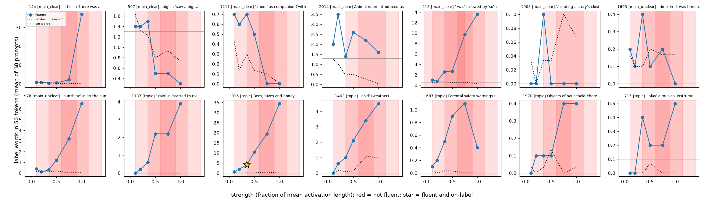

# Steering, third and last design: strength as a fraction of the mean activation length

> No feature label here has been verified by a human.

Design, word lists and success rule were committed in `config.yaml` (`steering_v3`) before the run. 10 prompts, 3 random directions per feature, strengths [0.1, 0.2, 0.35, 0.5, 0.75, 1.0] x the mean activation length at layer 3, 50 tokens.
Fluent threshold (rule: 2 x the 95th percentile of unsteered perplexity, 140 samples): **7.81** (unsteered median 2.45, 95th percentile 3.90).

**Rule.** *fluent*: a (feature, strength) cell is fluent if the median over prompts of the steered text's perplexity under the unsteered model is <= 2 x the 95th percentile of the perplexity of all unsteered samples in this run *on_label*: a cell is on-label if the steered text has more label words than the mean of the 3 random-direction texts on at least 9 of the 10 prompts (ties count against; one-sided sign test p = 0.011), and its mean label-word count also exceeds the unsteered mean *feature_succeeds*: a feature steers if at least one of the 5 strengths is both fluent and on-label (5 chances per feature, so a false pass has probability up to about 0.05 per feature) *claim*: 'steering reliably moves text toward the label' is supported for a group only if at least 5 of its 6 features steer; 2 to 4 = 'sometimes'; 0 or 1 = not supported. Counts are reported whatever they are.

## Result by group

| group | features that steer | verdict under the rule |
|---|---|---|
| main_clear | 0/6 (none) | not supported |
| main_unclear | 0/2 (none) | n/a (group of 2) |
| topic | 1/6 (916) | not supported |

## Every cell

hits = label words per 50 tokens, mean over prompts. wins = prompts (of 10) where the feature text has more label words than the mean of the random texts.

| feature | group | label | label words | k | vector length | unsteered hits | feature hits | random hits | wins | feature ppl | random ppl | fluent | on-label | success |
|---|---|---|---|---|---|---|---|---|---|---|---|---|---|---|
| 144 | main_clear | ' little' in 'there was a little boy/girl' | boy, girl, little | 0.1 | 0.25 | 0.5 | 0.9 | 0.3 | 4 | 2.7 | 2.3 | yes | no | no |
| 144 | main_clear | ' little' in 'there was a little boy/girl' | boy, girl, little | 0.2 | 0.50 | 0.5 | 0.8 | 0.6 | 4 | 3.2 | 3.1 | yes | no | no |
| 144 | main_clear | ' little' in 'there was a little boy/girl' | boy, girl, little | 0.35 | 0.88 | 0.5 | 0.3 | 0.6 | 1 | 5.9 | 4.9 | yes | no | no |
| 144 | main_clear | ' little' in 'there was a little boy/girl' | boy, girl, little | 0.5 | 1.26 | 0.5 | 0.5 | 0.2 | 3 | 10.7 | 10.0 | no | no | no |
| 144 | main_clear | ' little' in 'there was a little boy/girl' | boy, girl, little | 0.75 | 1.89 | 0.5 | 2.1 | 0.2 | 6 | 61.6 | 61.2 | no | no | no |
| 144 | main_clear | ' little' in 'there was a little boy/girl' | boy, girl, little | 1.0 | 2.51 | 0.5 | 37.0 | 0.0 | 10 | 42.8 | 209.8 | no | yes | no |
| 597 | main_clear | ' big' in 'saw a big ...' (encounter) | big, saw | 0.1 | 0.25 | 1.3 | 1.4 | 1.6 | 2 | 2.8 | 2.5 | yes | no | no |
| 597 | main_clear | ' big' in 'saw a big ...' (encounter) | big, saw | 0.2 | 0.50 | 1.3 | 1.4 | 1.3 | 6 | 2.9 | 3.1 | yes | no | no |
| 597 | main_clear | ' big' in 'saw a big ...' (encounter) | big, saw | 0.35 | 0.88 | 1.3 | 1.5 | 1.2 | 6 | 5.8 | 4.5 | yes | no | no |
| 597 | main_clear | ' big' in 'saw a big ...' (encounter) | big, saw | 0.5 | 1.26 | 1.3 | 0.5 | 0.8 | 4 | 16.3 | 8.7 | no | no | no |
| 597 | main_clear | ' big' in 'saw a big ...' (encounter) | big, saw | 0.75 | 1.89 | 1.3 | 0.5 | 0.9 | 3 | 211.3 | 46.6 | no | no | no |
| 597 | main_clear | ' big' in 'saw a big ...' (encounter) | big, saw | 1.0 | 2.51 | 1.3 | 0.3 | 0.7 | 2 | 960.4 | 143.5 | no | no | no |
| 1211 | main_clear | ' mom' as companion ('with her mom', 'her mom and dad') | dad, mom, mommy, mother, mum | 0.1 | 0.25 | 0.2 | 0.7 | 0.4 | 3 | 2.7 | 2.4 | yes | no | no |
| 1211 | main_clear | ' mom' as companion ('with her mom', 'her mom and dad') | dad, mom, mommy, mother, mum | 0.2 | 0.50 | 0.2 | 0.6 | 0.1 | 4 | 3.6 | 2.7 | yes | no | no |
| 1211 | main_clear | ' mom' as companion ('with her mom', 'her mom and dad') | dad, mom, mommy, mother, mum | 0.35 | 0.88 | 0.2 | 0.7 | 0.3 | 5 | 5.2 | 4.5 | yes | no | no |
| 1211 | main_clear | ' mom' as companion ('with her mom', 'her mom and dad') | dad, mom, mommy, mother, mum | 0.5 | 1.26 | 0.2 | 0.5 | 0.1 | 4 | 11.5 | 10.7 | no | no | no |
| 1211 | main_clear | ' mom' as companion ('with her mom', 'her mom and dad') | dad, mom, mommy, mother, mum | 0.75 | 1.89 | 0.2 | 0.0 | 0.1 | 0 | 427.1 | 46.9 | no | no | no |
| 1211 | main_clear | ' mom' as companion ('with her mom', 'her mom and dad') | dad, mom, mommy, mother, mum | 1.0 | 2.51 | 0.2 | 0.0 | 0.0 | 0 | 877.8 | 294.6 | no | no | no |
| 2014 | main_clear | Animal noun introduced as protagonist in the opening sentence (fox, cat) | bear, bird, bunny, cat, cow, dog… | 0.1 | 0.25 | 1.3 | 2.0 | 1.3 | 4 | 2.8 | 2.8 | yes | no | no |
| 2014 | main_clear | Animal noun introduced as protagonist in the opening sentence (fox, cat) | bear, bird, bunny, cat, cow, dog… | 0.2 | 0.50 | 1.3 | 3.5 | 1.0 | 5 | 3.0 | 3.2 | yes | no | no |
| 2014 | main_clear | Animal noun introduced as protagonist in the opening sentence (fox, cat) | bear, bird, bunny, cat, cow, dog… | 0.35 | 0.88 | 1.3 | 1.4 | 0.5 | 5 | 5.1 | 4.8 | yes | no | no |
| 2014 | main_clear | Animal noun introduced as protagonist in the opening sentence (fox, cat) | bear, bird, bunny, cat, cow, dog… | 0.5 | 1.26 | 1.3 | 2.6 | 0.5 | 7 | 7.6 | 9.8 | yes | no | no |
| 2014 | main_clear | Animal noun introduced as protagonist in the opening sentence (fox, cat) | bear, bird, bunny, cat, cow, dog… | 0.75 | 1.89 | 1.3 | 2.2 | 0.3 | 8 | 37.0 | 41.6 | no | no | no |
| 2014 | main_clear | Animal noun introduced as protagonist in the opening sentence (fox, cat) | bear, bird, bunny, cat, cow, dog… | 1.0 | 2.51 | 1.3 | 1.6 | 0.0 | 6 | 90.1 | 249.1 | no | no | no |
| 215 | main_clear | ' was' followed by 'so' + emotion after a mishap ('He was so sad') | angry, mad, sad, scared, so, upset… | 0.1 | 0.25 | 0.6 | 1.0 | 0.5 | 6 | 2.4 | 2.7 | yes | no | no |
| 215 | main_clear | ' was' followed by 'so' + emotion after a mishap ('He was so sad') | angry, mad, sad, scared, so, upset… | 0.2 | 0.50 | 0.6 | 0.8 | 0.6 | 6 | 2.9 | 2.9 | yes | no | no |
| 215 | main_clear | ' was' followed by 'so' + emotion after a mishap ('He was so sad') | angry, mad, sad, scared, so, upset… | 0.35 | 0.88 | 0.6 | 2.6 | 0.6 | 7 | 8.9 | 4.9 | no | no | no |
| 215 | main_clear | ' was' followed by 'so' + emotion after a mishap ('He was so sad') | angry, mad, sad, scared, so, upset… | 0.5 | 1.26 | 0.6 | 2.7 | 0.5 | 8 | 67.7 | 9.3 | no | no | no |
| 215 | main_clear | ' was' followed by 'so' + emotion after a mishap ('He was so sad') | angry, mad, sad, scared, so, upset… | 0.75 | 1.89 | 0.6 | 9.7 | 0.5 | 10 | 752.1 | 46.9 | no | yes | no |
| 215 | main_clear | ' was' followed by 'so' + emotion after a mishap ('He was so sad') | angry, mad, sad, scared, so, upset… | 1.0 | 2.51 | 0.6 | 13.6 | 0.3 | 9 | 3177.2 | 234.4 | no | yes | no |
| 1905 | main_clear | '.' ending a story's closing/moral sentence (e.g. 'happily ever after.') | after, end, ever, happily, learned, lesson… | 0.1 | 0.25 | 0.0 | 0.0 | 0.0 | 0 | 2.6 | 2.5 | yes | no | no |
| 1905 | main_clear | '.' ending a story's closing/moral sentence (e.g. 'happily ever after.') | after, end, ever, happily, learned, lesson… | 0.2 | 0.50 | 0.0 | 0.0 | 0.0 | 0 | 2.8 | 2.9 | yes | no | no |
| 1905 | main_clear | '.' ending a story's closing/moral sentence (e.g. 'happily ever after.') | after, end, ever, happily, learned, lesson… | 0.35 | 0.88 | 0.0 | 0.1 | 0.0 | 1 | 4.7 | 4.7 | yes | no | no |
| 1905 | main_clear | '.' ending a story's closing/moral sentence (e.g. 'happily ever after.') | after, end, ever, happily, learned, lesson… | 0.5 | 1.26 | 0.0 | 0.0 | 0.0 | 0 | 7.5 | 9.2 | yes | no | no |
| 1905 | main_clear | '.' ending a story's closing/moral sentence (e.g. 'happily ever after.') | after, end, ever, happily, learned, lesson… | 0.75 | 1.89 | 0.0 | 0.0 | 0.1 | 0 | 154.6 | 68.1 | no | no | no |
| 1905 | main_clear | '.' ending a story's closing/moral sentence (e.g. 'happily ever after.') | after, end, ever, happily, learned, lesson… | 1.0 | 2.51 | 0.0 | 0.0 | 0.1 | 0 | 10773.8 | 347.0 | no | no | no |
| 1693 | main_unclear | ' time' in 'it was time to go home' | home, time | 0.1 | 0.25 | 0.0 | 0.2 | 0.2 | 1 | 2.5 | 2.7 | yes | no | no |
| 1693 | main_unclear | ' time' in 'it was time to go home' | home, time | 0.2 | 0.50 | 0.0 | 0.1 | 0.1 | 1 | 2.6 | 2.7 | yes | no | no |
| 1693 | main_unclear | ' time' in 'it was time to go home' | home, time | 0.35 | 0.88 | 0.0 | 0.4 | 0.1 | 3 | 4.9 | 4.1 | yes | no | no |
| 1693 | main_unclear | ' time' in 'it was time to go home' | home, time | 0.5 | 1.26 | 0.0 | 0.1 | 0.2 | 1 | 7.9 | 7.5 | no | no | no |
| 1693 | main_unclear | ' time' in 'it was time to go home' | home, time | 0.75 | 1.89 | 0.0 | 0.2 | 0.2 | 1 | 52.2 | 39.2 | no | no | no |
| 1693 | main_unclear | ' time' in 'it was time to go home' | home, time | 1.0 | 2.51 | 0.0 | 0.0 | 0.2 | 0 | 1374.3 | 385.6 | no | no | no |
| 978 | main_unclear | ' sunshine' in 'in the sunshine' | sun, sunny, sunshine | 0.1 | 0.25 | 0.1 | 0.4 | 0.2 | 1 | 3.1 | 2.6 | yes | no | no |
| 978 | main_unclear | ' sunshine' in 'in the sunshine' | sun, sunny, sunshine | 0.2 | 0.50 | 0.1 | 0.1 | 0.1 | 1 | 2.1 | 3.0 | yes | no | no |
| 978 | main_unclear | ' sunshine' in 'in the sunshine' | sun, sunny, sunshine | 0.35 | 0.88 | 0.1 | 0.3 | 0.1 | 3 | 3.6 | 4.4 | yes | no | no |
| 978 | main_unclear | ' sunshine' in 'in the sunshine' | sun, sunny, sunshine | 0.5 | 1.26 | 0.1 | 1.2 | 0.2 | 7 | 7.9 | 9.6 | no | no | no |
| 978 | main_unclear | ' sunshine' in 'in the sunshine' | sun, sunny, sunshine | 0.75 | 1.89 | 0.1 | 3.2 | 0.0 | 9 | 30.5 | 50.7 | no | yes | no |
| 978 | main_unclear | ' sunshine' in 'in the sunshine' | sun, sunny, sunshine | 1.0 | 2.51 | 0.1 | 6.5 | 0.1 | 10 | 104.8 | 325.5 | no | yes | no |
| 1137 | topic | ' rain' in 'started to rain' | rain, raindrops, rained, raining, rainy | 0.1 | 0.25 | 0.0 | 0.0 | 0.0 | 0 | 2.1 | 2.6 | yes | no | no |
| 1137 | topic | ' rain' in 'started to rain' | rain, raindrops, rained, raining, rainy | 0.2 | 0.50 | 0.0 | 0.2 | 0.0 | 2 | 3.0 | 2.8 | yes | no | no |
| 1137 | topic | ' rain' in 'started to rain' | rain, raindrops, rained, raining, rainy | 0.35 | 0.88 | 0.0 | 0.6 | 0.0 | 2 | 4.9 | 4.2 | yes | no | no |
| 1137 | topic | ' rain' in 'started to rain' | rain, raindrops, rained, raining, rainy | 0.5 | 1.26 | 0.0 | 2.2 | 0.0 | 9 | 16.0 | 8.0 | no | yes | no |
| 1137 | topic | ' rain' in 'started to rain' | rain, raindrops, rained, raining, rainy | 0.75 | 1.89 | 0.0 | 2.2 | 0.0 | 10 | 60.4 | 35.2 | no | yes | no |
| 1137 | topic | ' rain' in 'started to rain' | rain, raindrops, rained, raining, rainy | 1.0 | 2.51 | 0.0 | 3.9 | 0.0 | 9 | 293.0 | 121.3 | no | yes | no |
| 916 | topic | Bees, hives and honey | bee, beehive, bees, hive, hives, honey | 0.1 | 0.25 | 0.0 | 0.6 | 0.0 | 2 | 2.7 | 2.6 | yes | no | no |
| 916 | topic | Bees, hives and honey | bee, beehive, bees, hive, hives, honey | 0.2 | 0.50 | 0.0 | 1.9 | 0.0 | 5 | 4.0 | 2.9 | yes | no | no |
| 916 | topic | Bees, hives and honey | bee, beehive, bees, hive, hives, honey | 0.35 | 0.88 | 0.0 | 4.0 | 0.0 | 9 | 6.8 | 4.0 | yes | yes | **yes** |
| 916 | topic | Bees, hives and honey | bee, beehive, bees, hive, hives, honey | 0.5 | 1.26 | 0.0 | 10.4 | 0.0 | 9 | 22.5 | 8.1 | no | yes | no |
| 916 | topic | Bees, hives and honey | bee, beehive, bees, hive, hives, honey | 0.75 | 1.89 | 0.0 | 19.4 | 0.4 | 10 | 235.2 | 43.8 | no | yes | no |
| 916 | topic | Bees, hives and honey | bee, beehive, bees, hive, hives, honey | 1.0 | 2.51 | 0.0 | 34.5 | 0.0 | 10 | 349.9 | 181.1 | no | yes | no |
| 1463 | topic | ' cold' (weather) | chilly, cold, colder, freezing, icy, snow… | 0.1 | 0.25 | 0.0 | 0.0 | 0.0 | 0 | 2.5 | 2.6 | yes | no | no |
| 1463 | topic | ' cold' (weather) | chilly, cold, colder, freezing, icy, snow… | 0.2 | 0.50 | 0.0 | 0.6 | 0.2 | 4 | 2.8 | 2.7 | yes | no | no |
| 1463 | topic | ' cold' (weather) | chilly, cold, colder, freezing, icy, snow… | 0.35 | 0.88 | 0.0 | 1.0 | 0.1 | 5 | 4.4 | 4.3 | yes | no | no |
| 1463 | topic | ' cold' (weather) | chilly, cold, colder, freezing, icy, snow… | 0.5 | 1.26 | 0.0 | 2.1 | 0.1 | 7 | 10.0 | 8.9 | no | no | no |
| 1463 | topic | ' cold' (weather) | chilly, cold, colder, freezing, icy, snow… | 0.75 | 1.89 | 0.0 | 3.4 | 1.1 | 7 | 48.0 | 67.0 | no | no | no |
| 1463 | topic | ' cold' (weather) | chilly, cold, colder, freezing, icy, snow… | 1.0 | 2.51 | 0.0 | 4.5 | 1.0 | 10 | 268.7 | 213.8 | no | yes | no |
| 687 | topic | Parental safety warnings ("don't go too close"); promotes 'dangerous' | careful, danger, dangerous, safe, warned, warning | 0.1 | 0.25 | 0.0 | 0.1 | 0.0 | 1 | 2.9 | 2.4 | yes | no | no |
| 687 | topic | Parental safety warnings ("don't go too close"); promotes 'dangerous' | careful, danger, dangerous, safe, warned, warning | 0.2 | 0.50 | 0.0 | 0.2 | 0.0 | 2 | 3.4 | 3.0 | yes | no | no |
| 687 | topic | Parental safety warnings ("don't go too close"); promotes 'dangerous' | careful, danger, dangerous, safe, warned, warning | 0.35 | 0.88 | 0.0 | 0.5 | 0.0 | 4 | 4.4 | 4.8 | yes | no | no |
| 687 | topic | Parental safety warnings ("don't go too close"); promotes 'dangerous' | careful, danger, dangerous, safe, warned, warning | 0.5 | 1.26 | 0.0 | 0.9 | 0.0 | 6 | 9.7 | 9.6 | no | no | no |
| 687 | topic | Parental safety warnings ("don't go too close"); promotes 'dangerous' | careful, danger, dangerous, safe, warned, warning | 0.75 | 1.89 | 0.0 | 1.1 | 0.0 | 8 | 33.9 | 41.3 | no | no | no |
| 687 | topic | Parental safety warnings ("don't go too close"); promotes 'dangerous' | careful, danger, dangerous, safe, warned, warning | 1.0 | 2.51 | 0.0 | 0.4 | 0.0 | 4 | 391.6 | 133.6 | no | no | no |
| 1970 | topic | Objects of household chores (dishes, laundry, weeds) | chore, chores, clothes, dish, dishes, floor… | 0.1 | 0.25 | 0.0 | 0.0 | 0.0 | 0 | 2.7 | 2.6 | yes | no | no |
| 1970 | topic | Objects of household chores (dishes, laundry, weeds) | chore, chores, clothes, dish, dishes, floor… | 0.2 | 0.50 | 0.0 | 0.1 | 0.0 | 1 | 3.6 | 3.3 | yes | no | no |
| 1970 | topic | Objects of household chores (dishes, laundry, weeds) | chore, chores, clothes, dish, dishes, floor… | 0.35 | 0.88 | 0.0 | 0.1 | 0.0 | 1 | 6.4 | 4.4 | yes | no | no |
| 1970 | topic | Objects of household chores (dishes, laundry, weeds) | chore, chores, clothes, dish, dishes, floor… | 0.5 | 1.26 | 0.0 | 0.1 | 0.1 | 1 | 13.0 | 8.1 | no | no | no |
| 1970 | topic | Objects of household chores (dishes, laundry, weeds) | chore, chores, clothes, dish, dishes, floor… | 0.75 | 1.89 | 0.0 | 0.4 | 0.0 | 2 | 32.8 | 50.8 | no | no | no |
| 1970 | topic | Objects of household chores (dishes, laundry, weeds) | chore, chores, clothes, dish, dishes, floor… | 1.0 | 2.51 | 0.0 | 0.4 | 0.0 | 4 | 143.6 | 159.1 | no | no | no |
| 715 | topic | ' play' a musical instrument | drum, drums, flute, guitar, instrument, music… | 0.1 | 0.25 | 0.1 | 0.0 | 0.0 | 0 | 2.7 | 2.7 | yes | no | no |
| 715 | topic | ' play' a musical instrument | drum, drums, flute, guitar, instrument, music… | 0.2 | 0.50 | 0.1 | 0.0 | 0.0 | 0 | 3.0 | 2.7 | yes | no | no |
| 715 | topic | ' play' a musical instrument | drum, drums, flute, guitar, instrument, music… | 0.35 | 0.88 | 0.1 | 0.4 | 0.0 | 1 | 4.7 | 4.1 | yes | no | no |
| 715 | topic | ' play' a musical instrument | drum, drums, flute, guitar, instrument, music… | 0.5 | 1.26 | 0.1 | 0.2 | 0.1 | 2 | 12.9 | 7.5 | no | no | no |
| 715 | topic | ' play' a musical instrument | drum, drums, flute, guitar, instrument, music… | 0.75 | 1.89 | 0.1 | 0.2 | 0.0 | 2 | 92.3 | 35.7 | no | no | no |
| 715 | topic | ' play' a musical instrument | drum, drums, flute, guitar, instrument, music… | 1.0 | 2.51 | 0.1 | 0.5 | 0.0 | 4 | 505.7 | 174.7 | no | no | no |

## Sample text (prompts 0 and 4; feature and first random direction)

### Feature 144: ' little' in 'there was a little boy/girl'

**Prompt:** Once upon a time, there was a little girl named Lily.

| run | hits | ppl | text |
|---|---|---|---|
| unsteered | 0 | 1.9 |  She loved to play with her toys and sing songs. One day, Lily went to the park with her mommy. They saw a big, red balloon flying in the sky. Lily was so happy and shouted, "Look, mommy! A |
| feature 0.1x | 0 | 2.4 |  She loved to play with her toys and watch television. One day, her mom asked her if she wanted to try on a new dress. Lily said yes, but she wasn't sure if she wanted to. ⏎  ⏎ Her mom said, "Don |
| random 0.1x | 0 | 2.1 |  She loved to play in the park with her friends. One day, they were playing hide-and-seek when they saw a big, scary dog. Lily got scared and hid behind a tree. The dog came closer and closer, but soon Lily |
| feature 0.2x | 0 | 2.1 |  She loved to play outside in her garden. One day, she saw a white caterpillar crawling on the ground. She wanted to touch it, but it started to crawl away.  ⏎  ⏎ Lily's mom came outside and saw her daughter trying |
| random 0.2x | 0 | 3.1 |  She had a pretty pink dress that she loved to wear. One day, she found a magic wand that could make her even more special. She was so happy and started to jump up and down. ⏎  ⏎ Lily wanted to try a new spell |
| feature 0.35x | 0 | 2.4 |  She loved to play with her toys, but sometimes she got bored. One day, she wanted to play with her favorite toy car, but her mom said it was difficult for her to fix it. Lily was sad, but then she had an idea |
| random 0.35x | 0 | 4.1 |  She loved to help her mommy in the kitchen. Her mommy would fill the big tub with water and bubbles to the water. Lily would fill the big tub and splash in the water.  ⏎  ⏎ One day, Lily was feeling a big |
| feature 0.5x | 0 | 15.7 |  Lily loved to walk to the forest, with her furry bunny bunny bunny that loved to play. One day, she went for a walk with her mommy rabbit, and they came to see a stream. The water was cold and brown, like a |
| random 0.5x | 0 | 20.7 |  She loved to play and have a big party at her classroom. Her favorite toy, a player named Cheer her favorite toy. The game was Cheerarts! ⏎  ⏎ During the party, Cheer- the player with the funny character. He |
| feature 0.75x | 1 | 112.4 |  She loved animals, and girl,. She loved animals animals, and like like like you. One day, she went by the bunny animals, like a bird, and like bird. She went it, like a bunny bunny. One day, she |
| random 0.75x | 0 | 89.9 |  She loved to swim in the water and welcome the friendly fish.  ⏎  ⏎ One small, a huge, and a huge, welcome. The water and the so much, her so happy. She couldn't a price for it. But just as |
| feature 1.0x | 45 | 42.1 |  girl boy girl boy,. girl girl girl girl girl girl girl girl girl girl girl girl. She girl girl girl girl girl girl girl girl girl girl girl girl girl girl girl girl girl girl girl girl girl girl girl girl girl boy girl girl girl, |
| random 1.0x | 0 | 1400.1 |  She big and a bad a big. her a poor-looking. us the big and empty spaces. !" until the big and empty space and a big empty space. so lots and a croch!" and a so, nobody it a big |

**Prompt:** There was a big tree near the house. Under the tree,

| run | hits | ppl | text |
|---|---|---|---|
| unsteered | 2 | 2.5 |  there was a pot of gold. The pot was very pretty. A little girl named Lily wanted to take a piece of the pot. She thought her mom would be happy if she took the pot from the house. ⏎  ⏎ Lily went to the |
| feature 0.1x | 2 | 2.0 |  there was a swing. A little girl named Lily wanted to swing on the swing. She went to the swing and sat on it. She was very happy. The swing was long and easy to sit on. ⏎  ⏎ Lily sat on the swing |
| random 0.1x | 1 | 2.6 |  there was a small crack. A little bird lived in the crack. The bird was sad because it was hungry. ⏎  ⏎ One day, the bird found a big leaf. It was a good egg to feed the bird. The bird ate the egg |
| feature 0.2x | 3 | 3.2 |  there lived a boy named Tim. Tim loved to climb the tree. One day, he found a blue ball near the table. He was very happy. ⏎  ⏎ As Tim saw the ball on the table, he saw a little girl named Lily. |
| random 0.2x | 0 | 2.7 |  a bird lived in it. The bird was hurt and could not fly. The bird was sad because it could not find a place to rest. ⏎  ⏎ One day, the bird saw a small box. The box was empty. The bird pushed the |
| feature 0.35x | 2 | 6.1 |  there was a furry dog named Max. Max was playing with his toy dog, Tim. Max was playing outside in his garden. He saw a little girl named Lily who was looking for her dog. Max was very sad and scared. ⏎  ⏎ One |
| random 0.35x | 1 | 5.8 |  a girl named Lily came to visit. She was very sleepy. She yawned and closed her eyes. They became friends and had a lot of fun. They were fast asleep under the tree. Lily was not too sleepy. They stayed under the tree |
| feature 0.5x | 1 | 5.8 |  there was a house, a boy named Tim. He had a dog named Tim. One night, Tim had an idea. He wanted to find a big, open space in the house. He walked around the house, looking up at the books with |
| random 0.5x | 2 | 10.2 |  a shiny red ball. A little boy named Lily was coming. He was so happy! He saw the shiny ball and started to run. He was so happy, he couldn't stop moving. He jumped up and down, happy too.  ⏎  |
| feature 0.75x | 7 | 80.3 |  a girl named Lilly. She was a girl, like a girl, like bird girl. She liked to walk and care. One day, she went by the girl boy, named Tim. He girl, Lily, and sister,. He lived, |
| random 0.75x | 0 | 78.6 |  a bowl of water. The water and a swim. He was so happy, and the water to fill the big pool. He jumps in the water and the big, and getting a swim.  ⏎  ⏎ - a big, and a happy, |
| feature 1.0x | 46 | 32.8 |  crawled bunnys. boy girl girl girl girl girl girl girl girl girl girl girl girl girl girl girl girl girl girl girl girl girl girl girl girl boy girl girl boy girl girl girl girl girl girl girl girl girl girl girl girl girl girl girl girl girl |
| random 1.0x | 0 | 1274.5 |  wide and sleepy. There, and the sleepy. us a wide, and ready to find a new and fit through a new. waiting to the big and getting a big and open one. ." he happy so so it the big and so so |

### Feature 597: ' big' in 'saw a big ...' (encounter)

**Prompt:** Once upon a time, there was a little girl named Lily.

| run | hits | ppl | text |
|---|---|---|---|
| unsteered | 2 | 2.2 |  She loved to play outside in the sunshine. One day, she saw a giant walking on the street. The giant was very big and had lots of arms.  ⏎  ⏎ Lily got scared of the giant and ran away. But then, the |
| feature 0.1x | 1 | 2.0 |  She loved to play outside and explore the world around her. One day, she found a big cardboard box in her backyard. She was so excited to see what was inside.  ⏎  ⏎ Lily decided to fill the box with leaves and sticks to |
| random 0.1x | 1 | 2.3 |  She loved to play with her toys and eat candy. One day, her mom gave her a big bag of cookies. Lily was very happy and ate one cookie all by herself. ⏎  ⏎ After eating her cookies, Lily couldn't stop thinking about her |
| feature 0.2x | 2 | 2.7 |  She loved to play outside and look at the pretty earth. One day, she saw a small hole in the earth and decided to explore it.  ⏎  ⏎ As she was walking, she saw a group of ants crawling on a rock. They were |
| random 0.2x | 0 | 2.4 |  She loved to play with her toys and eat candy with her mommy. One day, her mommy made a yummy treat for her. Lily was so excited to eat it! ⏎  ⏎ But then, her mommy had to leave for work |
| feature 0.35x | 1 | 6.3 |  Lily loved to eat grapes. One day, Lily saw a grape grape in the water. She wanted to bite it but the grape was too high. "Oh no, the grape boy tried to get it," he said.  ⏎  ⏎ Lily |
| random 0.35x | 0 | 2.0 |  She loved to play with her toys and play with her friends. One day, Lily's mom asked her to help clean up her room. Lily didn't want to clean, and she wanted to play instead. ⏎  ⏎ Lily's mom asked her |
| feature 0.5x | 1 | 31.1 |  Lily saw a helicopter flying in the sky. The helicopter was flying and scary. Lily fell into the water.  ⏎  ⏎ Lily bird that there was. Lily had an idea to destroy the water.  ⏎  ⏎ Lily did, and scary |
| random 0.5x | 1 | 9.4 |  Her mom was a good cook and a big dinner. One day, Lily's mom made a pizza for dinner. Lily was happy to eat her dinner, but her mom thought they wouldn't be good. ⏎  ⏎ Lily didn't his request for |
| feature 0.75x | 1 | 387.0 |  A truck truck came to to see it. ⏎  ⏎ " means to wake, and scary monster pill pill pill pill. "There!" said, and scary dinosaur dinosaur. ⏎  ⏎  thunder came in the big, scary dinosaur. It came in the, |
| random 0.75x | 0 | 26.2 |  She was the day she wished her toy car was. One day, a toy car was her friend and they couldn't play. ⏎  ⏎ Lily was a bad day and didn't play with her toy. Lily had a bad time playing with her |
| feature 1.0x | 2 | 1393.6 |  elephant elephant cake ice cake., and pill cup puddle and water water tub water. Big puddle of water and scary, scary rocks, scary dinosaur rocks. ⏎  to scare the scary scary threat came., scary monster. to the big p |
| random 1.0x | 0 | 75.2 |  There was dinner time, dinner time. Lily was his dinner, and his own dinner and his mom was. ⏎  ⏎ His parents had his dinner and dinner day for dinner. ⏎  ⏎ One day, his parents said his dinner was dinner. His family |

**Prompt:** There was a big tree near the house. Under the tree,

| run | hits | ppl | text |
|---|---|---|---|
| unsteered | 0 | 2.7 |  there was a little bird. The little bird was hurt and could not fly. The little bird wanted to help his friend. He had an idea. ⏎  ⏎ The little bird got some soft water and put it on his wing. The little bird felt |
| feature 0.1x | 1 | 2.3 |  there was a bookcase. A little girl named Lily saw the bookcase. She wanted to read the book. ⏎  ⏎ Lily walked to the bookcase and sat down. She reached up and tried to read the book. The book was fun |
| random 0.1x | 2 | 2.0 |  there was a little boy named Timmy. Timmy loved to play outside. One day, Timmy saw a big, strong tree. The tree was very tall, and he wanted to climb it. ⏎  ⏎ Timmy's friend, Johnny, |
| feature 0.2x | 1 | 2.9 |  there was a little birdie. The birdie was very sad because it was all alone. The birdie had no friends to play with. The birdie saw that spring was coming from its nest. The birdie looked up at the birdie |
| random 0.2x | 1 | 3.5 |  there was a big box. The box was for a little boy named Tim. Tim was very happy to have a new toy. He wanted to play with his toy, but he knew he had to delay eating it from his box. ⏎  ⏎ One |
| feature 0.35x | 0 | 5.3 |  there was a hole. A man came and took out a bottle of bubble soap. He poured it in the hole. The bubble bubble filled with water. ⏎  ⏎ The man said, "I can see if you can fill up this hole in the |
| random 0.35x | 1 | 4.1 |  there was a nice lady named Tom. One day, Tom was sitting by the tree when a little bird came to sit near the owner. The bird was sad and couldn't sit by the tree. Tom saw the bird and wanted to help. He |
| feature 0.5x | 0 | 8.7 |  there was a hole in the tree. Tom wanted to get out of it. Tom said, "I can escape. Come and soak in the pond. It will be and cool." ⏎  ⏎ Tom jumped into the pond. He splashed water. |
| random 0.5x | 3 | 9.5 |  there was a cake. A mom had made a snack. His friends wanted some yummy food. One day, one of his friends, a big bear named Bear. The bear was so big. ⏎  ⏎ The bear saw the cake and thought it |
| feature 0.75x | 0 | 300.7 |  high branch. kids dinosaur boxes, trying to reach on the hole. "D dinosaur!" the dinosaur came. He grow, and scary dinosaur. "Ro, he might bite!" he came and scary, scary rocks and scary dinosaur. ⏎  ⏎  scary |
| random 0.75x | 2 | 70.4 |  there was a big cake. One day, everyone was the time to the big adventure. ⏎  |
| feature 1.0x | 0 | 1206.0 |  with water water spl spl. " water spl splash. " water splash," and scary, jumping, " SPL waves spl SPL SPL SPL. SPL SPL SPL SPL SPL monster. water spl SPL SPL SPL SPL SPL SPL SPL SPL SPL SPL SPL SPL SPL |
| random 1.0x | 0 | 117.2 |  the dinner-out was a toy. ⏎  ⏎ At the dinner time all the dinner. The dinner was a day and everyone night. ⏎  ⏎ T year- his friends the dinner time his mom was the night. ⏎  and all the dinner was the |

### Feature 1211: ' mom' as companion ('with her mom', 'her mom and dad')

**Prompt:** Once upon a time, there was a little girl named Lily.

| run | hits | ppl | text |
|---|---|---|---|
| unsteered | 1 | 2.2 |  She loved to eat jelly on her toast every morning. One day, her mommy told her that she needed to add more jelly to her toast. Lily was sad because she didn't want to eat her jelly.  ⏎  ⏎ But then, her |
| feature 0.1x | 3 | 2.0 |  She lived in a house with her mommy and daddy. One day, they went to the store to buy some groceries. Lily saw a big sack and asked her mommy what it was. Her mommy said it was a sack for cleaning the |
| random 0.1x | 0 | 2.1 |  She loved to play outside in the park with her friends. One day, Lily and her friends found a purple ball. They all wanted to play with it, but Lily disagreed. She said, "Let's take turns to play with the ball." |
| feature 0.2x | 1 | 2.7 |  She loved to go to the mall with her mommy. The mall had many stores and people. One day, they went to the store to buy some food. The store had a big window and it was very fancy.  ⏎  ⏎ Lily |
| random 0.2x | 2 | 2.5 |  Lily loved to bake cakes with her mom. One day, they decided to make a cake with lots of frosting. Lily's mom told her to stir the batter carefully with a big spoon. ⏎  ⏎ Lily poured the batter into the round pan |
| feature 0.35x | 1 | 3.2 |  She loved to play outside in the garden. One day, she was hungry and wanted to eat cookies.  ⏎  ⏎ Lily went to the kitchen to get some food. She saw the empty cookie jar on the counter. She asked her mommy |
| random 0.35x | 1 | 4.3 |  She loved to play outside in the sun and play in the rain. One day, Lily went outside and jumped in the puddles, but she got all wet! She was so happy and ran off to show her mommy. They jumped in |
| feature 0.5x | 0 | 10.4 |  She loved to cook food in the kitchen. One day, she went to the store. She said, "I want to stop some fresh food from the grocery store. Can I have a good." ⏎  ⏎ Lily said, "Yes, let |
| random 0.5x | 0 | 5.9 |  She loved to play dress up and go on the stage. She would go on stage and perform for all her friends to see! ⏎  ⏎ One day, Lily invited everyone to come and play on the stage. She wore her best act and everyone loved |
| feature 0.75x | 0 | 105.5 |  She loved to watch themy's watch. Onemy said, "my,my, thatmy's not telling memymy'smy's order.my's order is not tellingmy'smy's order it's timemy's foodmy's |
| random 0.75x | 0 | 85.4 |  Lily loved to go on more rides all van. She would go all kinds and see all her toys from different places, like unicoms, unicISON and unicoms. They would happen every day and unic to everyone on the bed, Lily and anything |
| feature 1.0x | 0 | 1128.0 | mymymymymymymymy wentmymymymymy'smy.mymymymymymymymymymymymymymymymymymymymymymymymymymymymymymymymymy |
| random 1.0x | 0 | 634.1 |  She wanted to go on ever, pink, pink pink carpet, anything everyone would allow anyone let her permit her name Lily on everyone, anyone, everyone Lily! She will perform on all animals, people, everyone could permit that everyone would permit her people |

**Prompt:** There was a big tree near the house. Under the tree,

| run | hits | ppl | text |
|---|---|---|---|
| unsteered | 0 | 2.4 |  there was a small house next to a house. In the house, there was a little girl named Lily. She had a pet cat named Max. Max was a good pet, and Lily loved to play with Max. ⏎  ⏎ One day, Lily |
| feature 0.1x | 0 | 2.6 |  there was a boy named Tim. Tim loved to play outside. One day, he saw a light in the sky. He saw a big bird flying. ⏎  ⏎ The bird was very pretty. Tim asked the bird, "Where are you going?" |
| random 0.1x | 0 | 3.0 |  there was a little boy. He was sitting under the tree. He was very happy. He loved to look at the tree and feel its leaves. But one day, a big storm came. The rain was very heavy and loud. The wind blew |
| feature 0.2x | 0 | 4.0 |  there was a book. The book was old and broken. A little girl named Lily took the book to the store. She wanted to put the book in the machine. The machine was like a big machine. The machine helped Lily look at pretty pictures |
| random 0.2x | 0 | 2.2 |  there was a bird. The bird was yellow and had pretty feathers. The bird was very graceful. ⏎  ⏎ One day, a little boy came to the tree. He wanted to climb it. He put one foot on the trunk and started to climb |
| feature 0.35x | 0 | 3.6 |  there was a little bird. The bird was tired. The bird wanted to go to the toilet. The bird said, "I can't help you find my way to the house." ⏎  ⏎ The bird said, "I need to go to the |
| random 0.35x | 0 | 3.2 |  there was a fancy bird. The bird was blue and lived in a tree. The bird liked to sing and play all day. ⏎  ⏎ One day, the bird heard a little girl crying. She was walking and looked at the bird. The girl |
| feature 0.5x | 0 | 10.1 |  they were waiting for the flowers. The sun was dry and the water started to dry the flowers. They were very happy. ⏎  ⏎ "Let's go to the garden," said grandma. She put a warm coat on themy's coat. " |
| random 0.5x | 0 | 10.1 |  a girl named Lily came. Lily wanted to play with Lily and decided to invite all her friends to come and play with her." Lily was so happy and ran all around the tree. They all sat on the branch and talked on the bird's branches |
| feature 0.75x | 0 | 168.3 |  it was dry. ⏎  ⏎ Lily andmy were still holding hermy's hand.my wasmy's handmy's hand.my said, "mymy, mommymymymymymymymymymymymymymymy |
| random 0.75x | 0 | 22.5 |  all the kids can see on the bed. They all go to live on top of the tree. They like to play on the wall, up and on the wall and wall. Every day, kids play on the wall and everyone come and all around |
| feature 1.0x | 0 | 817.3 |  said, "mymymymy'smymy'smy'smy'smymymymy'smy'smymymymymymymymymymymymymymymymymymymymymymymymymymymymy |
| random 1.0x | 0 | 178.7 |  everyone was pink and everyone loved. They all put on all animals, Lily and everyone, Ben, Rosie Lily and everyone on the bed, Lily and everyone come from all on Lily's twins! ⏎  ⏎ Maybe all Lily and Dants will come |

### Feature 2014: Animal noun introduced as protagonist in the opening sentence (fox, cat)

**Prompt:** Once upon a time, there was a little girl named Lily.

| run | hits | ppl | text |
|---|---|---|---|
| unsteered | 1 | 2.5 |  She had a big dog named Max. Max was very playful and loved to run around the house. One day, Lily and Max were playing in the yard. Max ran and jumped around the yard. Suddenly, Lily saw a big, scary bug on |
| feature 0.1x | 2 | 2.2 |  She loved to play outside and pick flowers. One day, she saw a bird flying in the sky. She ran to her mom and said, "Mommy, look! A bird!" Her mom replied, "Yes, we can gaze at it |
| random 0.1x | 0 | 3.1 |  She loved to play outside and explore the woods. But one day, she stumbled upon a stream and decided to go for a swim. She didn't like the water because it made her feel wet.  ⏎  ⏎ As she was swimming, she noticed |
| feature 0.2x | 0 | 2.2 |  She loved to play with her toys every day. One day, she went to the park and met a boy named Max. Max was very rude, and he always did not like to share his toys. ⏎  ⏎ One day, Lily and Max went |
| random 0.2x | 0 | 1.6 |  She loved to play with her toys and go on adventures. One day, Lily's mommy asked her to clean up her toys. Lily said, "Okay mommy, I will clean up my toys."  ⏎  ⏎ Lily's mommy |
| feature 0.35x | 3 | 4.1 |  She loved to go on adventures with her dog, yes! One day, she went on an adventurous walk in the forest with her dog, Max. They walked and walked until they found a tree, where they saw a bird, who said, " |
| random 0.35x | 0 | 4.1 |  She went to the beach with her family. They saw the water and the tide were high. The waves were so deep that they reached the bottom. Lily loved the ocean. She wanted to touch the water. But her mom said, "No, |
| feature 0.5x | 0 | 6.7 |  She went to the beach with her family. She loved to collect shells on the sand and the sand. One day, she found an enormous rock with a lotion on the beach. She looked and found the rock with her brain.  ⏎  ⏎  |
| random 0.5x | 0 | 4.3 |  She was walking in the kitchen with her mommy. Her mommy was making soup. She was making a big pot of soup in the middle of the room. It was very big! ⏎  ⏎ Suddenly, Lily saw something in the pot. She |
| feature 0.75x | 1 | 34.1 |  She went on a great journey through the forest. She walked in and walked in the forest. She looked around and was walking in the trees. s and she didn not worry. She was not scared because she had a rabbit in her tummy |
| random 0.75x | 0 | 17.9 |  She was very busy. There loved playing outside. The sun was high in the sky. The sun was so big. It had a lot of water. It was very impressive. ⏎  ⏎ But at the sun, was suddenly done. The sun was |
| feature 1.0x | 1 | 73.5 |  She was out in the garden with her garden. She went through and saw a bird with apron. It was hopping and, and he was in the garden. He was walking in and on the garden. She walked in and whistles and excited |
| random 1.0x | 0 | 27.4 |  The sun was a sun in the sky. The sun loved playing in the room of the sun. The sun was in the sun. The sun was very big. The sun was very proud of the sun in the sun's home of love in the |

**Prompt:** There was a big tree near the house. Under the tree,

| run | hits | ppl | text |
|---|---|---|---|
| unsteered | 0 | 2.6 |  there was a small hole. Tom wanted to discover what was inside. He went to the hole and looked inside. He saw a small bug. The bug was very scared. ⏎  ⏎ Tom and the bug started to talk. They said, "I |
| feature 0.1x | 5 | 2.9 |  there was a pot. In the pot lived a cat. The cat was very thirsty. The cat saw a cup. It wanted to drink the water from the cup. The cat used its paw to drink the water. The cat did not like the |
| random 0.1x | 5 | 2.1 |  there was a little girl. She saw a small bird. The bird was hurt. It was crying. The little girl wanted to help the bird. ⏎  ⏎ The girl saw the bird and said, "Don't cry, little bird. I will |
| feature 0.2x | 6 | 2.9 |  there was a bird. The bird had pretty feathers. Suddenly, the bird saw a big rock. The rock was too heavy for the bird to move. The bird was sad because it could not fly.  ⏎  ⏎ A cat came by the tree |
| random 0.2x | 0 | 4.3 |  there was a small bug. The bug was very small and lived in a hole in the tree. The sun was always shining and the rain had risen. The garden was full of fresh water and many plants. ⏎  ⏎ One day, a little bug |
| feature 0.35x | 1 | 4.9 |  there was a cat named Tom. Tom liked to eat apples. One day, he found a bottle. The bottle was not empty. He was sad. The bag was empty. Tom went to the shop. He wanted to fix the bag. He |
| random 0.35x | 0 | 3.8 |  there was a small hole. The hole was high in the tree. The hole was dark and deep. There was a small hole that was made of wood. ⏎  ⏎ One day, Tim went to the house. He wanted to see the hole in |
| feature 0.5x | 8 | 7.1 |  there was a bird and a dog. They were walking in the garden. They saw a cat and a cat. They looked and they gazed at themselves. The cat was sad. The cat saw the dog and cat. They did not like birds. |
| random 0.5x | 0 | 8.1 |  there was a big tree in the middle of the forest. The sun was shining very bright. The sky was clear. ⏎  ⏎ In the sky, out of the tree was a deep and dark. The sky was blue and calm. The sun was |
| feature 0.75x | 2 | 27.5 |  was a brown bear who lived in the forest. He was walking through the woods. in the valley. He was walking down and looking out of the tree and walking. He walked down and on the grass in the road. He saw a cat, |
| random 0.75x | 1 | 12.5 |  at the sun was a pit of ice. The family of fish lived in the pit at the bottom of the pit. They were safe. The family knew what to have done. The family who lived in the pit's home was a big, deep |
| feature 1.0x | 6 | 73.2 |  was a dog and a dog named Sam. He walked and walked through the house. On the hair on the dog and the dog who lived in the dog, wouse, and the dog. He walked down and had. He did not like. |
| random 1.0x | 0 | 16.6 |  at the sun was an orange light. The sun was an sun. The sun was in the sea. The sun was out of the ocean. The sun was very safe. ⏎  |

### Feature 215: ' was' followed by 'so' + emotion after a mishap ('He was so sad')

**Prompt:** Once upon a time, there was a little girl named Lily.

| run | hits | ppl | text |
|---|---|---|---|
| unsteered | 1 | 1.8 |  She loved to play with her toys and sing songs. One day, Lily's mom gave her a shiny new cap to wear. Lily was so happy and said, "Thank you, Mommy! This is the best cap ever!"  ⏎  ⏎  |
| feature 0.1x | 1 | 2.4 |  She loved to play outside in the sunshine and pick flowers. One day, she saw a bird rise from a nest in a tree. She was scared at first, but then she felt better. ⏎  ⏎ As she was walking, she saw a big |
| random 0.1x | 0 | 1.6 |  She loved to play with her toys and eat cookies. One day, Lily's mom said, "Lily, it's time to go to the park." Lily said, "Okay, Mommy!" and ran to get her shoes. ⏎  ⏎  |
| feature 0.2x | 1 | 2.0 |  She loved to play outside in the sunshine. One day, she went to the park with her mom. They saw lots of birds flying in the sky. ⏎  ⏎ Suddenly, it started to rain. Lily was sad because she was wet and cold. |
| random 0.2x | 1 | 1.8 |  She loved to play outside in the park. One day, Lily went to the park to play on the swings. She was having so much fun swinging back and forth. ⏎  ⏎ Suddenly, Lily saw a little bird in a tree. The bird was |
| feature 0.35x | 1 | 8.8 |  She loved to play outside and explore the world around her small. But today something different she had to be told about.  ⏎  ⏎ "Mommy, I'm going to be in the navy today! It going to be so exciting," said Lily |
| random 0.35x | 1 | 2.6 |  She had a unique toy that she loved to play with. One day, Lily's little brother Max wanted to play with her toy. But he didn't want to share. Lily got angry and took Max's toy.  ⏎  ⏎ Lily started |
| feature 0.5x | 1 | 69.5 |  She very lonely because she never seen having any of her friends around in a lot of trouble.  ⏎  ⏎ But one day something very exciting about a meeting. When it all the kind of a kind and generous girl, speaking really there for her so |
| random 0.5x | 0 | 6.3 |  Lily was very thirsty and she went to find some water. She found an ordinary cup filled with water. She drank some water and felt happy. ⏎  ⏎ Lily went to tell her mommy. She had water in a jug in her house. |
| feature 0.75x | 11 | 484.3 |  very sad and scared in a very sad year. She scared all alone in her big and scared when in the back at so scared there was just the only a part of there so scared somebody looking a tiny gone still there in so very tired. so |
| random 0.75x | 0 | 24.8 |  Lily had a lot of her, but she was very hot. She had, to be down in the house.  ⏎  ⏎ Lily's friends, Timmy Lily's other were in the park. Tim's friends had lots of fun playing there |
| feature 1.0x | 9 | 2984.3 |  so sad just alone gone feeling so lonely all alone gone very so very very sad all alone gone now so very small just just gone just so there all already really really really there just over there in there all the only a now so the already so very |
| random 1.0x | 0 | 2946.0 |  Lily. Lily. She pretended was IThat was pretend in Lily's," And have! She in because. DoWhat's in there? What have inissy, in where itch! Yes, intoissy.  ⏎ It. And be |

**Prompt:** There was a big tree near the house. Under the tree,

| run | hits | ppl | text |
|---|---|---|---|
| unsteered | 0 | 1.8 |  there was a pretty flower. A little boy named Tim saw the flower. He liked the flower a lot. He wanted to show his mom. ⏎  ⏎ Tim ran to his mom and said, "Mom, look at the pretty flower I found! |
| feature 0.1x | 0 | 2.5 |  there was a little bird. The bird was waiting to fly high in the sky. But there was a problem. The wind was blowing very hard. The little bird wanted to fly high like the big birds. ⏎  ⏎ One day, the little bird |
| random 0.1x | 0 | 3.1 |  a little girl found a jar. She was very curious and wanted to know what was inside the jar. She opened the jar and saw lots of pretty beads. She took one and put it in the jar. Lily was happy with her discovery and played |
| feature 0.2x | 0 | 3.5 |  there was a deep blue light. It was called a crystal. One day, a little boy came to the tree and took the crystal from its beak. He held it close to his face and smiled. But then, he heard a loud noise |
| random 0.2x | 0 | 2.5 |  there was a lot of leaves. One day, a little girl named Lily came to the house. She heard a noise outside. She looked down and saw a bird.  ⏎  ⏎ "Hello!" said the bird. "Do you want to play |
| feature 0.35x | 1 | 6.1 |  there was a puddle of water. The water was all over there, all very filthy. The old man wanted to soak the water in the water, so he could not move. He looked around to see what was happening. ⏎  ⏎ Suddenly, |
| random 0.35x | 0 | 3.3 |  there was a small, quiet cat. The cat was very quiet and peaceful. It had a nice spot under the tree. ⏎  ⏎ One day, a girl came to the house. She was playing in the yard. She was having a lot of |
| feature 0.5x | 3 | 53.5 |  a very loud noise. It was the sound that a big bear! The bear, so scared. But then an even a brave boy, up brave enough to the bear. He just in the part of the tree looking a bit scared. ⏎  ⏎  |
| random 0.5x | 0 | 8.4 |  lived a happy dog. It was also playing with water. The sun is warm and the day was sunny. ⏎  ⏎ One day, Timmy was playing with his dog Lily. They were both very thirsty. They were thirsty because they were thirsty. |
| feature 0.75x | 9 | 627.6 |  so lonely and sad when playing in the same, waiting to meet there feeling a very sad all alone. the cold so cold, looking so cold so dark and never full. ⏎  so the only there just very still just a very sad! ⏎  so |
| random 0.75x | 2 | 42.8 |  Lily wanted to look in the park. She is scared. She can't find you. She," Mommy. She was not scared. They both go to play. ⏎  ⏎ They were both happy! They were in the forest. They both did |
| feature 1.0x | 9 | 3037.2 |  sad really looking a very tired there so sad not so a very really there just a quite scared just just a very still a very still there now a big, still so not really looking a looking just just a very angry a very fast so there so |
| random 1.0x | 0 | 475.7 |  Lily was Lily's,. It is still, Tom, in Tom. Let's play!" They both pretend!" They are in their under�boce. They!! They giggle and laughed and made fun. They! They forget can't |

### Feature 1905: '.' ending a story's closing/moral sentence (e.g. 'happily ever after.')

**Prompt:** Once upon a time, there was a little girl named Lily.

| run | hits | ppl | text |
|---|---|---|---|
| unsteered | 0 | 1.6 |  She loved to play with her dolls and teddy bears. One day, Lily lost her favorite teddy bear in the dark. She was very sad and cried a lot. ⏎  ⏎ Her mom saw her crying and asked her what was wrong. Lily |
| feature 0.1x | 0 | 2.5 |  She loved to eat snacks, especially cookies. One day, her mom gave her a bag of cookies and told her to mind where they went.  ⏎  ⏎ Lily was so excited to eat the cookies in the kitchen. She opened the bag of |
| random 0.1x | 0 | 1.9 |  She loved to play with her toys all day long. One day, her mom gave her a new toy. It was a big teddy bear with a zip on its back. Lily was so happy! She played with it all day. ⏎  ⏎  |
| feature 0.2x | 0 | 3.3 |  She loved to eat apples, but she knew they were not good. One day, she saw a man who was being very foolish and not paying attention to him. ⏎  ⏎ Lily's mommy told her that it's not right to be foolish |
| random 0.2x | 0 | 2.5 |  She loved to play with her toys and eat yummy snacks with her mom. One day, Lily's mom was making a cake and she needed to stir the bowl. Lily wanted to help, but her mom said she had to wait for the cake |
| feature 0.35x | 0 | 5.2 |  She loved to play outside and go on adventures. One day, she went to the park and met a new friend named Tom. Tom was a little bossy dog who sometimes came to listen to Lily when she was calling him from a squirrel. ⏎  |
| random 0.35x | 0 | 3.0 |  She loved playing with her toys, especially her teddy bear. One day, her favorite toy broke. She was very sad.  ⏎  ⏎ Lily's mommy showed her a new toy. It was a big, shiny truck. But the |
| feature 0.5x | 0 | 7.8 |  She loved to play with her toys and they were her favorite toys. ⏎  ⏎ One day, she found a bottle of wine bottle of wine that she thought it could share with her friends. She was so excited to give it to her friends who would |
| random 0.5x | 0 | 11.5 |  She was very sad because her favorite toy toy was broken. But then, she saw the radio that made a loud sound. The radio turned on. The switch made a new one. ⏎  ⏎ "Oh, this is the first radio!" said Lily |
| feature 0.75x | 0 | 143.0 |  She was She had a normal daydm ⏎  ⏎  ⏎ Lily's friend came over to her friend They asked Lily ⏎  ⏎ Lily came to ⏎  ⏎  ⏎ Librarian The other animals They ⏎  ⏎ Lily's friend came out of her new |
| random 0.75x | 0 | 83.5 |  Water water water with water. Water need water that it rugs. Water needs water for a. Water needs water for a baby. Water needs a leak. Water leaks water. Water leaks water the leak. Water can water leaks. Water water leaks |
| feature 1.0x | 0 | 4207.9 |  She came to ⏎  ⏎ One day ⏎  ⏎ Lily The She She ⏎ She  She ⏎  ⏎ Lily She She They They They They They ⏎  ⏎  ⏎  ⏎ L They They They They ⏎  ⏎  ⏎  ⏎  ⏎ The ⏎  ⏎  ⏎ Lily They |
| random 1.0x | 0 | 488.1 |  There was a big, teddy bear. ⏎ uddle in the water. can and for trees... Water and small. Water water water water. Water water toy toys with a broken toy.. Water. Water. Water water water. Water |

**Prompt:** There was a big tree near the house. Under the tree,

| run | hits | ppl | text |
|---|---|---|---|
| unsteered | 0 | 3.8 |  there was a hole. The hole was white and went underground. A little bird wanted to rest there. He looked around and saw a small hole. He flew near the hole and found a comfortable spot to sit down. ⏎  ⏎ The little bird saw |
| feature 0.1x | 0 | 2.2 |  there was a little girl named Lily. She had a red ball. One day, she saw a boy named Sam. Sam was rude to the ball. He did not want to share. This made Lily sad. ⏎  ⏎ Lily had an idea |
| random 0.1x | 0 | 3.3 |  there was a small, warm sun. Lily liked to help her mom. One day, she saw a small bird on a branch. ⏎  ⏎ The bird was scared. Lily wanted to save it. She waved her hand and said, "Don't |
| feature 0.2x | 0 | 2.5 |  there was a small bird. The bird was not fit and it was sad. It could not fly because it was too small. ⏎  ⏎ One day, a little girl came to the house. She saw the bird and the bird. She wanted to |
| random 0.2x | 0 | 2.1 |  there was a small house. In the house lived a boy named Tim. Tim was not scared of the tree. He liked to play with his toy car. ⏎  ⏎ One day, Tim found a bottle in his room. The bottle had a big |
| feature 0.35x | 0 | 2.2 |  there was a little boy named Timmy. Timmy loved to play in the rain. He would jump in the rain and get very wet. ⏎  ⏎ One day, Timmy went outside to play in the rain. He was having fun until he |
| random 0.35x | 0 | 3.8 |  there was a small house. In the house, there was a boy. The boy wanted to find the mom. But his house was very small. ⏎  ⏎ The boy looked everywhere. He looked in the yard, but the boy was not there. |
| feature 0.5x | 0 | 7.2 |  there was a little birdie named Tweetie. Tweetie was a friendly squirrel who always gave her friend, a kind squirrel who they loved to play together. ⏎  ⏎ One day, Tweetie came to Lily and she said, "I need to |
| random 0.5x | 0 | 16.0 |  there was a deep hole. Water. Water and water was dripping water. Water was too. Water was sad. Water was not good. Water was sad. Water was too small. Water can. Water can hurt. Water can break things. Water |
| feature 0.75x | 0 | 314.9 |  ⏎  ⏎ One day, A squirrel came to the squirrel that squirrel. The squirrel was the squirrel They looked under the squirrel and The squirrel They were They They looked under the squirrel that they saw ⏎  ⏎  ⏎ The squirrel was They They fell from One ⏎  |
| random 0.75x | 0 | 58.8 |  there was a very big. Water. Water. Water holes in a broken window. Water water leaks. Water can. Water can. Water leaks water water. Water leaks water. Water can and water leaks water. Water's water can, but it |
| feature 1.0x | 0 | 8310.1 |  Tim's friend They They They would They ⏎  ⏎  ⏎ Tim They They ⏎  ⏎  ⏎ Tim They They They They They They ⏎  ⏎  ⏎  They ⏎  Tim They They They ⏎  ⏎  ⏎  ⏎  Tim They They They They They ⏎  ⏎  ⏎  ⏎  They They They |
| random 1.0x | 0 | 91.9 |  there was a hole in a fence. Water water in a hole. Water water that water. Water water water water broken a tree.. Water water water and water. Water water broken water. Water. Water. Water and water. Water can. |

### Feature 1693: ' time' in 'it was time to go home'

**Prompt:** Once upon a time, there was a little girl named Lily.

| run | hits | ppl | text |
|---|---|---|---|
| unsteered | 0 | 2.0 |  She loved to eat spicy food. One day, her mommy made her favorite spicy soup. Lily ate it all up and felt very full.  ⏎  ⏎ Later that night, Lily went to bed and looked at the stars. She saw a shooting |
| feature 0.1x | 0 | 1.8 |  She loved to play with her toys and run around outside. One day, her mom asked her to clean up her toys, but Lily didn't want to. So, she went to her room and started to put away her toys. ⏎  ⏎ Suddenly |
| random 0.1x | 0 | 1.9 |  She loved to play outside in the sunshine. One day, she went for a walk and saw a big building with lots of windows. She thought it was very exciting and wanted to go inside.  ⏎  ⏎ Lily knocked on the door and a |
| feature 0.2x | 0 | 2.1 |  She loved to play outside in the sun. One day, she went to the park with her mom. They found a big building with lots of toys inside. Lily wanted to play on the swings, but her mom told her to be careful. ⏎  |
| random 0.2x | 0 | 3.1 |  She loved to dream about going to the beach and playing in the sand and splashing in the water. One day, Lily's mommy bought her a new room to live in. It was called a sea. Lily was so happy to live in |
| feature 0.35x | 0 | 1.9 |  Lily went to the park to play. She saw a boy named Timmy. Timmy was playing with his friends.  ⏎  ⏎ Lily asked Timmy, "Do you want to play with us?"  ⏎  ⏎ Timmy said, " |
| random 0.35x | 0 | 3.6 |  She loved to play with her dolls and dress up in different costumes. One day, she was playing with her favorite costume, a fake princess costume.  ⏎  ⏎ Lily's mom was a real princess, but she couldn't make her princess costume |
| feature 0.5x | 0 | 6.0 |  Lily's friend, a little dog came to play with her. They were playing with their toys. Suddenly, Lily's friend came to play with her. They were having fun to play with Lily's friend. ⏎  ⏎ Lily's friend started to |
| random 0.5x | 0 | 5.5 |  She had a cat named Mittens. One day, Lily and Mittens went to the park to play with the other kids. She was very excited to play all of the way there. ⏎  ⏎ "Meow scared me, me!" she called |
| feature 0.75x | 0 | 28.8 |  Lily was on a to go to school. She to school, and to go to school. When she got to class, she was to rush to school. Lily to come to enter the room before she came to school. At class, she started |
| random 0.75x | 0 | 25.7 |  She was very rich in her house in a big store where Lily lived in the whole the money in the money. One day, Lily and the store lady had to live in a long way out of money. One day, Lily's house was so |
| feature 1.0x | 0 | 1468.9 |  Lily was to come to a to school. to go to for a. to to let her to pass to to to to her to class. to go to school. ⏎  to move to to a her to the to school. to go to to |
| random 1.0x | 0 | 310.4 |  She was a jigut the whole in the whole that she was in the whole the whole. One same in the day out with any animal that she was in the only her house in the most stubborn of her mother as she was out in the |

**Prompt:** There was a big tree near the house. Under the tree,

| run | hits | ppl | text |
|---|---|---|---|
| unsteered | 0 | 2.6 |  there was a small mouse. The mouse was feeling sad. It did not know why. It wanted to find a place to hide. ⏎  ⏎ The mouse looked around for a place to hide. It saw a big log. It thought the log could |
| feature 0.1x | 0 | 2.5 |  there was a little girl named Lily. She saw a dead bird on the side of the branch. Lily was sad because she could not find her mom. ⏎  ⏎ She asked her friend, Tom, "Have you seen my mom?" Tom said, |
| random 0.1x | 1 | 2.4 |  there was a small apple. It was round and red. A little girl named Lily wanted the apple. She thought it was the most special thing she had ever seen. ⏎  ⏎ Lily took the apple home. She showed it to her mom. |
| feature 0.2x | 0 | 3.2 |  there was a bird. The bird was red and had a long tail. The bird saw the cat and the flower. The cat was hungry and wanted to eat the flower. ⏎  ⏎ The bird flew down and called the dog. The cat woke up |
| random 0.2x | 0 | 2.1 |  a little girl named Lily found a shiny, shiny thing. She picked it up and showed it to her friend, a little boy named Tim. Tim said, "Wow, that's a cool thing! Where did you find it?" ⏎  ⏎ L |
| feature 0.35x | 0 | 6.4 |  a little boy came to watch the bird. He saw the bird and the bird. The bird turned to the bird and smiled. The little boy watched the bird and the bird. The little boy was happy to see more of the things in the tree |
| random 0.35x | 0 | 4.1 |  there was a little boy named Tim and his friend, a girl named Sue. Tim was very happy with Sue's big tree house. They played all night and night. They were very competitive. ⏎  ⏎ One day, Tim and Sue went to the |
| feature 0.5x | 0 | 11.4 |  there was a crack. A little bird came to the tree. The bird came to study. The bird sang to the bird. The bird took the ground to the tree. The bird passed by the boy. The bird helped to study again. The |
| random 0.5x | 0 | 6.1 |  there was a little boy named Tim and his sister would play chess. One day, Tim and his sister decided to rock the tree in the garden. They were very competitive and would each chance to make their game. ⏎  ⏎ At the tree, they |
| feature 0.75x | 0 | 126.5 |  Tim came to play. Tim and to pack for the fun, to go to a different's. Sam, her friend, let him to play with. At to see their new fun. At the park, Tim and to play outside. Tim, |
| random 0.75x | 0 | 21.0 |  a man lived out with a boy. The boy was very rich and had lots of money each night. The boy was very wealthy in the man but he had a lot of money. One day, the boy and one night in the man went a |
| feature 1.0x | 0 | 1646.5 |  for the dog to go to to to to eat. to go to to to to eat. The, let to to to to to to to to go to to to to eat. At to to get to to to to to to to a to |
| random 1.0x | 1 | 578.7 |  the bear would demand all the door. Jack and his one day when he one one the would out of a very loudly one out the all his was in the out in the out. Jack the the entire out and a single time, the whole the |

### Feature 978: ' sunshine' in 'in the sunshine'

**Prompt:** Once upon a time, there was a little girl named Lily.

| run | hits | ppl | text |
|---|---|---|---|
| unsteered | 0 | 1.6 |  One day, she went to the park with her mom. Lily saw a big tree and wanted to climb it. She asked her mom if she could climb it. Her mom said yes, but she warned her to be careful. ⏎  ⏎ Lily |
| feature 0.1x | 0 | 2.1 |  She loved to play outside and explore the world around her. One day, she found a big barrel in her backyard. It was so big that she couldn't carry any of the leaves. ⏎  ⏎ Lily asked her friend, a little bird, |
| random 0.1x | 1 | 2.8 |  She loved to play outside in the sunshine. One day, she saw a butterfly with a beautiful dress. But then, she saw a boy who also had a pretty dress with lots of colors. Lily wanted to wear the dress, but she didn't |
| feature 0.2x | 0 | 2.0 |  She was very hungry and wanted to eat some food. She went to her mommy and asked for some food. ⏎  ⏎ "Mommy, can you give me some food for my face?" Lily asked. ⏎  ⏎ "Of course, sweetie |
| random 0.2x | 0 | 2.7 |  She loved to play with her dolls and eat cookies. One day, her mom made a special cookie for her and gave her a big spoon. ⏎  ⏎ Lily was so happy and excited to eat the cookie. "Yum, this cookie is |
| feature 0.35x | 0 | 3.7 |  She loved to play with her toys and her cat, Mr. Fluffy. ⏎  ⏎ One day, Lily went to the park to find some fun. She saw a big, old tree and some flowers. Suddenly, she heard a noise and blinked |
| random 0.35x | 0 | 2.7 |  She loved to play with her blocks. She had a big box where she kept all of her favorite blocks. One day, she wanted to build a big tower. ⏎  ⏎ Lily worked very hard on her tower. She saw her top was very |
| feature 0.5x | 1 | 7.3 |  She lived in a big house near the pretty sea. One day, she saw a beautiful light in the sky. It was a lovely! ⏎  ⏎ One day, she saw a little fish twinkling in the sun. She asked it, " |
| random 0.5x | 0 | 11.4 |  She loved to play pretend that she was a doctor. She had a toy doctor made for her favorite doctor. The doctor gave her a medicine that made it yummy in her tummy.  ⏎  ⏎ "Wow, this cut in you, doctor |
| feature 0.75x | 2 | 37.9 |  She lived in a charming little house. One day, her little baby little baby was very surprised. "Hi there! How many there?" her little baby was so tiny and cute! ⏎  ⏎ One sunshine and the little sunshine was very in the little |
| random 0.75x | 0 | 145.0 |  She wanted to play with a very good at the good at the good makes a big you want to hear the big you make a loud noise. ⏎  ⏎ The loud makes a loud loud makes a loud noise like the loud makes a loud loud can run |
| feature 1.0x | 6 | 315.5 |  She lived in a lovely all the lovely in the sunshine. ⏎  ⏎ One day, a lovely old, and very in the little sunshine. The sunshine r happened every sunshine on the beautiful little and the sunshine. ⏎  and the sunshine r r r r |
| random 1.0x | 0 | 196.3 |  She wants to cut a big caner is a big you can you can still makes the fire that you can make a y fire fire. It has a lot the fire you can do not fire it can make a fire it sparks. ⏎  ⏎ The |

**Prompt:** There was a big tree near the house. Under the tree,

| run | hits | ppl | text |
|---|---|---|---|
| unsteered | 0 | 2.1 |  there was a little girl named Lily. She was sad because she could not find her ball. She looked and looked, but the ball was not there. She felt miserable because she lost her ball. ⏎  ⏎ Lily wanted her ball back, but |
| feature 0.1x | 0 | 3.3 |  a little girl had a bottle. She liked to rub the bottle and see the flowers grow. Every day, she would take the bottle and rub it. She saw a bird and it made her happy. ⏎  ⏎ One day, the little girl saw |
| random 0.1x | 0 | 2.4 |  there was a boy. He was hungry. He wanted to eat something, but he did not know what. He looked around the house. He saw a cookie on the table. It was big and white. ⏎  ⏎ The boy took the cookie and |
| feature 0.2x | 0 | 3.9 |  there was a small house. In the house, there was an ignorant man. He never heard the children say the same words before. He walked around the house and looked at the toys and the books on the shelves. ⏎  ⏎ One day, the |
| random 0.2x | 0 | 2.4 |  there was a little boy. The boy wanted to climb the tree. He wanted to reach the top. ⏎  ⏎ The little boy started to climb. He climbed and climbed. The tree was very tall. He looked down and saw a small tree. |
| feature 0.35x | 1 | 3.9 |  a small bird had a shiny brown feather. The bird was very happy when it saw the sun. ⏎  ⏎ One day, the bird saw a small bunny. The bunny was very cute. The bird flew down to the bird and asked, "Hello |
| random 0.35x | 0 | 4.7 |  there was a small box. The box had a symbol on it. The symbol said the box had a job it did work. ⏎  ⏎ A man with the box wanted to deliver the symbol. The man said, "I will help you deliver the |
| feature 0.5x | 0 | 4.2 |  a little red bird was sitting on a leaf. The bird had a lot of new friends on the tree. ⏎  ⏎ One day, a little bird flew by and saw a little bird. The little bird saw the little bird and asked, "What |
| random 0.5x | 0 | 9.4 |  there was a man and a man who did not get a cookie. The man wanted to cut the cookie. A big can of chocolate! The man wanted a shape in the cookie. The man wanted to cut the cookie in the cut. ⏎  ⏎  |
| feature 0.75x | 8 | 27.2 |  a little bug. The sunshine was in the sunshine. The sunshine made the sunshine a very light. The sun made the sunshine was so light. ⏎  ⏎ One day, a little some cute little bugs on the trees. The sunshine and some sunshine made |
| random 0.75x | 0 | 97.5 |  they are hungry. They have a good today wants to eat something that they want to eat on beef. ⏎  ⏎ The man says he has beef for beef for the best beef I can make I a tasty you you want. beef is not your most |
| feature 1.0x | 8 | 168.8 |  a green leaves. ⏎  ⏎ One day, a little pink came to the. It was a very! The sunshine sunshine and the lovely sunshine. ⏎  ⏎ One sunshine on that the sunshine. The sunshine r once sun was so high. How so sunshine |
| random 1.0x | 0 | 421.4 |  there the fire in the fire starts a fire fire. A fire fire that is not fire well does not hard you know a word no pain?" can there can do a fire that I can makes a fire it makes a firework I can I eat |

### Feature 1137: ' rain' in 'started to rain'

**Prompt:** Once upon a time, there was a little girl named Lily.

| run | hits | ppl | text |
|---|---|---|---|
| unsteered | 0 | 2.2 |  She loved to play outside in her garden. One day, she saw a vine growing on the wall. It was big and green and looked like a snake. Lily thought it was disgusting and didn't want to touch it. ⏎  ⏎ Suddenly, Lily |
| feature 0.1x | 0 | 1.7 |  She loved to play outside with her friends. One day, Lily found a shiny penny on the ground. She was so happy and showed it to her friends. ⏎  ⏎ But then, Lily's mom came outside and saw the penny. "Oh no |
| random 0.1x | 0 | 2.2 |  She had a big heart and loved to help others. One day, Lily saw a poor man who was sad. She went to him and said, "Hello! Why are you sad?"  ⏎  ⏎ The poor man said, "I am sad |
| feature 0.2x | 0 | 2.5 |  She loved to wear her pink dress and play with her dolls. One day, Lily's brother came into her room and spilled water on the carpet. He was very sad because he didn't like the water.  ⏎  ⏎ Lily wanted to help |
| random 0.2x | 0 | 2.6 |  She loved to eat oatmeal for breakfast every day. One day, Lily's mom said, "Lily, remember when we celebrate the important things that make us happy." ⏎  ⏎ Lily didn't understand what her mom meant by "celebrate |
| feature 0.35x | 0 | 4.0 |  Lily loved to play in the puddles. She would jump in the puddles and splash down every day. But one day, Lily's mommy told her that she would spoil her. She needed to go to the bathroom to wash her |
| random 0.35x | 0 | 2.7 |  Lily loved to play in her room, but she never liked to rest. Her room was always messy and messy. ⏎  ⏎ One day, Lily's mom told her to clean up her toys in the closet. But Lily didn't want to listen to |
| feature 0.5x | 1 | 7.6 |  She loved to play in the rain. One day, she was jumping in puddles and hercoat blew a big, but she couldn't put her in too much.  ⏎  ⏎ Lily had to quit her every day. She was sad |
| random 0.5x | 0 | 2.8 |  One day, she was very bored and wanted to have some fun. She decided to go outside and play.  ⏎  ⏎ As she was playing, she felt the sun on her face and it started to get warm. But soon, she started to |
| feature 0.75x | 2 | 65.1 |  Lily loved to play in the rain. Lily loved to climb about the in the puddles.  ⏎  ⏎ When the puddles was coming in theained. Lily meant to stop and rain. Soon, and water pours from coming in |
| random 0.75x | 0 | 66.3 |  She always happy and pretty, and often life in life. But one day, she was very, and some people in the kind things in the things she loved to life. One day, she needed to make a very pretty thing in her forest. |
| feature 1.0x | 3 | 487.3 |  Lily was coming to rain. Rainbows come from coming from coming. Sally rained from in. ⏎  ⏎ ained and puddles rainbows come from. ⏎ Rainaineddropsdrops coming to stop. Soon. Soon. And rained drops water |
| random 1.0x | 0 | 101.8 |  Every day, and kind and life. But one day, to that day and. The sun, and in the pretty flowers and the flowers in the pretty flowers. Every morning, pink flowers and in the beautiful flowers. But one day, the flowers |

**Prompt:** There was a big tree near the house. Under the tree,

| run | hits | ppl | text |
|---|---|---|---|
| unsteered | 0 | 2.2 |  there was a small, weak frog. The frog was very thirsty. It wanted to drink some water. ⏎  ⏎ The frog saw a big stick on the ground. It picked up the stick with its mouth. The frog put the stick in the water |
| feature 0.1x | 0 | 1.7 |  there was a small house. In the house lived a boy named Tim and his dog, Spot. Tim and Spot loved to play and have fun. ⏎  ⏎ One sunny day, Tim and Spot went to the park to play. Tim saw a big |
| random 0.1x | 0 | 2.2 |  there was a little bird. The bird was very happy. The bird liked to sing and dance in the sun. ⏎  ⏎ One day, a rude cat came to the house. The cat was not nice. He saw the bird dancing and wanted to |
| feature 0.2x | 0 | 5.4 |  there was an exit. A person called the door. The man came inside the tree and saw a big storm. The wind was very strong and it made the tree tremble. The tree started to shake. The branches were shaking and the storm was |
| random 0.2x | 0 | 2.6 |  there was a small mouse. The mouse was feeling sleepy. He wanted to nap, but he was too tired to go to the house.  ⏎  ⏎ Suddenly, he heard a loud noise. It was a big cat! The cat was angry because |
| feature 0.35x | 3 | 4.8 |  a big storm came. The wind blew very hard. The rain fell down and the wind blew. The tree fell down quickly.  ⏎  ⏎ But, the storm was very bad. The tree was broken and the rain was coming. The rain was |
| random 0.35x | 0 | 4.4 |  a little girl named Lily liked to play. One day, she met a nice ladybug. The ladybug told her stories about the things she had. ⏎  ⏎ Lily said, "I like to collect flowers in the garden. I like to |
| feature 0.5x | 2 | 16.0 |  a lot of bird came to take away the water from. A little girl came and filled up her water. The rain started to come down and her puddles started to pour. The raindrops fell on the tree and the water started to fill |
| random 0.5x | 0 | 3.5 |  there was a little cat. The cat was very happy. But one day, it started to feel sad. The cat's friends were mean to the cat. ⏎  ⏎ One day, the cat saw a little girl. The girl was happy. The |
| feature 0.75x | 1 | 40.0 |  water started to come down.  ⏎  ⏎ Soon, and rain came to cover. The water started to pour. Soon, and the pained. The raineddrops started to pour. Soon, and water started to pour. ⏎  ⏎ Soon started |
| random 0.75x | 0 | 29.2 |  pretty flowers flowers. Every day, flowers flowers flowers and pretty flowers. ⏎  ⏎ One day, the flowers in the flowers were sad. One day, the flowers were sad too. But then, the sun went by. A little flower flower flower. |
| feature 1.0x | 4 | 463.2 |  and lots of water. ⏎  ⏎ Dop rained. Soon. and water came coming from the. In the while. Soon. Soon, rained water on the and. ⏎ ained and rained. Soon. ⏎ aineddrops from the rain |
| random 1.0x | 0 | 299.4 |  flowers and flowers. But one flower flower flower flowers very pretty. Every day, flowers and flowers in the flowers and flowers. Every day.. On. But one day, flowers flowers and flowers flowers flowers. Why colors in different colors. One kind |

### Feature 916: Bees, hives and honey

**Prompt:** Once upon a time, there was a little girl named Lily.

| run | hits | ppl | text |
|---|---|---|---|
| unsteered | 0 | 2.2 |  She loved to eat pasta with chicken nuggets. One day, her mom made her a big plate of spaghetti with lots of noodles. Lily was so happy and ate all of her plate. ⏎  ⏎ Lily's mom asked her, "Do you |
| feature 0.1x | 0 | 2.3 |  She loved to play with her toys and eat ice cream. One day, her mom made her a big bowl of cream. Lily was so happy! She ate all of it and felt very full.  ⏎  ⏎ Afterwards, Lily's mom told |
| random 0.1x | 0 | 2.2 |  Lily had a big brother, Max. Max loved to play with his toys and Lily liked to play with her dolls. One day, Lily wanted to play with Max's toy car. Max said, "Lily, can I please play with your |
| feature 0.2x | 0 | 2.6 |  She loved to play outside in the sun. One day, Lily's mom said, "Lily, it's time for your haircut. We will make you look mighty, but you must be very careful."  ⏎  ⏎ Lily didn't want |
| random 0.2x | 0 | 2.6 |  She loved to play with her toys and her friends. One day, her mommy gave her a message to ask for help. The message said, "Please bring me the water." ⏎  ⏎ Lily was very happy and smiled a lot. She |
| feature 0.35x | 0 | 4.3 |  She loved to fly with her tiny feet. One day, she saw a big hill in her garden. It was very steep and she wanted to fly up to the top. She tried to go right, but she couldn't.  ⏎  ⏎ " |
| random 0.35x | 0 | 3.4 |  She had a lot of toys, but her favorite was a pink blanket. It was her favorite color, and she always wore it with her warm socks. ⏎  ⏎ One day, Lily went to her mommy's room. Her mommy said, |
| feature 0.5x | 2 | 9.0 |  She was very busy in the kitchen. She loved to make cookies and that her mommy gave her honey. One day, her little brother asked her, "Can I help you cook honey?" ⏎  ⏎ "Yes, please!" said Beebee. |
| random 0.5x | 0 | 6.3 |  She had a pretty, long, curly hair. One day, her mommy said, "Ben, let's go on a walkie-bye-a-foot!"  ⏎  ⏎ Lily loved to go on adventures. They went on |
| feature 0.75x | 28 | 250.6 |  Honeybeebee lived Honey bees. Honeybee Honey Honey Honey was Honey Honey Honey. Honeybee honey Honey Honey honey honey honeybee honey honeybees. Honey Honey Bee hive Honey bee honey honey honey hive hivebee hive honey honeybee hive honeybee honey |
| random 0.75x | 0 | 86.0 |  One day, she went on adventuresierasdakesdneakdnds. She had so many, anda of her own. Shea-a-a-a-a-aa-a-a-aa |
| feature 1.0x | 32 | 1504.8 |  Honey honey hive hive hive honeybees hive Honey hive honey hive hive hive honeybee hive hive hive hive hive honeybee hive Honey honey hive honey honeybeeive honey honey hiveBee Honey hive honey honeybee hive Honey hiveBeeBee hive hive honey honeybee |
| random 1.0x | 0 | 600.1 |  One night, She had the wall of her own, it of the more. It so! She got the very, so, and when she did with it more andmggararramble-allaasak- |

**Prompt:** There was a big tree near the house. Under the tree,

| run | hits | ppl | text |
|---|---|---|---|
| unsteered | 0 | 2.8 |  there was a small house. The house had a big, happy family. One day, the family went to the market to buy some food. ⏎  ⏎ At the market, the family saw a man working hard to sell things. The man was working |
| feature 0.1x | 0 | 3.2 |  there was a happy family. They loved to play and sing together. One day, a little bird tried to fly away from home. But the tree was so big that it broke a window in their house. The little bird was sad and scared. |
| random 0.1x | 0 | 3.1 |  there was a happy bird named Bobo. Bobo was not feeling fine. He wanted to make the tree happy again. He thought of a plan. ⏎  ⏎ Bobo went to the kitchen and found a bottle of lotion. He put the |
| feature 0.2x | 9 | 4.3 |  a nice bee was flying high in the sky. One bee was drinking honey from the hive. The bee was very happy because there were many honey there.  ⏎  ⏎ Suddenly, a bee came and started buzzing around the hive. The honey was too |
| random 0.2x | 0 | 3.2 |  there was a long rope. One day, a bird and a cat came to Tom. They played with the rope and had fun. ⏎  ⏎ The cat saw Tom and wanted to play too. So, they started to fight. They pushed and pulled |
| feature 0.35x | 9 | 8.9 |  there was a hive. A bee lived in the hive. Bees were sad because she needed Honey. Honey was very thirsty, and she was ashamed. ⏎  ⏎  bee wanted to be friends with bees. She wanted to make honey. She thought, " |
| random 0.35x | 0 | 3.3 |  there was a rabbit named Ben. Ben had many friends. One day, they went to the park. They played on the swings, the slide, and the seesaw. But then, Ben's friend, Sam, got bored. ⏎  ⏎ One |
| feature 0.5x | 21 | 39.2 |  there was a bee hive. The hive was Bee hive. Bee was hive. Bees hive was hive high honey. Bees buzzing buzz honey and bees buzzing. ⏎  ⏎ Beebee. Honey was pollenty bee. Honey was Honey hive. Honey loved honey |
| random 0.5x | 0 | 8.0 |  there were two friends, Daisy and her friend Mary. They would pick the leaves of the leaves and make a pile of leaves. ⏎  ⏎ One day, when they were out of the house, the leaves got very dirty. The leaves were brown, |
| feature 0.75x | 35 | 215.8 |  there honey bee hive honey honeybee. Honey bees hive honeybees honey honey hive hive hive hive and honey bee hive honey honey hive honey honeycomb. Honey was honey honey honey Honey Honey hive honey hive honey. Honey bee Honey honeybees buzzing honey honey |
| random 0.75x | 0 | 125.1 |  it would the very day of the more there would find more of the babya found the more of the big, longs called furniture. ⏎  ⏎ One day, when the little cubs went out of the babys, their new pair of more |
| feature 1.0x | 45 | 2396.3 |  honey bee bee bee buzzing hive honey hive hive hive hive honey honey hive honey'." bee hive hive bees hive honey hive hive hive hive hive hive hive hive Honey hive hive buzzing hive. Honey honey hive hive hive hive hive hive hive hive honey buzzing hive hive |
| random 1.0x | 0 | 516.6 |  of the, soakas," heraaaaaaaaaaaaaaaaaaaaaaaaaaaaaaaaaaaaaaaaa |

### Feature 1463: ' cold' (weather)

**Prompt:** Once upon a time, there was a little girl named Lily.

| run | hits | ppl | text |
|---|---|---|---|
| unsteered | 0 | 2.0 |  She loved to bake cookies with her mom. One day, they went to the store to buy some ingredients for their cookies. Lily was very excited to help her mom. ⏎  ⏎ When they got to the counter, Lily's mom told her to wait |
| feature 0.1x | 0 | 2.9 |  One night, she went to bed and started to dream. She dreamed that she was in a big, beautiful world with lots of adventures. But then, she realized that she was not there anymore. She felt scared and alone. ⏎  ⏎ The next |
| random 0.1x | 0 | 3.0 |  Lily loved to wear her favorite sweater, but it was too wet to keep her warm. She asked her mommy to put it on, but it was too tight.  ⏎  ⏎ One day, Lily went to a movie with her friends. They |
| feature 0.2x | 0 | 2.1 |  She loved to play outside in her backyard. One day, she found a shiny stone on the ground. It was so pretty that she could not resist picking it up.  ⏎  ⏎ Lily's mom told her not to touch it because it was |
| random 0.2x | 0 | 2.7 |  She loved to play outside in the sunshine. One day, she went to play in the woods to find a cabin. She was very excited to explore and discover all the rooms in her house.  ⏎  ⏎ As she walked through the woods, she |
| feature 0.35x | 1 | 3.2 |  She lived in a house with her mommy and daddy. One day, Lily saw her mommy's telephone outside. She wanted to play with it, but she couldn't reach it.  ⏎  ⏎ Lily didn't like the cold day at |
| random 0.35x | 0 | 3.3 |  She loved to play outside in the sun. One day, she saw a bird and wanted to catch it. She ran and ran, but the bird was too fast. Suddenly, the bird got hurt and scared. The bird had to go of the |
| feature 0.5x | 2 | 4.2 |  She was very cold and outside. She wanted to play in the park, but her mom said it was already. Lily didn't like the cold. She wanted to play with her umbrella.  ⏎  ⏎ Lily tried to shiver, but she |
| random 0.5x | 0 | 5.0 |  She had a long hair. She loved to play with her hair. One day, she made a scary picture of a big, scary dog. The dog ran away. ⏎  ⏎ Lily's mommy was very sad. She cried and cried. |
| feature 0.75x | 1 | 47.9 |  She loved to play outside in the snow. One day, and it was but it was so warm it down that it all the air. ⏎  ⏎ L night, shivering. She had in her day, but all day. She was shivering |
| random 0.75x | 0 | 96.8 |  She got a big, and a wild dog and a bad dog. The end firerow of the house. The wild ball and the dog got iticky and it yowd. The wild and the bally never ends. ⏎  ⏎ The end |
| feature 1.0x | 5 | 518.1 |  outside and wind blew it. The snow wind was outside. The snow and it couldn't cold. It was, and her day. and cold wind outside. And chill it air, and shivering air. In sh air. ⏎  ⏎ 's cold |
| random 1.0x | 0 | 331.1 |  She got a mittens and it it a mitten. It never a mamaommly it and it it mugs itt never gos. ⏎  ⏎ One of the mugs of the firetmine the dolls and it it |

**Prompt:** There was a big tree near the house. Under the tree,

| run | hits | ppl | text |
|---|---|---|---|
| unsteered | 0 | 2.5 |  there was a small bird. The bird was hungry and wanted to eat something. It saw a big, yellow lemon on the ground. The bird picked up the word "poison" on the lemon. ⏎  ⏎ The bird flew to the lemon and |
| feature 0.1x | 0 | 2.2 |  there was a hole. One day, a boy named Tim came to play under the tree. He wanted to see what was in the hole. Tim asked his mommy, "Can I open the hole, please?" His mommy said, " |
| random 0.1x | 0 | 2.5 |  a little boy found a new toy. It was a shiny, red ball. The little boy was very happy. ⏎  ⏎ He played with the ball on the ground. He threw it up high in the air. The ball flew up and up. |
| feature 0.2x | 0 | 2.7 |  there was a lot of stuff. A little boy named Tim lived in the house. He liked to play with the stuff under the tree. One day, Tim saw the leaves on the tree. He wanted to pick some leaves to make a cake. |
| random 0.2x | 0 | 2.7 |  there was a small bird. The bird wanted to scatter some food on the ground. The bird flew and scattered the food all over the house. The house was very smelly. ⏎  ⏎ One day, the bird saw a big cat. The cat |
| feature 0.35x | 0 | 3.4 |  there was a hole in it. One day, a little bird came to drink some water. The bird saw the hole and got scared. It wanted to go out, but the wind blew it out. The little bird was trapped and couldn't get |
| random 0.35x | 0 | 5.4 |  many toys and yummy fruit fell into it. The kids and the toys were not happy. They did not share the toys with others. They did not care. The kids were ignorant and did not know about the house. ⏎  ⏎ One day, |
| feature 0.5x | 3 | 9.0 |  there was a lot of rain. The wind blew and the leaves would fall. But, when the night came, something was going to happen. The winter was harsh. ⏎  ⏎ The winter was cold. The leaves and shined all around it. |
| random 0.5x | 0 | 9.2 |  a small cat and a birdy lost each other. They were very sad and did not have a friend. The bird and the birdy were not friends. The birdy was not happy and the birdy was not a part of a world. |
| feature 0.75x | 2 | 61.3 |  and it was. It was cold. The night, but it could not see. The night, and the air blew in. It was, but she could not. The days like it. and cold wind all around. The night, and all |
| random 0.75x | 0 | 37.9 |  it had a very soft. It was a girl and it cut a fire. The fire could not make it. ⏎  ⏎ One day, the fire was a very, and it a fire. The fire got a very noisy. The fire fire broke |
| feature 1.0x | 4 | 565.9 |  but it was all night.. and night, it was, but. night, and shindly under the wind wind. It was, and colder and shble.. night, shindled and cold outside.. and colder and colder |
| random 1.0x | 0 | 343.5 |  it a flame it made a fire. Tom, Tom and care of it fires a fire. Tom and Tom and fire Tom and firey. Tom and firesas ity and fires and wild Tom and Tom and fires, |

### Feature 687: Parental safety warnings ("don't go too close"); promotes 'dangerous'

**Prompt:** Once upon a time, there was a little girl named Lily.

| run | hits | ppl | text |
|---|---|---|---|
| unsteered | 0 | 1.6 |  She had a red dress that she loved to wear every day. One day, she went to the park with her mommy and saw a big slide. She wanted to go down it, but she was scared. ⏎  ⏎ "Mommy, I |
| feature 0.1x | 0 | 2.1 |  She loved to eat ice cream. One day, she went to the park with her mommy. She saw a big slide and wanted to go on it. But the slide was too high for her. She saw a boy who was sad because he |
| random 0.1x | 0 | 2.6 |  Lily loved to play outside in the sun. One day, Lily's mom asked her to send a letter to her grandma who lived far away.  ⏎  ⏎ Lily loved her mom because she always had a smile on her face when she wrote to |
| feature 0.2x | 0 | 2.7 |  Lily had a toy car with a motor that she loved to play with. One day, she accidentally drove her car around the house and broke it. She was very sad and thought she was careless. ⏎  ⏎ Lily's mommy saw her sad |
| random 0.2x | 0 | 3.2 |  She loved to play with her dolls and sing songs. One day, Lily's mom asked her to help clean up the house. Lily tried to put her clothes in, but she couldn't do it well because she was worried she would get punished. |
| feature 0.35x | 0 | 3.6 |  She loved to go to the grocery store with her mommy. They would go to the store to get some things to buy. ⏎  ⏎ One day, Lily saw a little bug on the ground and got stung. Her mommy told her to |
| random 0.35x | 0 | 2.7 |  She loved to play outside in the park. One day, she saw a pretty butterfly with a long tail. She wanted to catch it and keep it in her cage.  ⏎  ⏎ Lily's mom came to the park with an old lady. |
| feature 0.5x | 0 | 20.0 |  Lily was very curious and always asked me mommy to stay away. One day, she put on her safetys and always made a lot of space. She was very curious and looked herself doing a good job. ⏎  ⏎ Lily's mommy |
| random 0.5x | 0 | 5.8 |  She loved to play with her friends and they had a lovely pet dog named Max. One day, a lady came to the park and she had a big dog. The lady was very nice and she named Max.  ⏎  ⏎ Mommy came to |
| feature 0.75x | 0 | 216.4 |  She walked a big, hurt. She had a wet and uncomfortable thingsmy. Are you okay?" said mommy's okay. s okay?" ll look the step and stay near the edge. reting the well. Okay?" Lily |
| random 0.75x | 0 | 28.7 |  She had a friend named she was sick. One day, a lady walked bad. The day had a bad day and lost a friend. But she was sick in a bad day.  ⏎  ⏎ A few days, she was not normal again. |
| feature 1.0x | 1 | 547.0 |  It got a little wet and get a wet. She's delicate. okay not play with a near the big and gets hurt.  s's things are okay." s are not okay.."  ⏎ Yes. Fragitter was safe. |
| random 1.0x | 0 | 94.1 |  She was very busy. She had a in a big she was jolly year on a year.  ⏎  ⏎ A year was normal with a day to go to a year to a big year with a year.  a year to look very long |

**Prompt:** There was a big tree near the house. Under the tree,

| run | hits | ppl | text |
|---|---|---|---|
| unsteered | 0 | 2.1 |  there was a boy named Tim. Tim was thirsty. He wanted to drink some water. So, he went to the kitchen to find a cup. ⏎  ⏎ In the kitchen, Tim saw a big cup. It was heavy. Tim thought it was |
| feature 0.1x | 0 | 1.9 |  there was a cat named Max. Max was very lazy. He liked to sleep all day and play all day. ⏎  ⏎ One day, Max saw a little mouse near the house. The mouse was hungry. Max wanted to help the mouse. He |
| random 0.1x | 0 | 2.1 |  there was a small house. A little girl named Lily lived by the house. She loved to play in the house with her toys. ⏎  ⏎ One day, Lily found a small, lost kitten. The kitten was very sad. Lily wanted to help |
| feature 0.2x | 0 | 2.9 |  there was a small bird. The bird had a red cap. One day, the bird was sitting on a branch and the cap fell off. The bird did not fall. The bird was not hurt, but it could not fly. ⏎  ⏎ A |
| random 0.2x | 0 | 2.3 |  there was a little bird. The bird was very small and had many colors. One day, a big, mean cat came to the house. The cat wanted to catch the bird. The bird felt helpless and scared. ⏎  ⏎ The next day, |
| feature 0.35x | 0 | 3.8 |  there was a bird with thick fur. The bird could see the crack in the ground. The bird was very curious and wanted to see where it was going.  ⏎  ⏎ One day, the bird saw a sharp needle on the ground. The bird |
| random 0.35x | 0 | 5.3 |  there was a boy named Tim. Tim had a dog named Max. Max had a hurt head. One day, Tim found a big, red flower. ⏎  ⏎ A girl named Sue came to the park. She was very sad. Tom and his |
| feature 0.5x | 1 | 9.8 |  there was a gray branch. One day, a little bird fell from the beehive. He was very safe. He did not fall. He listened to the sharp edge of the tree. ⏎  ⏎ It was a big branch that could be sharp |
| random 0.5x | 0 | 11.5 |  there was a girl named Sam was very busy. She had a pretty dress with a long day. It was a day with a long time ago.  ⏎  ⏎ One day, she found a long, long time ago, a long time ago. |
| feature 0.75x | 1 | 16.6 |  there was a little girl named Sally. Timmy was not playing. He was not near the big. He could hurt. Timmy's mommy said, "Be alert when. Do not go near dangerous.." ⏎  ⏎ Timmy's mom |
| random 0.75x | 0 | 41.6 |  there was a little dog with a pet home. A lady was different.  ⏎  ⏎ A day with a big, with a nice lady named Lily and they had a nice lady. a lady was very nice with their house. One day, a |
| feature 1.0x | 1 | 579.9 |  it was not ready to get hurt. Timmy. He was not alert and the sharp beaks. "ring to get hurt,"'s mommy could." s dt. Aret a safe." okay?" okay?" mommys are |
| random 1.0x | 0 | 42.2 |  there was a very bad. A lady was bad. ⏎  ⏎ A friend did not like to do bad. She was dead to a bad day. The lady was sick a bad day. bad at home was a bad at home. ⏎  ⏎ A |

### Feature 1970: Objects of household chores (dishes, laundry, weeds)

**Prompt:** Once upon a time, there was a little girl named Lily.

| run | hits | ppl | text |
|---|---|---|---|
| unsteered | 0 | 1.8 |  She loved to play outside in her backyard. One day, she saw a butterfly flying around her. "Wow, look at the pretty butterfly!" she said.  ⏎  ⏎ Her mom came outside and saw the butterfly too. "Yes, that's |
| feature 0.1x | 0 | 1.4 |  She loved to play with her toys and sing songs. One day, Lily's mommy said, "Lily, it's time to clean up your toys." Lily didn't want to stop playing, but she knew she had to listen to her |
| random 0.1x | 0 | 1.8 |  She loved to play with her toys and watch cartoons on TV. One day, she was watching her favorite cartoon when it suddenly vanished! She looked around but couldn't find it.  ⏎  ⏎ Lily asked her mommy, "Where did my |
| feature 0.2x | 0 | 2.2 |  She loved playing outside in her garden. One day, she saw a big sunflower in her garden. It was so tall and green, and it looked very happy. ⏎  ⏎ Lily wanted to touch the sunflower, but she didn't know |
| random 0.2x | 0 | 2.5 |  She loved to play outside and explore the world around her. One day, she went for a walk and saw a big, open building. She wondered what she could see inside the building. ⏎  ⏎ Suddenly, she heard a voice. "Hello, |
| feature 0.35x | 0 | 5.4 |  She wanted to cook some food for her mommy. She was very eager to start cooking and she wanted to pour their food into the pot.  ⏎  ⏎ But the pot was very filthy and needed to be cleaned. Lily's mommy didn't |
| random 0.35x | 0 | 4.6 |  She was very hungry and she looked for food. Suddenly, she saw a fork hanging from a tree. She saw that it was on the other end of the kitchen.  ⏎  ⏎ Suddenly, her mommy came in and said, "Lily |
| feature 0.5x | 0 | 7.2 |  She had a big yard to play in their yard. The sun was very hot in her yard because it was very hot. ⏎  ⏎ One day, the birds were singing in the trees and the trees were singing. The leaves were bending and the bark |
| random 0.5x | 0 | 10.0 |  She was very happy to breathe the sweet smell of her food.  ⏎  ⏎ One day, she smelled something funny. She saw that it was something very spicy. She did a spin, but it was not right. She saw a bird that had |
| feature 0.75x | 2 | 20.6 |  She was very anxious because she needed food to cook and clean. She needed food from her food, but her floor was not tidy. The kitchen, the kitchen and made a big mess. Suddenly, the floor became a little and became wet.  |
| random 0.75x | 0 | 115.7 |  She saw a big and colorful door to the door. It that it is closed and a door to the door. She can you see something that she looks like it is to a noise. Maybe it to her a real touch. Then it, the |
| feature 1.0x | 0 | 194.4 |  She went in her garden but made a big and needed water from the vegetables in the yard. One day, one of his food, kept in their food for the increased in their food. The kitchen, but it was in his clean. s |
| random 1.0x | 0 | 764.1 |  it that sound to everything she sound to noise. from all that noise things that sound to the sound to the noise. do something to sound something to sound to something to make a noise. ask for help from the noise on that sound, sound people |

**Prompt:** There was a big tree near the house. Under the tree,

| run | hits | ppl | text |
|---|---|---|---|
| unsteered | 0 | 2.5 |  there was a big red apple. A little boy named Tim wanted to taste the apple. He picked the apple and took a big bite. The apple was spicy! Tim loved the taste. He said, "Yum!" ⏎  ⏎ The next day |
| feature 0.1x | 0 | 2.4 |  there was a small cat named Tom. Tom was very tired. He wanted to find a place to sleep. So, he started to search for a good place to sleep. ⏎  ⏎ Tom saw a small, red mailbox near the tree. He thought |
| random 0.1x | 0 | 2.8 |  there was a little boy named Tim. Tim had a tool box that he liked to collect things. One day, the tool box felt difficult for Tim. ⏎  ⏎ Tim asked his mom, "Mom, what is this?" His mom said, " |
| feature 0.2x | 0 | 3.6 |  a boy named Tim played with his ball. One day, his friend, Sam, asked him to play with his ball. Sam said, "I will get you to play with a ball, Tim." ⏎  ⏎ Tim went to the tree and saw |
| random 0.2x | 0 | 3.3 |  a little girl found a pot. The pot was full of spaghetti. She was so excited to eat it. ⏎  ⏎ The girl's mom said, "Do you know what this is?" The girl said, "Yes, I know." So, |
| feature 0.35x | 0 | 6.3 |  there was a small house. Max was playing with his toys. He was having a good time. One day, he found a long rope. He wanted to tie the leaves together. ⏎  ⏎ Then, the wind was loud. The wind blew the |
| random 0.35x | 0 | 2.9 |  there was a bird. The bird wanted to sing. But it did not know how to make the bird work. The bird tried to sing, but it could not. ⏎  ⏎ Then, a girl found a stick. She tried to make the bird |
| feature 0.5x | 0 | 10.2 |  there was a garden and a little boy named Tim. He was playing with his toys. Tim saw the clock and the legs in his house. He looked around the yard and saw the flowers in their garden. Some were very dirty. ⏎  ⏎ One |
| random 0.5x | 1 | 17.8 |  there was a door. It was a leak. The house breaks and water is wet. The people inside the air can be very slippery. ⏎  ⏎ A man that is wet clothes. He calls the tap. He turns it on and on. He |
| feature 0.75x | 0 | 33.0 |  the sun was a little in the sky. One day, a small town from the village started with water. They were very hot, because the plants and made food and cleaned up. But the fire grew up, so hot and grew in their homes |
| random 0.75x | 0 | 41.2 |  there is a door to the pot. A noise. It noises to water on the pot. Mommy and dad. Mom and see the water from the sink. They see the bubbles and steam. ⏎  ⏎ They see the water to the fish. |
| feature 1.0x | 0 | 222.7 |  where in the sun and had a family from the sky. One day, the birds and made food in the house. His name of water and needed for the dry. but kept the tap in his water and kept the water. ⏎ . very hot |
| random 1.0x | 0 | 954.2 |  sound to a table and something to eat. The sound noise, and sound noise. It sounds it sound someone to sound to the steam. Then. it behind water to a tap and noise sound, it there that sound something that water water to the |

### Feature 715: ' play' a musical instrument

**Prompt:** Once upon a time, there was a little girl named Lily.

| run | hits | ppl | text |
|---|---|---|---|
| unsteered | 0 | 2.3 |  She loved to eat snacks, especially cookies and ice cream. One day, her mom gave her a big bag of chips and said, "You can eat them all by yourself!" ⏎  ⏎ Lily was so happy and ate all the chips. But |
| feature 0.1x | 0 | 2.2 |  She loved to play outside in the garden with her spade. One day, she found a bird with a broken wing.  ⏎  ⏎ "Ouch! My wing hurts," said Lily. ⏎  ⏎ "Don't worry, Lily. I will |
| random 0.1x | 0 | 2.7 |  She loved to wear her favorite pink dresses, but one day, her grandma gave her a big present. Lily was so happy and said, "Thank you, Grandma!" ⏎  ⏎ But then, Lily heard a loud noise outside. She went to |
| feature 0.2x | 0 | 3.9 |  She lived in a village near a big forest. One day, she went on a walk and met a friendly dog. The dog told her about when she needed help.  ⏎  ⏎ Lily was a compassionate person, but she didn't know how |
| random 0.2x | 0 | 2.2 |  She loved to play outside in the mud. One day, her mommy told her not to get mud in the mud, but Lily didn't listen. She started to make mudballs and throw them at her mommy. ⏎  ⏎ Her mommy |
| feature 0.35x | 0 | 5.0 |  Lily had a big box of toys in her room. She loved to play with all her toys. One day, her little brother Tom came to her box of toys and said, "Wow, Lily! Can you make me something rare? I have |
| random 0.35x | 0 | 5.0 |  She loved playing with her blue dress. One day, she put on her favorite blue dress and went to the toy store. ⏎  ⏎ At the store, she saw many toys. But they all looked like toys. Lily did not like this, and |
| feature 0.5x | 1 | 29.6 |  She had a delicate necklace with delicate music on it. ⏎  ⏎ Suddenly, her toy car was her. A shooting star sounded out of the ground. "I wonder this beautiful princess," said the voice. Lily was excited as well. ⏎  ⏎ During |
| random 0.5x | 0 | 13.5 |  She loved playing outside playing with her friends all day long. But one day, it started to rain. Her clothes all ruffles and she couldn't do this ruffles! ⏎  ⏎ Lily did not have an umbrella to do all up |
| feature 0.75x | 0 | 44.1 |  One day, her favorite toy in the ground. The grass with the animals on it. ⏎  ⏎ In the middle of the ground, a graceful ball and a small ball. The animals, the sheep, their graceful all together. ⏎  ⏎  all the |
| random 0.75x | 0 | 75.4 |  She liked to play with her pink carpet. She did this up, off with her two hands. She did this up this hands, turning this, putting her hands old and making this a long, taking lots of splashes! ⏎  ⏎ One day |
| feature 1.0x | 0 | 501.6 |  the big and the great skills with the right. The great skills that everyone the the animals in the big, all the different from the colorful animals.  ⏎ . the big animals her the graceful their favorite kind. The animals from the nearby all the |
| random 1.0x | 0 | 3586.1 |  She did this a muchBut did walteze this morning, doing this would mounds, doing do doing this a making this walturl"Watching do not no doing this a ⏎  ⏎ "Wodynamic, doCatching it" |

**Prompt:** There was a big tree near the house. Under the tree,

| run | hits | ppl | text |
|---|---|---|---|
| unsteered | 0 | 2.2 |  there was a little boy named Tim. Tim was very happy. He loved to play under the tree all day long. ⏎  ⏎ One day, a squirrel came to the tree. The squirrel was very bossy. He wanted to tell Tim what to |
| feature 0.1x | 0 | 2.5 |  there was a small pot. In the pot, there was a spoon. The spoon was red and shiny. ⏎  ⏎ A little boy named Tom was playing near the pot. He saw the pot and smiled. Tom took the spoon and started to dig |
| random 0.1x | 0 | 2.8 |  there was a small, fluffy dog. The dog was very happy because the tree was his home. He loved to play and eat yummy leaves. But the dog was also very hungry. ⏎  ⏎ One day, the dog saw a big bird. |
| feature 0.2x | 0 | 3.4 |  there was a bird. The bird was very small. The person, a boy, was playing with a ball. They were having fun. ⏎  ⏎ A girl named Sally, Tom, came to the tree. She had a small ball. Tim saw |
| random 0.2x | 0 | 2.6 |  there was a little girl named Lily. Lily loved to look for hidden shells under the big leaves. One day, she found a very pretty shell. It was the most pretty shell she had ever seen. ⏎  ⏎ "Wow!" said Lily, " |
| feature 0.35x | 4 | 3.6 |  a little girl named Lily came to the house. She had a toy violin. The violin was fragile, but not as fragile. Lily played the violin for her friends, and they all loved it. ⏎  ⏎ One day, Lily and the violin went |
| random 0.35x | 0 | 5.7 |  there was a cat. The cat was very old and slow. It lived in the park. One day, it rained and wet from the sun. The tree became old and wet. The cat was not scared and did not like the wet leaves |
| feature 0.5x | 0 | 13.2 |  a little boy named Jack. He had a great idea. "Let's balance a ball on the ball!" said the boy. ⏎  ⏎ The kids heard her and came. The ball was beautiful and round from the ball. The ball was round and |
| random 0.5x | 0 | 9.1 |  there was a little bird. The bird was very happy and wiggled its tail. It loved to spring up and down, making the leaves fly in the air. It was a very fast and clever bird to find this up to her little bird |
| feature 0.75x | 0 | 165.3 |  a furry rabbit and a small creature. The happy bird from the ground high in the ground. The rabbit had a big wings. "Tw tw with the big animals in the big. "Twinkle and graceful stars can even the beautiful animals that happen |
| random 0.75x | 0 | 29.0 |  there was a little boy named Timmy. Timmy loved to play with this was an ordinary! One day, playing with the peeling peeling leaves, pulling the leaves from the top of her palms. It's going wobbly, pulling |
| feature 1.0x | 1 | 1183.9 |  a small. an attractive star from the nearby. ⏎  the next day, the nearby well on the nearby. the animals with the impressive from the ground the drums. The graceful a big. The animals from the big and their graceful the animals. " |
| random 1.0x | 0 | 361.9 |  rally her mom's hand wail Tommy's hand, rail Tommy's hands!  ⏎  ⏎ One day, ratching the two ruder old, pulling Tommy's might not making a my hands!  ⏎ "Jack both hands"" |
