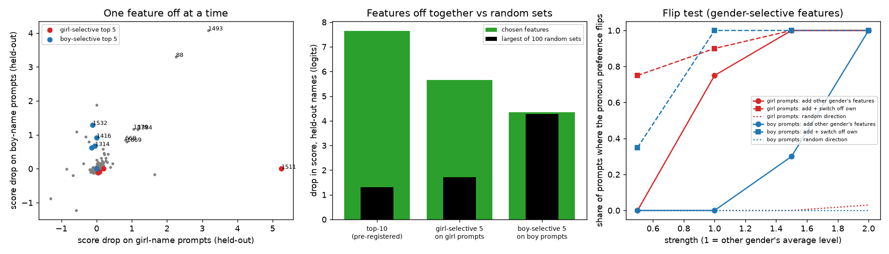

# Stage 7: tracing 'she'/'he' after a named character

> Any feature descriptions here are AI-written (by Claude) and have not been verified by a human.

## Setup

- 120 prompts: 20 names x 6 frames. Names (ranking half / held-out half): girls ['Lily', 'Mia', 'Sara', 'Sarah', 'Sally'] / ['Anna', 'Lucy', 'Sue', 'Jane', 'Amy']; boys ['Tim', 'Tom', 'Bob', 'John', 'Tommy'] / ['Ben', 'Jack', 'Joe', 'Billy', 'Jim'].
- Frames (the name always follows an opening phrase, because most girls' names are only single tokens with a leading space):
  - `went` (name_only): "One day, {N} went to the park." -> She/He
  - `found` (name_only): "Once upon a time, {N} found a big red ball." -> She/He
  - `because` (name_only): "Yesterday, {N} was very happy because" -> she/he
  - `but` (name_only): "One day, {N} wanted to play outside, but" -> she/he
  - `named` (noun_name): "Once upon a time, there was a little {G} named {N}." -> She/He
  - `who` (noun_name): "There was a kind {G} named {N} who was sad because" -> she/he
- Score = logit(correct pronoun) - logit(wrong pronoun) at the last position. Headline = name-only prompts.
- Ablation: zero one feature at every position after the start token, decode, add the SAE error back.

## 1. The behaviour exists

| prompts | n | clean score | correct beats wrong | correct is top-1 token | score with SAE reconstruction only |
|---|---|---|---|---|---|
| name_only | 80 | 9.06 | 100% | 75% | 10.06 |
| name_only/girl | 40 | 9.19 | 100% | 75% | 10.36 |
| name_only/boy | 40 | 8.93 | 100% | 75% | 9.77 |
| noun_name | 40 | 9.58 | 100% | 70% | 10.16 |
| noun_name/girl | 20 | 9.88 | 100% | 85% | 10.62 |
| noun_name/boy | 20 | 9.29 | 100% | 55% | 9.70 |

Splicing with the error added back reproduces the clean scores (max difference 2.5e-05).

## 2. Pre-registered test: top 10 features by effect on the ranking names

559 of 2048 features fire on at least one prompt; each was switched off alone. Joint test on held-out names, name-only prompts, against 100 random sets of 10 firing features:

| ranked on | prompts scored | clean | drop (top set) | score after | random sets: mean / max drop | top beats |
|---|---|---|---|---|---|---|
| overall | held-out overall | 9.06 | 7.65 | 1.41 | 0.12 / 1.30 | 100/100 |
| overall | held-out girl | 9.42 | 7.19 | 2.23 | 0.07 / 1.61 | 100/100 |
| overall | held-out boy | 8.70 | 8.10 | 0.60 | 0.18 / 2.87 | 100/100 |
| girl | held-out overall | 9.06 | 7.49 | 1.57 | 0.14 / 1.30 | 100/100 |
| girl | held-out girl | 9.42 | 7.31 | 2.11 | 0.07 / 1.77 | 100/100 |
| girl | held-out boy | 8.70 | 7.68 | 1.02 | 0.21 / 2.36 | 100/100 |
| boy | held-out overall | 9.06 | 6.97 | 2.09 | 0.10 / 2.67 | 100/100 |
| boy | held-out girl | 9.42 | 5.29 | 4.13 | 0.10 / 5.32 | 99/100 |
| boy | held-out boy | 8.70 | 8.64 | 0.05 | 0.10 / 2.67 | 100/100 |

**The pre-registered test passes** (100/100). **But it does not show what it was meant to.** Most of the top 10 are context features that fire identically on girl and boy prompts (see table): removing them shrinks the score for both genders. They are needed for the pronoun gap to be large, but carry no information about gender.

| feature | in top-10 of | held-out effect girl / boy | peak activation girl / boy prompts | fires on | top training examples |
|---|---|---|---|---|---|
| 1493 | overall, girl, boy | 3.17 / 4.08 | 5.7 / 5.7 | One (40), Yesterday (20) | [[One]] day, a; [[One]] day, a; [[One]] day, a |
| 88 | overall, girl, boy | 2.26 / 3.30 | 5.2 / 5.2 | day (40), Yesterday (20) | One[[ day]], David and; One[[ day]], a little; One[[ day]], a little |
| 1314 | overall, boy | -0.05 / 0.67 | 0.0 / 1.1 | <name> (39) |  day, a sleepy cat named[[ Tom]] woke up late; ay, a grumpy old man named[[ Tom]] lived on a; ay, a clumsy cat named[[ Tom]] found a pretty |
| 1511 | overall, girl | 5.25 / -0.00 | 1.7 / 0.0 | <name> (46) | [[Sarah]] was a young; [[Sarah]] was feeling very; e there was a girl called[[ Hannah]]. She was |
| 1384 | overall, girl, boy | 1.16 / 1.16 | 4.5 / 4.5 | , (100) | One day[[,]] Molly was walking; One day[[,]] David and his; One day[[,]] a little girl |
| 1879 | overall, girl, boy | 1.05 / 1.17 | 4.1 / 4.1 | , (100) | Once upon a time[[,]] there was a; Once upon a time[[,]] there was a; Once upon a time[[,]] there was a |
| 1416 | overall, boy | -0.00 / 0.91 | 0.1 / 2.2 | <name> (66), . (2) | , there were two twins named[[ Tim]] and Tom.; , there were two twins named[[ Tim]] and Tom.;  there was a little girl named[[ Tim]]my. One |
| 1869 | overall, girl, boy | 0.86 / 0.79 | 1.8 / 1.8 | park (20) | and Ben are playing in the[[ park]]. They see; nd Ben are playing in the[[ park]]. They find; and Ben are playing in the[[ park]]. They see |
| 668 | overall, girl | 0.81 / 0.85 | 3.0 / 3.0 | because (40) | s mom what happened[[ because]] he was afraid; g near his car[[ because]] they might scratch; Jack was very grumpy[[ because]] he could not |
| 1532 | overall, boy | -0.11 / 1.29 | 0.0 / 2.2 | <name> (59), , (18), boy (4) | [[Tom]] and Mia are; [[Tom]] and Anna are; [[Tom]] and Sue are |
| 1197 | boy | -0.14 / 0.63 | 0.1 / 0.8 | <name> (49) | Yesterday,[[ Bob]] went on a; [[Bob]] looked at the; [[Bob]] was playing in |
| 1408 | boy | -0.57 / 1.09 | 0.4 / 1.1 | <name> (73) | [[John]] was a small; [[John]] was walking in; [[John]] and Mommy |
| 1735 | girl | 0.20 / -0.00 | 0.7 / 0.0 | <name> (26) | , a little girl named[[ Sara]] was playing in; he sky. It was red and[[ orange]] and yellow.; e, there was a girl named[[ Sara]]. She lived |
| 905 | girl | 0.05 / -0.11 | 0.2 / 0.0 | <name> (24) | One day, Little Na[[ia]] was very excited;  there was a girl named Mon[[a]] who was very; as a sweet little girl named Av[[a]]. She was |
| 1630 | girl | 0.00 / -0.00 | 0.1 / 0.0 | <name> (6) | ed thoughtful and kind.[[ Lily]] asked him if; re having fun until[[ Lily]]'s friend started; ⏎⏎When her uncle arrived,[[ Lily]] ran to him |

## 3. Post-hoc analysis: gender-selective features

**This analysis was designed after seeing section 2, so treat it as exploratory.** A feature is selective for a gender if its mean peak activation on that gender's ranking-name prompts is at least 5x the other's. Selective features were ranked by ablation effect on their own gender's ranking names; the top 5 were switched off together on held-out names.

| set | features | candidates | drop on own gender (held-out) | random mean / max | beats | drop on other gender | drop on own gender (ranking names) |
|---|---|---|---|---|---|---|---|
| girl-selective | [1511, 1735, 905, 1630, 1324] | 59 | 5.66 of 9.42 (still correct on 100%) | 0.10 / 1.72 | 100/100 | -0.21 | 5.08 of 8.96 |
| boy-selective | [1314, 1416, 1532, 1197, 2037] | 39 | 4.34 of 8.70 (still correct on 100%) | 0.17 / 4.28 | 100/100 | -0.30 | 10.24 of 9.16 |

Per selective feature (held-out effect on own gender; peak activation per held-out name):

| set | feature | effect on ranking names | effect on held-out names | activation by held-out name |
|---|---|---|---|---|
| girl | 1511 | 2.88 | 5.25 | Anna 0.0, Lucy 3.0, Sue 2.7, Jane 3.5, Amy 2.3 |
| girl | 1735 | 0.58 | 0.20 | Anna 0.0, Lucy 0.0, Sue 1.7, Jane 0.0, Amy 0.0 |
| girl | 905 | 0.48 | 0.05 | Anna 0.1, Lucy 0.1, Sue 0.0, Jane 0.0, Amy 0.0 |
| girl | 1630 | 0.47 | 0.00 | Anna 0.0, Lucy 0.0, Sue 0.0, Jane 0.0, Amy 0.0 |
| girl | 1324 | 0.39 | 0.08 | Anna 0.0, Lucy 0.4, Sue 0.0, Jane 0.1, Amy 0.1 |
| boy | 1314 | 2.89 | 0.67 | Ben 0.0, Jack 0.2, Joe 1.1, Billy 0.0, Jim 1.1 |
| boy | 1416 | 1.97 | 0.91 | Ben 1.6, Jack 1.3, Joe 0.0, Billy 1.4, Jim 0.8 |
| boy | 1532 | 1.10 | 1.29 | Ben 3.1, Jack 3.0, Joe 3.5, Billy 2.4, Jim 3.3 |
| boy | 1197 | 0.93 | 0.63 | Ben 0.0, Jack 0.0, Joe 1.6, Billy 0.9, Jim 1.1 |
| boy | 2037 | 0.88 | -0.00 | Ben 0.0, Jack 0.0, Joe 0.0, Billy 0.0, Jim 0.0 |

## 4. Flip test

Target prompts are held-out names. Added vector = strength x the features' mean activation on the *other* gender's ranking-name prompts (same frame, same position) x their decoder directions. Control: random directions of the same length at each position (20 draws). 'Flip' = the wrong pronoun's logit exceeds the correct one's. 'Swap' also switches off the prompt's own gender-selective features.

### 4a. With gender-selective features (post-hoc set, name-only prompts unless marked)

| prompts | added | kind | strength | longest added vector | add: score / flips / other pronoun top-1 | swap: score / flips / top-1 | random: score / flips / top-1 |
|---|---|---|---|---|---|---|---|
| girl | boy feats | name_only | 0.5 | 0.55 | 3.86 / 0% / 0% | -1.38 / 75% / 60% | 9.36 / 0% / 0% |
| girl | boy feats | noun_name | 0.5 | 0.55 | 6.52 / 0% / 0% | 5.35 / 0% / 0% | 9.81 / 0% / 0% |
| girl | boy feats | name_only | 1 | 1.10 | -0.44 / 75% / 70% | -5.13 / 90% / 70% | 8.54 / 0% / 0% |
| girl | boy feats | noun_name | 1 | 1.10 | 3.57 / 0% / 0% | 2.80 / 0% / 0% | 9.81 / 0% / 0% |
| girl | boy feats | name_only | 1.5 | 1.66 | -3.88 / 100% / 75% | -7.94 / 100% / 75% | 7.72 / 0% / 0% |
| girl | boy feats | noun_name | 1.5 | 1.66 | 0.60 / 20% / 10% | -0.10 / 50% / 50% | 9.38 / 0% / 0% |
| girl | boy feats | name_only | 2 | 2.21 | -6.83 / 100% / 75% | -10.29 / 100% / 75% | 7.14 / 3% / 0% |
| girl | boy feats | noun_name | 2 | 2.21 | -2.78 / 100% / 100% | -3.70 / 100% / 100% | 9.21 / 0% / 0% |
| boy | girl feats | name_only | 0.5 | 0.23 | 5.92 / 0% / 0% | 0.98 / 35% / 25% | 8.65 / 0% / 0% |
| boy | girl feats | noun_name | 0.5 | 0.23 | 8.07 / 0% / 0% | 5.49 / 0% / 0% | 9.02 / 0% / 0% |
| boy | girl feats | name_only | 1 | 0.46 | 3.06 / 0% / 0% | -2.13 / 100% / 80% | 8.65 / 0% / 0% |
| boy | girl feats | noun_name | 1 | 0.46 | 6.88 / 0% / 0% | 3.93 / 0% / 0% | 8.99 / 0% / 0% |
| boy | girl feats | name_only | 1.5 | 0.69 | 0.41 / 30% / 15% | -5.15 / 100% / 85% | 8.59 / 0% / 0% |
| boy | girl feats | noun_name | 1.5 | 0.69 | 5.47 / 0% / 0% | 2.30 / 0% / 0% | 8.97 / 0% / 0% |
| boy | girl feats | name_only | 2 | 0.93 | -1.95 / 100% / 75% | -8.16 / 100% / 80% | 8.11 / 0% / 0% |
| boy | girl feats | noun_name | 2 | 0.93 | 3.90 / 0% / 0% | 0.63 / 20% / 10% | 8.93 / 0% / 0% |

### 4b. As first run: top features by per-gender effect (confounded: these sets include the shared context features)

| prompts | added | k | strength | add: score / flips / top-1 | swap: score / flips / top-1 | random: score / flips / top-1 |
|---|---|---|---|---|---|---|
| boy | girl feats | 5 | 0.5 | 7.28 / 0% / 0% | 5.18 / 0% / 0% | 8.72 / 0% / 0% |
| boy | girl feats | 5 | 1 | 5.55 / 0% / 0% | 3.91 / 0% / 0% | 8.44 / 2% / 0% |
| boy | girl feats | 5 | 1.5 | 3.78 / 0% / 0% | 2.13 / 0% / 0% | 8.16 / 1% / 0% |
| boy | girl feats | 5 | 2 | 2.10 / 0% / 0% | 0.44 / 30% / 10% | 7.00 / 3% / 2% |
| boy | girl feats | 10 | 0.5 | 6.27 / 0% / 0% | 0.43 / 55% / 40% | 8.54 / 0% / 0% |
| boy | girl feats | 10 | 1 | 3.48 / 0% / 0% | -2.43 / 90% / 70% | 8.53 / 1% / 0% |
| boy | girl feats | 10 | 1.5 | 0.85 / 15% / 10% | -5.26 / 100% / 85% | 7.19 / 2% / 0% |
| boy | girl feats | 10 | 2 | -1.40 / 70% / 55% | -7.76 / 100% / 95% | 6.37 / 5% / 1% |
| girl | boy feats | 5 | 0.5 | 6.68 / 0% / 0% | 0.95 / 40% / 10% | 9.44 / 0% / 0% |
| girl | boy feats | 5 | 1 | 3.97 / 0% / 0% | -1.35 / 80% / 60% | 9.02 / 0% / 0% |
| girl | boy feats | 5 | 1.5 | 1.38 / 15% / 15% | -3.78 / 80% / 60% | 8.15 / 5% / 1% |
| girl | boy feats | 5 | 2 | -1.15 / 85% / 70% | -6.15 / 90% / 70% | 6.51 / 7% / 4% |
| girl | boy feats | 10 | 0.5 | 4.57 / 0% / 0% | -1.11 / 80% / 30% | 9.32 / 0% / 0% |
| girl | boy feats | 10 | 1 | 0.23 / 35% / 30% | -4.60 / 95% / 50% | 8.58 / 0% / 0% |
| girl | boy feats | 10 | 1.5 | -3.57 / 100% / 75% | -7.52 / 100% / 50% | 7.38 / 3% / 0% |
| girl | boy feats | 10 | 2 | -6.85 / 100% / 75% | -9.92 / 100% / 50% | 5.02 / 10% / 2% |

## Limits

- Section 3 and 4a were designed after seeing the data; only section 2 was fixed in advance.
- 20 names, 6 hand-written frames, 10 held-out names per analysis (20 name-only prompts per gender). Flip rates are out of 20 prompts.
- Random-set controls are matched in count, not in activation size; context features have large activations, which is part of why they rank high.
- Only layer 3 is tested. Ablation shows a feature is needed there, not how later layers use it.
- The boy-selective features look name-specific (Tom, Tim, Bob) rather than a general 'male name' feature, and transfer less well to held-out names.
